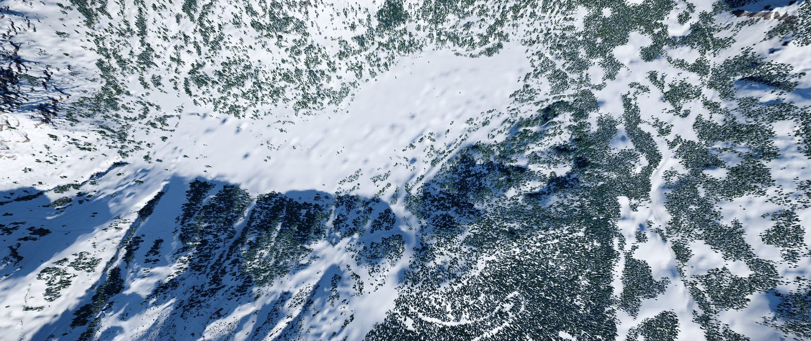
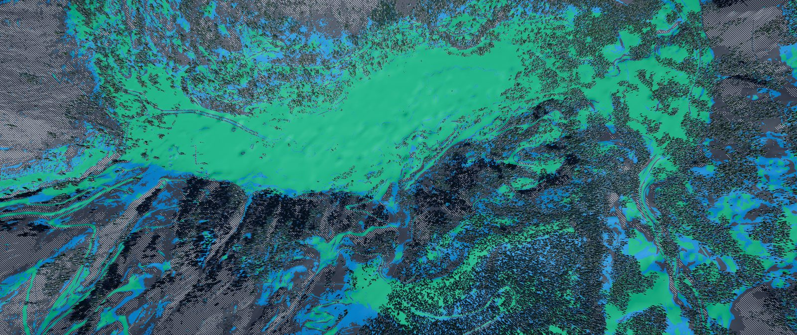
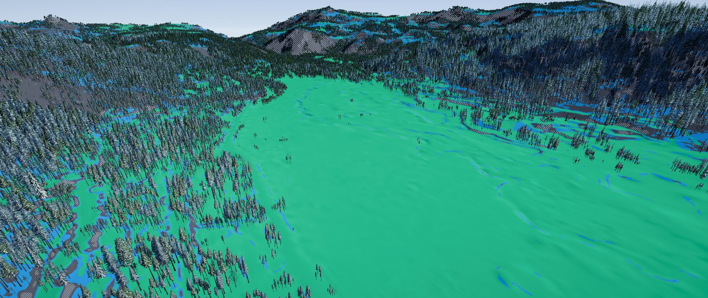
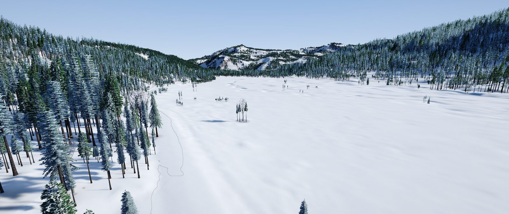
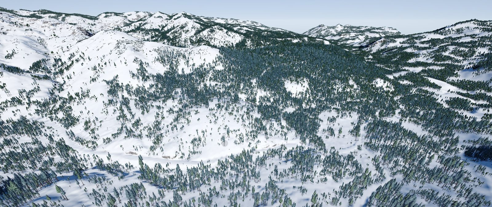
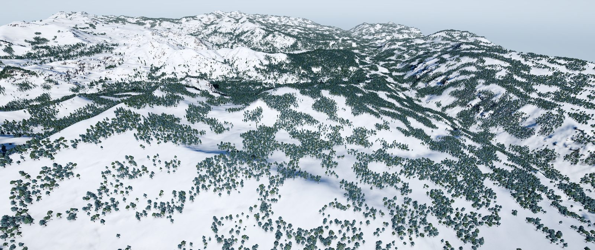

# P2-12: the real data-seam check (E1)

Phase 1 accepted exit criterion 3 with one gap (E1): the fallback blend was tested only on synthetic data
(`SeamsHaveNoStepAboveTwentyCentimetres`), because no downloaded area mixed S1M with the 3DEP fallback. This check
downloads one that does, measures the join in the saved heights and captures it in the v0.2.0 game.

## The site

**Palisades Tahoe, 5 km** (39.195, −120.235; owner's choice, TB3 in
[phase2-tester-findings.md](phase2-tester-findings.md)).

A survey of 52 U.S. ski areas against the S1M bucket's folder listings found three with an S1M edge inside the 11 km
square: Telluride, Palisades Tahoe and Grand Targhee (ring only).

At Palisades the S1M tile column ends at Albers x = −2,050,000, so the join is a straight north–south line 1,430 m
east of the centre. It crosses the core and the ring from edge to edge:
- west of the line, 3,930 m of the core is S1M;
- east of it, 1,070 m is filled from the 3DEP elevation service, whose source there is `CA_SierraNevada_B22`,
  1 m project lidar.

The download (`acquire`, scratch library, never committed):
- **Size and time:** 202 MB in 122 s.
- **Terrain 99/100:** "79% USGS S1M 1 m lidar, 21% 3DEP 1 m lidar".
- **USGS errors:** the elevation service returned 502 three times on the way. The command-line tool stops on that;
  each re-run resumed from the cache. The game's own downloads wait and retry (P2-06).

## How the join is built

`HeightAssembler`:
1. S1M fills what it has.
2. Every sector with a gap, or within 50 m of one, is fetched from 3DEP.
3. `Blend` puts the fallback in the gaps and, within 50 m of a gap, eases from the fallback to S1M with a smoothstep
   over the distance. So the heights are continuous at the join by construction; a difference between the two
   datasets would show as a 50 m ramp, not a cliff.

0.3 §4.2 calls this "the same 50 m slope-weighted blend USGS uses". The code is distance-weighted (smoothstep), not
slope-weighted. It makes no difference here (below), and 0.3's wording should say what the code does.

## Measured (`acquire seam-profile`)

The new tool reads the package's float32 heights. It profiles the join every 100 m along it, and compares strips on
each side with the 3DEP service's own heights.

| Measure | Core, 1 m (50 profiles) | Ring, 2 m (110 profiles) |
| --- | --- | --- |
| Step across the join, beyond the local slope: median / p95 / max | 0.015 / 0.068 / 0.090 m | 0.039 / 0.164 / 0.380 m |
| The same 500 m west, all S1M (the terrain's own noise) | 0.032 / 0.104 / 0.172 m | 0.037 / 0.197 / 0.457 m |
| Kink at the blend band's outer edge (50 m in) | 0.019 / 0.079 / 0.106 m | 0.041 / 0.145 / 0.200 m |
| Roughness, S1M side / fallback side (2nd-difference spread) | 0.065 / 0.050 m | 0.092 / 0.132 m |

The direct measure of what the blend hides is the package minus 3DEP's own heights, 200,000 cells per strip:

| Strip | Mean | Median | p5 | p95 |
| --- | --- | --- | --- | --- |
| S1M side, 95–55 m west (pure S1M) | −0.006 m | −0.002 m | −0.105 m | +0.064 m |
| Fallback side, 10–50 m east | 0.000 m | 0.000 m | 0.000 m | 0.000 m |

**Reading:**
- The step at the join is smaller than the terrain's own cell-to-cell noise 500 m away.
- The two datasets agree to 6 mm on average. 3DEP's source on the S1M side is the same `CA_SierraNevada_B22`
  survey, so S1M here was built from the lidar the fallback serves.
- The only difference is texture: the fallback is about 20% smoother in the core. The service resamples bilinearly,
  so fine 1 m detail softens slightly.

## Captures (v0.2.0 release game)

Captured with `-package <scratch> -nohud -time 10:30 -view …` in the v0.2.0 release game, render lane, 2560×1080.
In every shot **the join runs through the centre of the frame**: S1M on the left or west, the fallback on the right
or east. In the views looking north it runs away from the camera through the middle.

| | |
| --- | --- |
|  |  |
| Overhead, 1.8 km, north up: the join is the vertical centre line | The same with the Slope info layer, which shows any step as a stripe of steep colour |
|  |  |
| Looking east across the join over the Olympic Valley meadow, Slope layer: flat ground, where a step would show most | Low over the meadow with contours: the lines run through the join unbroken |
|  |  |
| Looking north along the join from 900 m | The ring (2 m) north of the core: the join continues to the edge |

No step, stripe, contour break or change of texture shows at the join in any view.

## Verdict

**No visible step.** E1 is met at Palisades:
- the heights are continuous to within the terrain's own noise;
- the two datasets agree to a few millimetres;
- nothing shows in the game.

No fix is needed. Follow-up for task 14: correct 0.3 §4.2's "slope-weighted" to "distance-weighted (smoothstep)",
which is what `HeightAssembler.Blend` does.

## Limits

- **The easy real case.** This is a seam between two products of the same lidar survey, which is what most S1M edges
  are today: S1M is built from 3DEP project lidar, and the fallback serves that project where S1M isn't out yet.
- **Coarse fallback.** A join against coarse fallback (S1M meeting 1/3 arc-second, about 10 m) wasn't found near any
  ski area. That case stays covered by the synthetic test.
