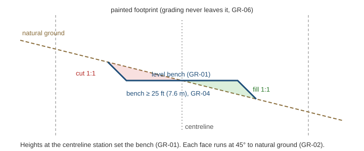
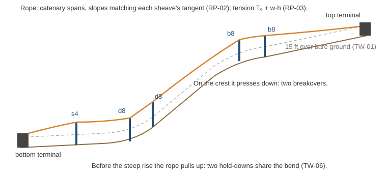

# Phase 3 · 02 Design rules: trails, lifts, paths and the network

**Audience:** the project owner and coding agents.
**Status:** for your review (task 02 ⛳). It gates tasks 03–10: no grading, lift, path or network code until you
approve it.
**Date:** 2026-10-16.
**Decisions:** DR1–DR27 in [phase0-decisions.md](phase0-decisions.md#phase-3-task-02-design-rules-decided-2026-10-16).
**Approved plan:** [p3-02-plan.md](p3-02-plan.md).

**What this is:** the rules the drawing tools follow. They are re-specified from the archived game's
[reference inventory](phase0-0.1-reference-inventory.md) (§6.1–6.3 and §9) and our own doctrine, and changed where you
ruled differently. No archived code is copied; the rules are stated here as prose and numbers and implemented natively.

## 1. How to read this

- **Rule IDs.** Every rule has an ID such as `GR-03`. The prefix names the area:

  | Prefix | Area | § |
  |---|---|---|
  | SH | Shared rules | 2 |
  | CF | Construction flow | 3 |
  | TR | Trail painting | 4.1 |
  | TD | Trail difficulty | 4.2 |
  | GR | Grading | 4.3 |
  | CL | Tree clearing | 4.4 |
  | TF | Trail construction flow | 4.5 |
  | LF | Lift construction flow | 5.1 |
  | LC | Lift catalog | 5.2 |
  | RP | Rope | 5.3 |
  | TW | Towers | 5.4 |
  | PA | Paths | 6 |
  | JN | Junctions | 6 |
  | NW | Network | 7 |

  An ID is never reused. A retired rule stays in this document, marked *retired*, with the rule that replaced it.
- **Tests cite IDs.** Each test that checks a rule names its ID, for example `GR03_BenchIsLevelAcrossTheSection`
  (definition of done, Phase 3 plan §7). Task 03 picks the exact mechanism.
- **Versions.** A rule holding a formula carries a version, as in `TD-02 v1`. A change of behaviour bumps the version
  and updates the rule's fixtures in the same PR (0.1 §9.10).
- **Units.** Every number is imperial first, with metric in brackets. The game computes in metres, newtons and
  seconds; only what the player reads changes (SH-01).
- **Tolerances.** Where a rule says "to within", tests use that tolerance. Elsewhere, results are exact: the same inputs
  give the same bytes (SH-04).
- **Where it runs.** Engine-free code computes every rule in `MountainPlanner.Domain.Design` (the design document,
  commands, grading, clearing, rope, towers and the network), following 0.3's assembly chain:
  - **World** applies height deltas and the clearing mask.
  - **Presentation** draws the results.
  - **UI** shows panels.

  Nothing in World, Presentation or UI decides a rule.
- **Placeholders.** Numbers marked *(tuned at 07)* are real-world starting values that the style tile (task 07) may
  adjust with your approval. Every other number is a rule.

## 2. Shared rules (SH)

- **SH-01, units:**
  - Stored and computed in metres. Shown through `UnitFormat`: imperial by default, metric on request.
  - Slopes are grades in percent (`SlopeBands`).
  - Volumes in yd³ (m³ when metric), forces in lbf (kN), speeds in fpm (m/s).
  - Rope and tower angles in degrees.
- **SH-02, heights:**
  - Every rule reads the float32 source heights, plus committed edits, through one sampler: bilinear on the 1 m grid.
  - Never Unity's 16-bit terrain.
  - A pending edit is read only by its own preview.
- **SH-03, frame:**
  - Positions are metres in the package's native grid (EPSG:6350), which is equal-area and true to within 0.1% across
    a 5 km site.
  - Lengths are horizontal unless a rule says "slope length". Elevations are NAVD88.
- **SH-04, determinism:**
  - Randomness comes only from keyed hashes of the world seed, the entity ID, a domain tag and an ordinal.
  - No wall clock, no `System.Random`, no unordered parallelism.
  - Collections iterate in ID order.
  - The same design and terrain give byte-identical results (golden tests).
- **SH-05, derived data is never stored:**
  - The network graph, stats, rope curves, tower forces and head types, difficulty ratings and the volumes are all
    rebuilt from authored data.
  - Authored data includes tower positions, heights and stance.
- **SH-06, inside the area:** every trail, lift, path and junction lies inside the area's core box (the 1 m terrain),
  never in the surround ring.
- **SH-07, keys:** every key is rebindable through `KeyBindings`, and captions come from `KeyBindings.Caption`.

## 3. Construction flow (CF)

- **CF-01, one tool:** one construction tool is active at a time. Choosing another cancels the current one at once,
  and its cleanup restores the cursor, camera keys and map state exactly once (0.1 §6).
- **CF-02, the flow:**
  1. Choose the tool.
  2. Draw.
  3. The tool analyses off the main thread.
  4. Review: stats, warnings, Confirm or Cancel.
- **CF-03, revisions:**
  - Every analysis names the design revision and terrain revision it was computed against.
  - A result for a superseded revision, or an old cursor position, is dropped and never merged (0.1 §9.2, §9.4).
- **CF-04, one confirmation at a time:** a second confirmation in the same tick is rejected.
- **CF-05, commands:**
  - Confirming issues one typed command against a named revision.
  - A stale command is rejected whole; nothing is partly applied.
  - Undo and redo restore the document, heights and trees exactly (task 03, task 05).
- **CF-06, the words:** the review panel commits with the HUD's words.
  - **Break ground** builds the work: grading, clearing and the structures appear at once. Construction time comes
    with the simulation.
  - **Save plan** keeps it in the design as a *plan*. It's drawn as planned (orange), edits no terrain and clears no
    trees, and can be built later with Break ground.
  - **Cancel** is the panel's ✕, which asks again before throwing work away.
- **CF-07, Esc:** Esc backs out one step and never drops placed work. From the first step, it closes the tool, asking
  first if anything is drawn.
- **CF-08, pending preview:** a pending edit draws its changed contours in yellow. They are cleared on cancel, on
  unchecking, and once committed.
- **CF-09, speed:**
  - A 1,000 ft (300 m) graded edit previews in ≤100 ms and commits in ≤250 ms, at p95 on the reference PC (exit
    criterion 2).
  - The construction tools allocate 0 B per frame while idle.

## 4. Trails

### 4.1 Painting (TR)

- **TR-01, brush:** **25–400 ft (7.6–122 m) wide, default 100 ft (30.5 m)**, in 5 ft (1.5 m) steps. The width can
  change between strokes, so one trail can be painted with several widths.
- **TR-02, footprint:**
  - The footprint is the union of every stroke's discs, each stroke at its own width, rasterised on the 1 m grid.
  - Shift-drag erases.
  - **Islands are allowed:** unpainted holes inside the footprint, where the ground and trees stay as they are.
  - The footprint must be one connected piece.
- **TR-03, head, tail and centreline:**
  - The player places the head (top) and the tail (bottom) in a separate stage, after painting (TF-03). The head must
    be higher.
  - **The centreline is automatic:** the path from head to tail inside the footprint that stays **as far from the
    edges as it can**, going around islands. It maximises the distance to the nearest edge, then is smoothed.
  - Stations sit every **25 ft (7.62 m)** along it, at most 800 per trail (20,000 ft, 6.1 km).
- **TR-04, length:** a trail is at least 100 ft (30 m) long along its centreline.
- **TR-05, ends (NW-07):** a head or tail within 30 ft (9.1 m) of **any lift's top or bottom**, or of **any point on
  another trail**, snaps there and joins it.
- **TR-06, kinds and settings:** every trail carries three settings, so freer forms can come later without a format
  change.

  | Setting | Values | In Phase 3 |
  |---|---|---|
  | **Grading** | Graded, Natural | Both |
  | **Kind** | Run, Glade, Zone (a freeride or backcountry area) | Run only |
  | **Clearing** | Clear, Thin, None | Clear only |

  - Glades and zones may have no single head and tail, and no grading. Their rules come with them.
  - **A cat track isn't a kind.** It's a narrow graded run that a player builds to put an easy way down across steep
    terrain (GR-11 prepares for it).

### 4.2 Difficulty (TD)

- **TD-01, the slope it reads:** the graded surface's fall-line slope, the same measure the Slope angle info layer
  shows.
  - At each station, it's the **median** slope of the 1 m cells on that station's cross-section inside the footprint.
  - Ungraded stretches read natural ground.
  - **v2** (owner, task 08, TL15): a benched station reads only its bench, the running surface; the 1:1 faces don't
    count, so grading never makes a trail rate harder than its natural ground.
- **TD-02 v1, rating value:** (3 × mean + max) / 4, in percent.
  - The mean is the station medians' length-weighted mean.
  - The max is the steepest 75 ft (23 m) window, three stations averaged, so one bumpy cell can't set the rating.
  - Sustained pitch counts three times the steepest stretch (0.1 §6.2).
- **TD-03, bands:** the slope layer's bands (`SlopeBands`).

  | Value | Rating | Symbol |
  |---|---|---|
  | Under 25% | Easiest | ● green |
  | 25–40% | More difficult | ■ blue |
  | 40–60% | Most difficult | ◆ black |
  | 60% and over | Experts only | ◆◆ double black |

- **TD-04, live:** the rating updates with every grading change and is shown in review and in the trail's inspector.
- **TD-05, not difficulty:** snow conditions, grooming and width don't change the rating. They feed a separate
  conditions rating with the simulation, from the one snow conditions map (Phase 4).
- **TD-06 v1, the estimate while painting:** before a head and tail exist, there's no centreline.
  - The estimate reads every 1 m cell in the footprint, on natural ground: **(3 × the mean + the 90th percentile) /
    4**.
  - The 90th percentile stands in for the steepest stretch. A plain maximum would jump at a few steep edge cells, and
    the mean alone would hide a short headwall.
  - It's kept as a running slope histogram, updated after each stroke over the cells the stroke touched. A 1,000 ×
    100 ft trail is about 9,300 cells, a fraction of a millisecond.
  - TD-02 replaces it once the head and tail are set.

### 4.3 Grading (GR)

- **GR-01, level bench:**
  - At every station, the running surface is **level across the section**, so contours run square to the centreline.
  - The bench's elevation is the natural ground at the centreline station.
  - **v2** (owner, task 08, TL21: "side slope should be permitted to an extent on a graded trail"): the bench keeps
    the ground's side slope across the section, up to **10%** either way (the least-squares fit of the ground across the
    painted width, averaged over two stations each way), so it runs straight across rather than dead level, and the
    faces take up only the slope it doesn't keep. A later cat track may set a flatter cap.
    - *Cap raised to **20%*** (owner, TL23, after measuring on their own trails: a wider bench and less earth moved;
      side slope doesn't change how smoothly the trail skis).
  - **v3, the long profile** (owner, TL23): the bench's elevation at a station is the natural ground under the centreline
    **averaged over 75 ft (3 stations) either way**, the window shrinking at the head and tail so the ends keep their
    ground. Lidar rolls no longer carry into the bench: on the owner's runs the grade's roll (RMS change between 5 m
    pieces) fell from 8-10% to 2-3.5% for 2-3% more earth.
    - *The profile is a local straight-line fit* (TL24), every station in the window weighted alike: a uniform grade
      comes through exactly however the stations are spaced (the last stretch is usually short), and past the head and
      tail the bench carries the end grade, taken over at least 25 ft, on to where the faces meet the paint's edge.
- **GR-02, faces:**
  - From each bench edge, a face runs to natural ground at **1:1 (45°)**, the same slope for cut and fill.
  - There is no widen-to-fit: the footprint is never enlarged to make a bench fit.
- **GR-03 v1, bench width:**
  - On each side, the bench edge is the widest offset b with b ≤ d − |g(d) − z| / s for some offset d inside the
    footprint. Here g is the ground, z the bench elevation and s = 1, the face slope.
  - It needs one outward scan per side.
  - On a uniform sidehill of grade m, this is budget × (1 − m / s): the bench vanishes at a 100% sidehill.
- **GR-04, minimum bench:** **25 ft (7.6 m)** across. A station that can't hold one keeps natural ground (GR-07).
- **GR-03 v2** (task 08, TL2): each side's budget runs along the section to the painted edge or an island, so mixed
  widths and lopsided paint work.
- **GR-05, between stations:** the design surface blends linearly between neighbouring stations' sections.
  - **v2** (owner, task 08, TL17): each side's bench width is first the narrowest within two stations (50 ft) and then
    the average of those, so it is never wider than GR-03 allows and rough ground doesn't step the faces every 25 ft.
  - **v3** (owner's reports, task 08, TL21): the sections sweep smoothly between stations (each square to a tangent
    turning from one station's to the next, over two stations each way), so the bench rounds a bend without flat
    wedges and steep bands outside it; and between a benched station and one too steep for a bench (GR-07) the ground
    ramps from the bench to natural across the stretch, instead of a flat tread and a drop.
- **GR-06, footprint:** grading **never leaves the painted footprint**. Heights outside it are byte-identical before
  and after (test).
  - *Exception (task 07, SK19):* a terminal's pad (LF-12) grades outside any trail, within GR-11's terminal-pad
    envelope.
- **GR-07, too steep:**
  - Stations that can't hold a bench keep natural ground and are drawn red.
  - Review reports the ungraded length in ft.
  - Grading is a tool, never a gate: Break ground is still allowed.
- **GR-08, volumes:**
  - Cut, fill and balance (cut − fill) are summed once over the 1 m cells of the design-minus-ground raster, not
    from section areas.
  - Shown in yd³, to within 0.1%.
  - **No cost in Phase 3**; volumes are tracked only.
- **GR-09, storage:** a confirmed grade is stored as height deltas in sparse 64 m tiles over the immutable package
  (tasks 04 and 05). Undo restores byte-identical heights.
- **GR-10, tolerance:** design heights are exact to within 1 mm (0.04 in) of GR-01 to GR-05.
- **GR-11, the envelope (built to grow):**
  - The grading engine takes a footprint, a centreline, a bench width and an **envelope**: where cut and fill may
    reach.
  - Phase 3 uses **envelope = footprint** (GR-06), except a terminal's pad (LF-12 v2), whose faces may reach **50 ft
    (15.2 m)** past the pad (v2, task 07 round 3; the 200 ft tuned for the style tile's hill is gone). A face that
    hasn't met the ground there is clipped and the step reported.
  - **v2, the lift-line envelope** (owner, task 07 round 3, finding #3, SK24): the trench under the chairs leaving the
    bottom terminal, like the dug-in loading area of a real lift.
    - **Where:** from the pad's edge, wherever the chairs fall short of TW-01 v2.
    - **What:** the ground comes down just enough, level across both ropes' chair paths plus **5 ft (1.5 m)** either
      side (about 30 ft on the Sessellift).
    - **How:** cut only, 1:1 sides, at most **10 ft (3 m)** deep, never within 15 ft of a line tower's base (TF-11).
    - **A pit:** where a steep bottom's station tower would stand too high on its 15 ft of steel, the ground under it
      comes down too.
    - **Checked on the finished rope:** a little deeper where real ground has bumps between the lattice's posts.
    - **Deeper needs** raise the terminal instead (TW-16 v3).
    - **Part of the lift's Break ground** (no save change).
  - A later cat track through steep terrain keeps a fixed bench and lets its 1:1 faces reach past the painted width,
    up to a set limit (0.1's road exception). That adds an envelope value, not a new engine.

- **GR-13, the edge envelope** (task 08, TL2): every changed point stays between the 1:1 slopes rising from the fixed
  ground within 2 m of the paint (the footprint's edge, islands, earlier trails' ground, TF-11's rounds and ungraded
  stretches), so the faces meet the ground at every edge, whatever shape is painted.
  - *Where the slopes cross* (fixed ground steeper than 1:1 on both sides, TL24): the point is clamped between them, the
    same clamp as everywhere else, instead of falling back to natural ground beside designed points (small cliffs).
- **GR-07 over a stretch** (TL24): a benched run shorter than 3 stations (75 ft) stays natural with its neighbours, and
  a graded stretch eases into a natural one (a smooth ramp, no crease at either end), so a marginal sidehill never
  alternates bench and natural every 25 ft.
- **GR-14, grading is a choice** (owner, task 08, TL13): a trail is graded only when the player sets it to Graded. A new
  trail starts Natural, and editing a trail keeps its setting.
- **GR-12 v2, rounded tie-ins** (owner, task 07, SK2, SK20): each face's crest and toe are rounded over **10 ft
  (3 m)** *(tuned at 07: 10, 15 and 20 ft compared in captures)*, inside the footprint. The rounding fades to nothing at
  the footprint's edge and never takes more than half the bench's width, so most of the bench stays level (GR-01). Where a
  face would reach the footprint's edge, the bench narrows by the rounding width so the toe rounds inside the footprint.
  Sharp creases stair-step on the 1 m heightmap; the rounding and the terrain shader's wider slope on earthwork keep the
  edges smooth.
  - **v3, the finish** (owner's ask for an adversarial smoothness review, TL24): after GR-13 the graded surface is
    smoothed over about 2 m (two passes of a 1-4-6-4-1 kernel each way, heights not changes, so the ground's own
    roughness never returns to the bench) and clamped by GR-13 again. It rounds what the clamp leaves sharp (faces
    meeting fixed ground, toes round islands, the lattice's stair-steps); a straight bench or face is unchanged. A
    narrow bench keeps half the rounding at least (a trough, never a V), and a tilted bench rounds into its face.

### 4.4 Tree clearing (CL)

- **CL-01, trails:** a built trail clears every tree whose trunk stands inside its footprint.
- **CL-02, ragged edge:**
  - Inside a 10 ft (3 m) band along the footprint's edge, each tree is kept or cleared by a keyed hash. The chance
    of clearing rises from 0 at the edge to 1 at the band's inner side.
  - The treeline reads natural, and nothing outside the footprint changes.
- **CL-03, lifts:** a built lift clears a **55 ft (16.8 m)** corridor centred on its line, from terminal to terminal,
  with straight edges.
- **CL-09, round terminals** (owner, task 07, decision SK14): a built lift also clears round each terminal, for loading
  and unloading: the terminal's footprint (from its model) plus **20 ft (6.1 m)** all round, and **50 ft (15.2 m)**
  more along the line in front of it *(tuned at 07)*.
  - **v2** (task 07, SK19): it also covers the terminal's pad and every cell its faces change (LF-12).
  - **v3** (task 07 round 3, SK24): and every cell the lift-line envelope cuts (GR-11 v2).
- **CL-04:** *retired.* Paths clear nothing (PA-05).
- **CL-05, effects:** clearing writes the clearing mask that forest density reads (0.3 §4.5). The forest floor and snow
  follow it (task 05).
- **CL-06, plans:** a saved plan (CF-06) clears nothing.
- **CL-07, undo:** undo restores the trees exactly; the deterministic forest regrows from the mask.
- **CL-08, islands:** trees inside a footprint's islands (TR-02) stay.

### 4.5 Trail construction flow (TF)

- **TF-01, the trail menu:** **Toolbox › Trail** opens it.
  - **Steps:** 1 Paint, 2 Head and tail, 3 Review.
  - **Options:**
    - the brush width, with **[ / ]** or a slider;
    - **Graded or Natural**;
    - the name, with "Run 1, Run 2, …" suggested and editable.
- **TF-02, painting (step 1):**
  - The brush circle follows the pointer. **Left-drag paints and Shift-drag erases**; right-drag stays the camera
    pan.
  - **Ctrl+Z** undoes the last stroke.
  - **After each stroke** (not while dragging), the area and the estimated rating (TD-06) update.
  - A second, separate patch is red, and Next is blocked until it's joined or erased.
- **TF-03, head and tail (step 2):**
  - Click the head, then the tail; each snaps by TR-05.
  - The centreline (TR-03) then appears as a dashed line, and the full analysis runs off the main thread:
    - the yellow pending contours (CF-08);
    - red stretches too steep to grade (GR-07);
    - the final rating (TD-02);
    - cut and fill;
    - the profile.

    Within CF-09's budget.
- **TF-04, the trail profile:** while a trail is being built, a wide strip sits above the status bar, like the lift's
  (LF-10).
  - **Axes:** x is the distance along the centreline, y elevation, in ft.
  - **Drawn:**
    - natural ground, dashed;
    - the graded surface, solid;
    - each stretch coloured by its band;
    - red ungraded stretches;
    - the steepest 75 ft window marked.
- **TF-05, review (step 3):**
  - length, vertical, rating, mean and steepest grade;
  - cut, fill and balance in yd³;
  - the ungraded length;
  - trees cleared;
  - warnings.

  Then Break ground, Save plan or Cancel (CF-06).
- **TF-06, Natural trails:** no grading at all. Trees are cleared, and the rating reads natural ground.
- **TF-07, editing:** select a built trail to:
  - repaint it, add islands or move its head or tail;
  - rename, split or join it (NW-10);
  - or delete it.

  Grading re-runs only on the stations that changed; delete restores ground and trees exactly.
- **TF-08, the built trail's card:** simple: name, rating, length, vertical. The grading detail shows only while
  editing.
- **TF-09, keys:**
  - **[ / ]** brush width;
  - **Shift** erase;
  - **Enter** next step;
  - **Esc** back one step (CF-07);
  - **Delete** the selected trail.

  All rebindable.
- **TF-10, overlaps:** where a new footprint overlaps another trail, the overlap keeps the earlier trail's grading.
  The network gets a junction there (NW-07).
- **TF-11, near lifts:** grading never changes the ground within 15 ft (4.6 m) of a tower base or terminal. A trail
  that would push a built lift's chair clearance below 15 ft (TW-01) turns that stretch red and blocks Break ground.
  - *v2 (task 07 round 3):* a lift's own pads and envelope (LF-12, GR-11 v2) are part of the lift and exempt, except
    the 15 ft round each line tower's base. No trail may fill a lift's envelope.

## 5. Lifts

Phase 3 builds fixed-grip chairlifts only (E13), using the Sessellift FGQ-4 and Monta FG4 assets. Every name is a code
name (decision A2, [generic names][lift-maker-code-names]); real makers are never named.

### 5.1 Construction flow (LF)

- **LF-01, the lift menu:** **Toolbox › Lift** opens it.
  - Its steps are **1 First terminal, 2 Other terminal, 3 Towers, 4 Review**.
  - It holds the type (Sessellift FGQ-4 or Monta FG4) and **Towers: Automatic or By hand**.
  - The switch remembers your last choice; the first time, it's Automatic. It can flip until the work is committed:
    to By hand keeps the towers, and to Automatic re-places them, asking first if any were placed by hand.
  - The type's capacity is shown, not chosen (LC-03).
- **LF-02, the bottom terminal:**
  - The whole terminal follows the pointer as a ghost, green where it can sit and red where it can't (LF-08).
  - Click 1 anchors it at its origin, the centre of its bullwheel. It then swings to face the pointer, and a dashed
    line shows the length, rise and grade.
  - **The first terminal is always the bottom one.**
- **LF-03, the top terminal:**
  - Click 2 places it, and fixes the line: straight, bullwheel to bullwheel. The bottom terminal turns to face along
    it.
  - The top terminal can't be lower than the bottom one; its ghost is red with "The top terminal must be higher".
  - The placed line is drawn trail-map style, a line with a dot at each end.
  - **In Automatic,** the towers appear live along the dashed line while you aim (TW-12).
- **LF-04, towers by hand, from the bottom up:**
  - The tower in hand slides along the line above the last placed tower (or the bottom terminal).
  - **Page Up / Page Down** raise and lower it in **5 ft** steps; click to place it.
  - **A red tower can't be placed**; the status bar (TW-13) says why and what the next tower needs.
  - **Fill the rest** places automatic towers (TW-12) from the last tower to the top terminal.
  - A placed tower can be selected, slid, re-heighted or deleted (**Delete**). If a change elsewhere turns it red,
    it blocks Break ground until fixed.
- **LF-05, moving the top terminal:** until the lift is committed, the top terminal can slide along the fixed line,
  from the menu or by dragging it. Towers beyond it are dropped, after asking.
  - **v2, editing a built lift** (owner, task 09, LT2, LT9): **Edit lift** moves towers (along the line and in height)
    and moves **either terminal anywhere**, re-aiming the line; it also changes the type and a terminal's level (SK14).
    In Automatic the towers re-place; By hand, each keeps its distance from the bottom terminal, and towers past the new
    top are dropped after asking. The changes are a draft in the tool; **Apply** commits them as one step with the lift's
    rebuilt earthwork, so one Ctrl+Z undoes the whole edit. A red tower blocks Apply.
- **LF-06, review:**
  - The panel shows length (horizontal and slope), rise, ride time, capacity, tower count, the lowest chair clearance
    and the tension range, plus warnings.
  - Then Break ground, Save plan or Cancel (CF-06).
  - **Re-place towers** re-runs automatic placement on the whole line.
- **LF-07, the line:**
  - Exactly two terminals on one straight line, the bottom first.
  - Speed and chair spacing come from the type (LC).
  - Undoable whole (CF-05).
- **LF-08, terminal siting:**
  - No part of the terminal stands in a lake or on a road, and it lies inside the core box (SH-06).
  - The natural ground under its footprint varies by no more than **10 ft (3 m)**; the terminal is then built on its
    graded pad (LF-12, task 07).
  - **v2** (owner, task 07 round 4, SK30): steeper sites are allowed. The terminal stands higher on its pier until it
    cuts at most 10 ft into the hill; its pad only cuts (LF-12 v3).
  - **v3** (owner, task 09, M3, LT34): a terminal stands where it's placed, at its ground plus the level the player sets
    with Page Up / Page Down. The build never raises it; its pad is flattened under it (LF-12 v4).
  - The two terminals stand at least **300 ft (91 m)** apart.
- **LF-09, keys (C8):** while a tower is in hand or selected, Page Up / Page Down move it; camera zoom keeps the wheel
  and + / −. Delete removes the selected tower; Esc backs out one step (CF-07).
- **LF-10, the lift profile:** while a lift is being built, a wide strip sits at the bottom of the screen, just above
  the status bar.
  - **Axes:** x is horizontal distance from the bottom terminal in ft; y is elevation in ft.
  - **Drawn:**
    - the ground;
    - the terminals and towers in simple outline;
    - the rope's loaded side;
    - **a clearance track: the chairs' bottom against a dashed line 15 ft above the ground**, with failing spans in
      red;
    - the tower in hand highlighted;
    - TW-09's green band.
  - The axes scale to fit, with labelled gridlines; a **True scale** switch shows the profile 1:1.
  - It closes when the lift is committed.
- **LF-11, after building:** a built lift's card is simple: name, type, capacity, length, rise, ride time, tower count.
  The engineering detail (tension, loads, clearances) shows only while the lift is being edited.
- **LF-12 v2, terminal pads** (owner, task 07, SK19; v2 round 3, finding #2, SK25): every terminal is built on a level
  pad, so only its plinth comes out of the ground.
  - The pad hugs the terminal: its footprint (measured on its model) plus **5 ft (1.5 m)** all round, level at the
    terminal's base elevation (its load or unload level). The same at either end: no unload extension; the unload area
    beyond comes with the off-ramp models.
  - Around it, 1:1 cut and fill faces run to the ground (GR-02), within GR-11's 50 ft terminal-pad envelope.
  - The pad is part of the lift's Break ground: its height deltas ride with the lift's command (no save change).
  - **v3, cut only** (owner, task 07 round 4, SK30): the pad is a clearance envelope round the terminal. Ground poking
    above the terminal's level is cut away; ground below is left as it is, under the terminal's pier, with nothing
    filled up to it. An inlaid unload ramp model comes later.
  - A terminal that stands higher (a steep site, LF-08 v2; TW-16 v3's last resorts, a flat summit or a bottom too steep
    for its trench) simply stands higher on its pier. Its level isn't in the terrain: the build hands it to the view,
    and saved designs carry it with task 09's save v2 (SK14).
  - **v4, cut and fill** (owner, task 09, M3, LT34, LT35; replaces v3 and the raises above): the terminal stands at its
    ground plus the level set by hand, and the pad is flattened to that level: cut on the high side, filled on the low,
    with 1:1 faces to the ground (GR-02), for every make. Where the line needs a terminal higher or lower (the rope
    leaving its row outside the range, the chairs low beside it, a trench past its cap), the review says by how much
    ("raise it 6 ft (Page Up)", amber) and the player decides.
  - **v5, a detachable's front half stands over natural ground** (owner, task 09, LT42, second review E1): a detachable
    terminal's pad ends at the **hood's middle**, measured on its model (the D6 drive's about 7 ft, its return's about
    6 ft in front of the bullwheel). Its front half (the nose, the bullwheel and the station rail toward the line) leaves
    the ground as it is: nothing filled and no face reaching under it. Only ground that would rise above the pad's
    level, into the terminal itself, is cut back to it with 1:1 faces. The quads keep v4 over their whole footprint.
    Clearing (CL-09) and the low zones (TW-01 v2) still measure from the whole footprint.

### 5.2 Catalog (LC)

- **LC-01, entries:** each type carries:
  - seats;
  - rope speed;
  - chair spacing;
  - haul rope diameter, weight and rated tension;
  - counterweight tension;
  - empty chair weight and design rider weight;
  - the drop from the rope to the chair's bottom;
  - line gauge;
  - sheave diameter and per-sheave limits;
  - the chair's width (TW-01 v2 measures under it);
  - **each end** (TW-16 v3): which terminal model stands there, its row (hold-down or support), the rope angles that
    row takes and the angle placement aims at, its footprint, where the rope leaves it and where its origin lies, the
    last three measured on the model.

  Later types (doubles, triples, detachables) get their own entries.
- **LC-02 v2, Phase 3 values** for both quads *(tuned at 07: SK8 the chair's drop; SK17 the 1¾ in rope)*:

  | Property | Value | Basis |
  |---|---|---|
  | Seats | 4 | The models |
  | Rope speed | **450 fpm (2.29 m/s)**, fixed (your ruling) | ANSI B77.1's fixed-grip limits fall 50 fpm per seat (600, 550, 500 fpm for one to three seats), giving 450 for a quad. France caps 3–4 seat fixed grips at 2.3 m/s (453 fpm) |
  | Chair spacing | 45 ft (13.7 m), fixed for now (your ruling) | A 6.0 s interval; new fixed quads carry up to 2,400 pph |
  | Haul rope | **1¾ in (44.5 mm)**, 6-strand fibre core, 5.15 lb/ft (7.66 kg/m), breaking strength 248,000 lbf (1,104 kN) | Fixed-grip ropes run 1⅜–1¾ in (35–45 mm); the owner chose the top of the range (SK17). The models' 17 in (432 mm) sheaves stay close to 10× the rope's diameter |
  | Rated tension | **49,600 lbf (221 kN)**: the breaking strength ÷ 5 | US tramway codes require a factor of safety of 5 on a new haul rope |
  | Counterweight tension, per side | **18,000 lbf (80 kN)** | A comparable fixed-grip double runs about 17,000 lbf per side |
  | Chair | **350 lb (159 kg)** empty; 1,030 lb (467 kg) with 4 riders at **170 lb (77 kg)** each | Fixed chairs weigh about 250–450 lb; US codes use a 170 lb design rider |
  | Load on the rope | 28.0 lb/ft (41.7 kg/m) loaded, 12.9 lb/ft (19.2 kg/m) empty | RP-03 |
  | Rise this allows | about **1,130 ft (344 m)** of vertical: (49,600 − 18,000) ÷ 28.0 | RP-05. Typical fixed quads climb 300–1,200 ft; longer lines need two lifts |
  | Rope to chair bottom | **8.7 ft (2.66 m)**, measured on the model (SK8) | Real chairs: 8–10 ft |
  | Line gauge | 13.5 ft (4.12 m) on both quads (task 09, LT12: the Monta's models were narrowed from 16.06 ft to share the tower heads) | The models |
  | Rope height at loading | 9.97 ft (3.039 m) above the load level | The models; real chairs about 10 ft |
  | Sheave | 17 in (432 mm) | The models |
  | Per sheave | at most **1,500 lbf (6.7 kN)** and **4.5°** of bend: game rules, as no passenger-ropeway figure was found | — |
  | Per group (one rope's train) | a support group's load stays at least **½ of one sheave's limit, 750 lbf (3.3 kN)**, in every case, or it needs hold-down sheaves; the same applies in reverse to hold-down groups | US tramway code |

- **LC-03, capacity:** seats × speed ÷ spacing, shown and not chosen. At the values above that's **2,400 pph**.
  - **v2, detachables** (owner, task 09, LT41): capacity is seats × 3,600 ÷ the **loading interval** (D6 7.2 s, 3,000
    pph); the spacing on the line is line speed × interval (120 ft at 1,000 fpm, about 2.7× a fixed grip's 45 ft); the
    carriers slow round each station's rail to boarding (1.0 m/s) and unloading (1.4 m/s), fractions of the line speed
    within 0.8–1.2 and 1.1–1.6 m/s, on 1 m/s² ramps, so a faster line raises them and the spacing and keeps the capacity.
    The ride adds the ramps' lost time to slope ÷ speed.
  Spacing becomes editable later.
- **LC-04, ride time:** slope length ÷ speed, plus nothing for loading (fixed grip).
- **LC-05, sources:** these values were checked on 2026-10-16 against:
  - ANSI's B77.1 summary;
  - the Pennsylvania aerial tramway code (34 Pa. Code ch. 7);
  - Michigan's ski area rules, which adopt B77.1-2006;
  - France's ropeway safety authority (STRMTG);
  - a Canadian safety authority's equipment table for a fixed-grip double;
  - a 6x19 wire rope table.

  No maker is named, per A2.
- **LC-07, rise limit** (owner, task 09, LT13): how much vertical a lift may climb, by type: fixed-grip double 2,800 ft,
  triple 2,500 ft, quad 2,200 ft; detachable quad 3,600 ft, six 3,300 ft, eight 3,000 ft; gondola 4,500 ft; tram no
  limit. Over it the lift is red ("Too much rise for a fixed-grip quad: 2,350 ft, 2,200 ft at most").
- **LC-08, lift types** (owner, task 09, LT15): Fixed-grip chair (double, triple, quad), Detachable chair (quad, six,
  eight), Detachable gondola (6, 8 or 10 person), Aerial tram (60 or 100 person), each with a model or maker. Only the
  fixed quad has its own models (Sessellift FGQ-4, Monta FG4); the others draw with them and carry placeholder speeds,
  spacings and weights (the mockup's LIFT_TYPES). Trams stand on towers up to 250 ft.
  - **v2** (owner, task 09, LT41): the Sessellift D6 detachable six has its own models and figures (2 in rope, 5.6 m
    gauge, 3.27 m chair drop, 1,000 fpm, 7.2 s); only it and the fixed quads can be built. Every other type stays in the
    menu greyed, a placeholder, until its models exist. Detachable placeholders' spacings follow their intervals (quad
    100 ft, eight 133 ft). Each type has a primary and an accent colour (the D6 black and white), chosen per lift later.
- **LC-09, what blocks** (owner, task 09, LT14, lenient placement): only chair clearance (TW-01), tower spacing (TW-03),
  an unfinished gap (towers by hand) and the rise limit (LC-07) block a lift. Head loads (TW-04 to TW-06), the rope's
  angle into a station (TW-16) and terminal ground varying more than 40 ft are amber warnings; automatic placement
  still works to avoid them.
- **LC-06, the clearance against the codes:** B77.1-2006 (as Michigan adopts it) asks for 13 ft from the deepest
  design snow to the top of the seat where people ski under the line, and 5 ft everywhere. TW-01's 15 ft from bare
  ground to the chair's bottom is your stricter, simpler rule, applied everywhere.

### 5.3 Rope (RP)

- **RP-01, in the terminals:**
  - The rope runs level through each station at 9.97 ft (3.039 m) above the load level.
  - The station's own sheave train turns it onto the first span, within that train's limits; each terminal model
    gives them (the Sessellift return can climb to about 15.9°).
- **RP-02 v1, spans and slope continuity:**
  - Each span is a catenary, y = a·cosh((x − x₀)/a) + c, with a = H/w: the horizontal tension over the load per
    unit length. So a differs from span to span.
  - **At each end, the span's slope, sinh((x − x₀)/a), equals the slope of the tangent leaving the last sheave**, to
    within 0.01°. The point where it leaves lies on that sheave's groove circle.
  - Across a train, the rope runs straight from sheave to sheave and turns a little at each. For the forces, the
    train's total bend is shared equally among its sheaves, as on real equalising trains.
  - *Realised for the look at task 07 (SK16):* each train is posed to the rope level by level (rockers, yokes, the
    equaliser), the spans rebuilt between the trains' contacts, three passes; the mismatch stays under 0.01°.
- **RP-03 v1, tension:**
  - The counterweight sets the tension at the bottom terminal. *Task 09 (owner, LT11): on both lifts, the Monta FG4's
    bottom station included, which both drives and tensions.*
  - Up the line, tension grows by the load per unit length × the height gained (frictionless sheaves), separately
    for each side: T(h) = T₀ + w·h.
  - The loads: the loaded uphill side is rope + loaded chair ÷ spacing; the empty side is rope + empty chair ÷
    spacing.
- **RP-04, load cases:** every check runs for two cases, **the line empty** and **the uphill side full**. Downloading
  and wind come later.
- **RP-05, tension range:** the highest tension, at the top of the loaded side, must not exceed the type's rated
  tension. Too much rise for a type turns the whole lift red ("Too much rise for this lift: tension at the top 112%
  of rating").
  - **v2, retired for blocking** (owner, task 09, LT13): the rope is assumed sized to suit. A **rise limit per type**
    blocks instead (LC-07). Tension is still counterweight + load × rise and still shapes the sag and the head loads.
- **RP-06, tension readout:** while building, a bar shows the bottom and top tension as % of the rating, with lbf in
  the detail line.
- **RP-08, the drawn load** (owner, task 07 round 3, finding #4, SK27): the rope is drawn at the load it carries. The
  chairs are empty until the simulation brings riders, so both sides hang with the empty sag (on a 250 ft span at the
  bottom, about 5½ ft against 12 ft loaded). Every check keeps both load cases (RP-04).
- **RP-07, chairs:** chairs hang plumb from the rope and travel at rope speed. Each chair's position is a pure
  function of the lift's ID, the clock time and its index.

### 5.4 Towers (TW)

- **TW-01 v2, clearance** (v2 by the owner at task 07 round 3, finding #4, SK23): every chair's bottom stays at least
  **15 ft (4.57 m) above bare ground**.
  - **Under each rope, across the chair's width:** the uphill rope loaded and empty, the downhill rope empty.
  - **On a terminal's pad** (its footprint plus LF-12's 5 ft) the terminal governs.
  - **The low zones:** from each pad's edge, the chairs climb at least along a straight line from their height over the
    pad to **15 ft at 100 ft (30.5 m) from the bullwheel**, the station zone's edge (owner Q5). The old exemption ("to
    the first point where the chairs reach 15 ft") could swallow a whole sagging span; this can't.
  - **Elsewhere**, 15 ft.
  - A span that breaks the rule is red.
- **TW-02 v2, heights:**
  - A tower's height is **the rope's height above the ground at the tower**.
  - Heights run **25–100 ft (7.6–30.5 m) in 5 ft steps**; 25 ft is the lowest step at which the chairs clear 15 ft
    at the tower.
  - **Station towers** (owner, task 07, SK18), within **100 ft (30.5 m)** of a bullwheel, in TW-01's low zones, may
    carry the rope from **15 ft (4.6 m)**.
  - **v3, the foundation shows the rest** (owner, task 07 round 3, SK26): a station tower's steel stays in 5 ft steps,
    and its concrete foundation stands up to just under 5 ft above the ground, so the rope meets its terminal exactly
    (TW-16 v3). The reveal is derived like the lean, never stored; a tower set by hand that can't reach its terminal's
    need shows a red terminal angle.
  - The kit builds the mast from that height. The 1 m mast sections take up the remainder at the base, as the Lift
    Lab does.
- **TW-03 v2, spacing and siting:**
  - towers at least **50 ft (15.2 m)** apart, and from a terminal;
  - except a **station tower** (SK18), which may stand from **15 ft (4.6 m)** past its terminal's front, at least
    **40 ft (12.2 m)** from the bullwheel. **v3** (round 3, finding #3): placement stands it where its terminal needs it
    (TW-16 v3), within the 100 ft station zone: the bottom one at the first slot where the chairs have climbed to
    15 ft, the top one at the closest slot where it's 15 ft tall. How close becomes a player setting later (shorter
    towers against wind exposure);
  - not in a lake or on a road;
  - inside the core box.
- **TW-04, head types:** at each tower, the load on each sheave (2T sin(δ/2), split over the sheaves, where δ is the
  bend) is computed for both rope sides in both load cases.

  | What the rope does in every case | Head |
  |---|---|
  | Presses down | **Support:** s4, s6 or b8 (breakover), the smallest that carries it |
  | Pulls up | **Hold-down:** d8 |
  | Flips between cases, or the group load falls within 750 lbf of zero (LC-02) | **Combination:** c8, 4 hold-down over 4 support sheaves |

  **v2, heads per type** (owner, task 09, LT41; the D6 handoff's G6): each type chooses from its own tower kit. The
  quads' is the table above. The D6's wide kit has s4 and s6, then s10 (flat, where the load needs the sheaves on a bend
  six sheaves' worth could take) or b10 (a sharper breakover), d10 for hold-down, and c8; so a bend needing nine or ten
  sheaves is carried on the D6 and too sharp on a quad.

  **v3, the player's kind** (owner, task 09, LT44, second review E6): a tower may carry a kind chosen by hand: **Auto**
  (the table above, the default and every automatic tower's), **Support**, **Hold-down** or **Combination** (K in the
  tower editor turns it round). The game still sizes the head within that kind from the load (TW-05). A kind that
  can't carry the rope there (a support where the rope pulls up, a hold-down where it presses down, a combination
  past its four sheaves a way) is drawn as that kind's biggest head and is **red** with its reason and what would
  carry it; it's never changed behind the player's back. Stored with the tower (save v3).

- **TW-05, limits per sheave and group:** LC-02's maximum load and maximum bend per sheave, and its minimum group load (so the rope stays seated), in
  every case.
  - *Task 09:* the bend one sheave may take is **the smaller of 4.5° and 2·asin(1,500 lbf ÷ 2T)**: 4.5° at the
    counterweight's 18,000 lbf, about 1.9° near the top of a 1,000 ft rise (about 46,000 lbf), where a b8 turns about 15°.
    The same limits apply at each terminal's own row (TW-16 v3), with its own sheave count (the Sessellift return 8, its
    drive 4; the Monta drive 12, its return's single deflection sheave 1, LT6). Each red reason names its rule.
- **TW-06, several towers close together:**
  - One tower can bend the rope only so far, and less where the tension is higher.
  - At a sharp crest the bend is shared by two or three breakovers close together; before a sharp rise, by two or
    three hold-downs. TW-03's 50 ft minimum allows that.
  - A tower that would need more is red: "Too sharp for one hold-down: add one before the rise", or "…for one
    breakover: add one on the crest".
  - **v2, groups spaced by their spans** (owner, task 09, LT45, finding E3): a break gets as many towers as its heads
    need, spaced as far apart as the rope allows, taller rather than more. Where the repair adds a partner it goes
    midway along the span on the bend's side (50 ft away only where that span is short), so a group is never a run
    of towers 50 ft apart.
- **TW-07, span limits:** no fixed number. A longer span sags more, so it needs taller towers (TW-01, TW-02), and bends
  the rope harder at both ends, so it needs bigger heads (TW-05).
- **TW-08 v2, tolerance:** clearance is checked every 3.3 ft (1 m) along the line against SH-02's heights, to within
  0.1 ft (3 cm), under each rope at the rope and at both edges of the chair (round 3). The ground is sampled once per
  line and every solve reads it.
- **TW-09, where it can stand:** for the tower in hand at its height, the line is checked every 5 ft (1.5 m) and the
  places it could stand are marked (the green band). It's recomputed only when the height or a placed part changes.
  *Task 09:* by hand too, the first span's shortfall up to GR-11 v2's 10 ft is left to the lift-line trench that Break
  ground digs, as on an automatic lift.
- **TW-10, speed:** a tower move evaluates in ≤0.5 ms, and TW-09 in ≤2 ms, with 0 B garbage per frame (§5.5).
- **TW-11, load gauge:** while building, each tower's gauge shows its per-sheave load in both cases, from "pulls up"
  to "presses down", as % of the limits.
- **TW-12, automatic placement:**
  - It follows the same rules as by hand, and **never leaves a red tower**.
  - It aims for **modest towers, about 30–40 ft (9–12 m)**, taller only to clear a dip. It uses the fewest towers
    within that, adds hold-downs, breakovers and combinations where the rope needs them, and spaces them evenly when
    layouts tie.
  - Positions are on a 5 ft grid; the same line always gets the same towers.
  - When nothing fits (too much rise for the type, or a dip that 100 ft towers can't span), it says why and leaves
    the line red.
  - The preview updates at least **10 times a second** while you aim, off the main thread, with stale results
    dropped (CF-03).
  - The final placement of a 1-mile (1.6 km) line takes **≤50 ms**.
  - **v2, the line planned** (owner, task 09, LT45; findings E2–E4, 2026-10-23):
    - **The towers between the station towers are chosen together:** the fewest towers whose spans keep the loaded
      chairs 15 ft up (TW-01 v2; the low zones are the trench's and the unload ramp's) and whose every head carries
      its bend in both load cases, each span's sag included (TW-04, TW-05, on the kit's largest heads). The station
      towers' heads count too, so no end takes a turn no head carries.
    - **Taller before more:** a tower may stand up to TW-02's 100 ft before another is added. The search's old soft
      caps (line towers raised to 60 ft at most, a station tower's neighbour to 60 ft, a crest's neighbours by 20 ft)
      are gone.
    - **Among plans with as many towers,** heights nearest a modest 35 ft, then spans nearest even. Each tower then
      comes down in 5 ft steps while everything still fits.
    - **The first span's shortfall** up to 15 ft short of the first line tower is the trench's (GR-11 v2, at most
      10 ft), as Break ground digs it; no tower is squeezed in there.
    - **Where nothing fits** (a steep pitch running right up to a level top, say), the plan is the line whose heads
      are least past what they carry; the repair (adding or raising towers) and LT34's level hints take it from there.
    - The candidates are every 25 ft along the line, with 35, 45, 60, 80 and 100 ft of steel.
- **TW-13, placement status bar:** a line in the lift menu about the tower in hand.
  - **Status:** OK, or the red reason.
  - **Head and load:** the head it would get, and its load in both cases as %.
  - **Clearance:** the lowest chair clearance in the span behind it.
  - **Next tower:** how far the next span can reach before the chairs drop below 15 ft, at this height and at 100 ft
    ("Next tower within 420 ft, or 610 ft with a 100 ft tower"). A warning appears when the rope will pull up within
    that reach ("Hold-downs ahead").
- **TW-14 v2, plumb or leaned** (v2 by the owner at task 07, decision SK13):
  - Each lift has a setting, **Towers stand: Plumb** (the default) **or Leaned**.
  - **Leaned leans the towers that need it:** a tower leans where the rope crosses its head at more than **10°**, or
    where its head is a breakover, hold-down or combination (the heaviest loads). The rest stay plumb. Which towers lean
    is decided on the plumb rope; it's derived, never stored (SH-05).
  - A leaning mast tilts along the line, square to the rope there: it bisects the arriving and departing rope angles,
    capped at **15°**; real towers lean up to about the slope angle, 10–15°. That's square to the rope rather than the
    ground, because the rope is smooth where the ground under one tower may not be.
  - **Leans come in 2.5° steps**, one tower base model each (`tower_base_l025` to `l150`). The foundation pier leans
    with the mast, exactly in line with it (owner, task 07).
  - The head then sits height × sin(lean) along the line from the base, and every rule uses the head's real position.
  - On a plumb tower on a steep line, part of the rope's load pushes the mast sideways. It's shown now, and Phase 4
    can price it.
- **TW-16 v2, terminals are heads** (owner, task 07, SK15, SK18, SK19):
  - **At the bottom,** the rope runs level through the loading area. The return terminal's built-in hold-down row turns
    it up, and its trains rock to the angle the rope actually leaves at, from **8.3°** to the row's design limit
    (**15.9°** on the Sessellift's station arc; the row keeps every sheave on the rope from 8.3° to 20°, measured on the
    model at task 07). Where the line is gentler than 8.3°, the bottom station tower stands taller so the rope climbs out
    at 8.3° or more, and a breakover brings it back down to the line.
  - Where the line climbs gentler than that, a **breakover soon after** brings the rope to the line's angle. Where it
    climbs steeper, the next tower turns the rope up further and is a **hold-down**; a second follows where one would be
    too sharp (TW-06). Only if that still can't work is the terminal raised, as a last resort (LF-12).
  - **At the top,** the rope comes in level to the bullwheel over the drive terminal's built-in support row, whose
    trains rock to the arriving rope, at most **18°** (4 sheaves × 4.5°, LC-02). There is always **at least one
    breakover before the top terminal**.
  - Placement puts the **station towers** in first, as close as TW-03 v2 allows (about 40 ft from each bullwheel),
    from 15 ft tall (TW-02 v2); a terminal whose rope angle is over its row's limit is red.
  - Each type's row limits come from its catalog entry (LC-01).
- **TW-16 v3, each end needs its rope** (owner, task 07 round 3, findings #1 and #3, SK21, SK22):
  - **Each end is read from the terminal model standing there** (LC-01). A lift's terminals face where its bullwheels
    are (the Monta's drive is its bottom station; task 09), so no rule assumes which end is the drive.
  - **A hold-down row** (the Sessellift return): the rope leaves within its range (8.3–15.9°) in both load cases;
    placement aims the empty rope at **14.3°** (90% of the limit), so the loaded one is flatter and still in range.
  - **A support row** (the Sessellift drive): **the last span is level.** The last tower carries the rope at the
    station's rope height (RP-01), so it runs straight into the terminal; the sag brings it in just above level, so
    in both load cases it only ever presses down on the row (0–18°), never pulls up. *Round 4:* each head's rope side,
    and a combination's loaded row, follow the drawn rope's own bend; a too-sharp head with no room for a TW-06 partner
    on the bend's side gets one on the other. That tower takes the whole turn to
    level, with breakovers before it where one would be too sharp (TW-06).
  - **Remedies, in order:** where the station tower stands (TW-03 v3); taller or added line towers; at the bottom, the
    lift-line envelope (GR-11 v2) and then the terminal raised; at the top, **the terminal raised** where the ground
    doesn't fall away from it (owner Q6; on its pier, nothing filled, round 4). Raises go in 1 ft steps, at most 30 ft.
  - Placement only adds or raises line towers, never lowers or moves them; a crest too sharp for the room is left
    red with its reason (TW-06), its neighbours raised at most 20 ft trying.
  - RP-03's tensioning end and the Monta's own ends are task 09's.
  - **v4** (owner, task 09, M1 and M3, LT32, LT34):
    - **A terminal with its own station** (the Monta's drive, with its hold-down tower built in) gets no station tower.
      The first line tower keeps the rope's exit within the row's range and stands tall enough for the chairs to clear
      beside it. The Sessellift's return keeps its station tower.
    - **No terminal raises.** The remedies end at the line towers and the envelope; what's left is the player's, told
      by how much (LF-12 v4).
  - **v5, detachables level at both ends** (owner, task 09, LT43; findings E2, E4): a detachable's two terminals both
    have support rows. The rope runs **level** between each terminal and its station tower, at the terminal's own rope
    height, in both directions. The turn from level to the line is shared by the station tower and the towers after it
    (TW-12 v2): no station tower takes a bend its head can't carry, so the drawn rope runs straight into its trains.
    The quads keep v3/v4: the FGQ-4's return still exits at 14.3°, and the Monta's drive keeps its own station.
- **TW-15, stored:**
  - A tower's position along the line, its height and its stance are authored and saved, and (LT44) the kind of
    head chosen for it, Auto unless the player chose one.
  - Its head type, forces and rope geometry are derived (SH-05).

### 5.5 Making it fast (proxies)

Real ropeway software models rope stretch, each chair as a point load, sheave friction, wind and stopping. The game
uses closed-form stand-ins, all in Domain and deterministic:

| # | Stand-in | Instead of |
|---|---|---|
| P1 | The ground under the line is sampled once, every 3.3 ft (1 m), when the line is fixed | Terrain queries on every move |
| P2 | Chairs spread as an even load: rope weight + chair weight ÷ spacing (RP-03) | Point loads per chair |
| P3 | Tension from height alone: T₀ + w·h | A whole-line tension solve |
| P4 | Each span a catenary in 2–4 Newton steps | Elastic catenaries |
| P5 | Each train first as a point, then 2–3 Newton steps so every span leaves its last sheave on the tangent (RP-02) | Contact with every sheave |
| P6 | Two load cases plus fixed per-sheave margins | Dynamics, wind and stopping |
| P7 | A tower move re-solves only its two spans and three trains | Re-solving the whole line |

## 6. Paths and junctions (PA, JN)

Paths are automatic: you never draw one. They connect trails that come close without touching.

**Off for now (owner NT22, 2026-10-26):** PA-05 to PA-08 are switched off; the network adds no paths, and trails meet
only where they touch, cross or share a station. The rules below stay for when paths come back as a deliberate feature.

- **PA-01 to PA-04:** *retired.* Drawn connector paths are replaced by PA-05 to PA-08.
- **PA-05, automatic paths:**
  - Where two trails' footprints come within **30 ft (9.1 m)** of each other without touching, the network adds a
    **path** at their closest point, so skiers can cross from one to the other.
  - A long stretch where they stay that close gets one path, at its closest point.
  - A path changes no ground and clears no trees.
- **PA-06, direction:** a path runs from its higher end to its lower end, both ways if the two ends are within 3 ft
  (0.9 m) of each other in elevation.
- **PA-07, not across:** a path never crosses a lake, a road or a lift terminal's footprint.
- **PA-08, shown:** a short dashed link in the Network view and while building. It's not a map line of its own.
- **JN-01 to JN-03:** *retired.* Junctions are derived from geometry (NW-07), so no command creates or prunes them.
- **JN-04, IDs:** junction and path IDs are keyed hashes of what they join (SH-04), so a reload rebuilds the same
  ones.

## 7. The network (NW)

- **NW-01, derived:** the ski network is rebuilt from lifts and trails on every load and edit, and never stored. The
  same design gives the same graph bytes (golden).
- **NW-02, graph:** *v2 (task 10, owner NT13):* lift ends are stations (NW-14).
  - **Nodes:** stations (NW-14), trail heads and tails, junctions and path ends.
  - *v1:* lift tops and bottoms were nodes of their own.
  - **Edges:**
    - lifts go up;
    - trail segments (NW-08) go from head toward tail;
    - paths follow PA-06.
  - Saved plans (CF-06) are left out.
- **NW-03, lifts are the backbone:** there is no Guest Entrance in Phase 3. A built lift is **connected** when a
  descent from its top reaches some lift's bottom, its own included.
  - *v2 (task 10, owner NT14):* a descent from its top's station reaches a station that holds a lift's bottom. A top
    in a station with another lift's bottom is connected at once (a transfer: unload and ride on).
- **NW-04, flags:** the NW-12 warnings show in review, in the Analysis network view and in the status bar's lift and
  trail counts.
- **NW-05, measuring:** topology uses metres in the local frame (SH-03); reported lengths are horizontal, in ft.
- **NW-06, authored and derived:**
  - **Authored** and saved: lifts; trails (footprint, settings, head, tail, name); and split and join markers.
  - **Derived:** junctions, segments, paths and the graph.
- **NW-07, natural junctions:** a junction appears wherever:
  - a head or tail snaps to a lift's top or bottom, or to a point on another trail (TR-05);
  - or two footprints overlap.

  It sits on each trail's centreline, at the snap point or nearest the overlap's middle.
  - *v2 (task 10, owner NT13):* a trail that passes through a station (NW-14) is cut there, at its centreline's point
    nearest the terminal; the station is that stop. A trail end in a station attaches to it (no 30 ft limit there).
- **NW-08, segments:**
  - Each trail's centreline is cut at its junctions and path ends into **segments**, the network's edges.
  - Each segment has its own rating (TD-02 on its stations), kept for guests later. The player sees one rating per
    trail.
- **NW-09, one trail, one line:** however many segments a trail has, the map draws it as **one line** with one name and
  one symbol.
- **NW-10, split and join:** two tools that change trail names and boundaries, never ground.
  - **Split** a trail at a junction or a point on its centreline. The two parts become two trails ("Run 1" and "Run 1
    lower", renamable), and the footprint is divided by the cross-section there.
  - **Join** two trails where one's tail meets the other's head. They become one trail and keep the upper one's name.
  - Each is one undoable command.
- **NW-11, cat tracks:** a cat track is a narrow graded run (TR-06), not a separate network piece. It joins the network
  like any trail.
- **NW-12, warnings:**
  - **"No way down":** a lift that isn't connected (NW-03).
  - **"No lift serves this":** a trail that can't be reached from any lift's top.
  - **"Leads nowhere":** a trail whose tail reaches no lift bottom, no other trail and no path.
- **NW-13, seeing the network:** an **Analysis › Network** view lists each lift with its status. Selecting a lift
  highlights every trail reachable from its top.
- **NW-14, stations (task 10, owner NT13–NT16, 2026-10-26):**
  - Every built lift terminal has a **station** reaching **100 ft (30.5 m)** from its bullwheel point.
  - Stations whose areas overlap (terminals within 200 ft) **merge** into one: a shared base or a transfer.
  - A trail joins a station when its head or tail, or any part of its footprint, comes within the reach (NW-07 v2).
  - The Network view draws a station as an area ring the size of its reach (NT15); placing a lift shows the ring round
    its terminals as it goes, with the existing terminals' rings and the trails it would catch (NT16).
  - TR-05's 30 ft snap while drawing is unchanged.
  - *v2 (owner NT17, NT18, 2026-10-26):*
    - A station's area is the **rounded hull** of its terminals: their convex hull, grown 100 ft. What's drawn is what
      catches trails.
    - Two stations whose areas touch (hulls within 200 ft) merge, again until none touch, so a hub grows as more joins
      it.
    - A merge that would put both ends of one lift in one station is skipped.
    - A path between two runs that both end in one station is dropped: the station joins them.
- **NW-15, Areas (task 10, owner NT19–NT20, 2026-10-26):**
  - A station holding terminals of **two or more lifts** is an **Area**: one larger node where everything in it
    interacts.
  - **What it reaches:** a descent from the Area, plus each lift that loads there, ridden and descended from its top.
  - **Its name:** until the player names it, the Area goes by its lifts and ends, e.g. "Chair 1 & Chair 2 base", "Chair
    3 top", "Chair 3 & Chair 4 transfer".
  - **A saved name** keeps the lift ends the Area held when named. It binds to the hub sharing most of those ends, so it
    keeps through growth, merges (the older name wins), moved lifts and reloads; a split brings the other name back.
  - Deleting a lift drops its ends from the names.
  - **Where it shows:** the Network tab lists the Areas; an Area's shape or row opens its card (rename with a click or
    F2); its name is labelled on the map.
  - **Placing a lift (NT20):** the hub the terminal would join is drawn as it would be with it, growing before the
    click.

## 8. What the player already sees

The rules agree with what the shipped game shows:

| Shipped | Rule |
|---|---|
| The Slope angle layer: 25/40/60% bands, in percent | TD-01, TD-03: trails are rated with the same bands and the same measure |
| The cursor readout: slope % and band name, elevation in ft or m | SH-01: every new readout uses the same units and formatters |
| Contours from float32 heights | SH-02: rules read the same heights; edited heights feed contours and the readout (task 05) |
| The Snow conditions info layer (a placeholder) | TD-05: conditions don't change difficulty; they come with the simulation |
| Map layers (physical) and info layers (display) | The Trails and Lifts map layers are physical; any trail-rating view is an info layer |

## 9. Contradictions resolved

| # | Sources disagreed | Resolution |
|---|---|---|
| C1 | Difficulty bands: 0.1 used degrees (16/24/37°), the slope layer percent (25/40/60%) | Percent (DR1) |
| C2 | The fill face: an earlier handoff said 1.5:1 fill with widen-to-fit; the doctrine and 0.1 say 1:1 for both, with widen-to-fit removed | 1:1 for both, no widen-to-fit (DR3) |
| C3 | The slope that rates a run: along the centreline, or the fall line | The fall line, as the slope layer shows (DR2) |
| C4 | Capacity: chosen by the player (lift drawing v1) or by type (0.1) | By type, through fixed chair spacing (DR11) |
| C5 | Speed: 400 fpm (0.1) or 2.3 m/s (v1) | 450 fpm (DR6) |
| C6 | The lift clearing corridor | Kept at 55 ft (16.8 m) |
| C7 | Towers, spacing, clearance and sag: no source | New rules, RP and TW |
| C8 | Page Up / Page Down are camera zoom today | They move the tower in hand; zoom keeps the wheel and + / − (LF-09) |
| C9 | 5 ft tower steps against 1 m mast sections | The base takes up the remainder; no model change |
| C10 | The kit's flat support arcs (s4 turns 2.8° and s6 4.2° at full arc) are smaller than a loaded rope's 7–13° bends | Capacity from TW-05; task 09 rocks the trains to the real bend |
| C11 | Terminals oriented bottom-first by elevation (0.1), or placed by the player | The player places the bottom first (LF-02) |
| C12 | The tower kit is modelled plumb | Leaned towers (TW-14) need a tilted base plate on a level pier: a small change for the lift asset thread, after your model approval |
| C13 | Connector paths and free-standing pins were drawn by the player (0.1 §6.3) | Paths are automatic between trails that come close (PA-05); junctions come from geometry (NW-07) |
| C14 | A cat track as its own kind (round 8 draft) | A narrow graded run (TR-06, NW-11) |

## 10. Who implements what

| Task | Rules |
|---|---|
| 03 Design document, commands, undo | SH-04, SH-05, CF-03 to CF-06, TW-15, JN-04, NW-06, NW-10 |
| 04 Save file | SH-05 (what's saved), GR-09, CF-06 (plans saved) |
| 05 Terrain edits | SH-02, GR-09, GR-10, CL-05, CL-07, CF-09 |
| 06 Toolbox and placement | SH-07, CF-01, CF-02, CF-06 to CF-08, LF-01, LF-09 |
| 07 Style tile | the *(tuned at 07)* values, TW-14's cap |
| 08 Trails | TR, TD, GR, TF, CL-01, CL-02, CL-08 |
| 09 Lifts | LF, LC, RP, TW, CL-03 |
| 10 Paths and the network | PA, JN, NW |

## 11. Later

These are not in Phase 3:
- wind, downloading and dynamic load cases;
- an editable chair spacing and speed;
- cost for grading, towers and leaned towers;
- detachables, gondolas and surface lifts;
- graded terminal pads;
- grooming and the conditions rating;
- roads drawn by the player (0.1's road exception to GR-06).

[lift-maker-code-names]: phase0-decisions.md#01-reference-inventory-approved-2026-09-25
