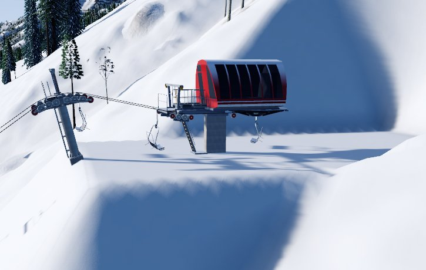
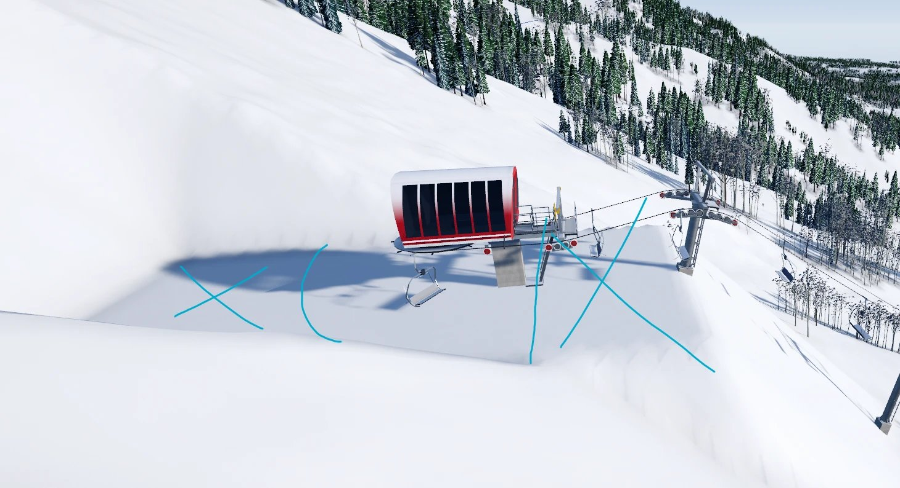
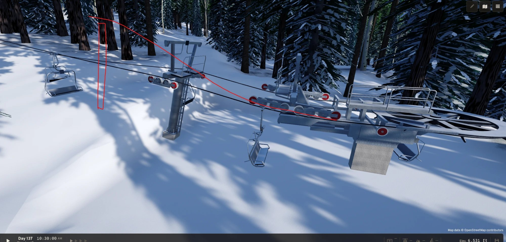
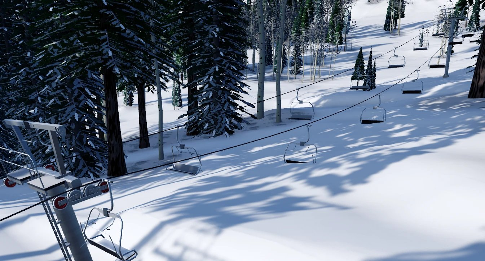

# Phase 3 · 07 Style tile: the owner's in-game findings, round 3

**Audience:** the project owner and coding agents. **Status:** open, collecting (the owner's review in the game, from
2026-10-18). **Build reviewed:** `feature/p3-07-style-tile` at a2869ef: the approved posable models, the drive row
equalising (owner), terminal pads, TW-16 v2, the 1¾ in rope, dense corduroy. **Earlier rounds:**
[p3-07-findings.md](p3-07-findings.md) (round 1 and 2, all twelve fixed). **Task:** [p3-07-plan.md](p3-07-plan.md).

Each finding: what the owner saw, the likely cause, and what happens to it (fixed in 07, or handed to 08, 09 or Later
with the owner's OK). Screenshots live in `images/p3-07-findings-r3/`.

**The rule for every fix (owner, 2026-10-18):** "with all findings and following fixes, we need to make sure we are
implementing it such that the user can build things easily without tweaks like we are doing."
- A fix lives in the rules and the engine: grading, placement, posing, shaders. Then any trail or lift a player draws
  gets it automatically, on any mountain.
- **Not allowed:**
  - values tuned to this site;
  - hand-placed towers;
  - per-run flags;
  - camera-specific fixes.
- Every fix states how it's general. It's verified on the style tile and on at least one other line or trail, on
  different ground (another spot on Jackson Hole, or a recorded fixture).
- Where today's build relies on style-tile tuning, the finding says so and the fix removes it. Known cases from round 2:
  - the frozen tower list;
  - the pad face envelope, widened for this hill;
  - the `-styletile-round` A/B flag.

**Terminal ends (owner's ruling, through the coordinator, 2026-10-18):** a lift's terminals face where its bullwheels
are. The Monta's drive is its **bottom** station. Task 09 implements this. Until then, the round 3 fixes must not
hard-code "return at the bottom, drive at the top" in reusable code:
- Each end's rules (exit or entry range, hold-down or support row, pad size, the level last span of #1) are read from
  the terminal model at that end.
- They are not read from bottom or top.
- Today the code assumes it in four places:
  - `LiftView.Build`, which places `return` at the bottom and `drive` at the top;
  - `TryPosedLoop`, where the return's row holds down and the drive's supports;
  - `LiftType`'s `BottomExit*` and `TopEntryMax`, documented as the return's and the drive's rows;
  - TowerPlacement's comments.

The style tile's Sessellift keeps its drive at the top.

**The fix plan (approved 2026-10-18).** It was vetted by a design agent and two adversarial reviewers. The owner's
answers:
- **Station towers:** the steel stays in 5 ft steps, and the concrete foundation shows the rest (0–5 ft). That lets the
  rope meet each terminal exactly: a 14.3° exit at the bottom, a level last span at the top.
- **Pads:** the footprint plus 5 ft.
- **The rope:** drawn with the empty sag. The checks keep both load cases.
- **The low zones:** the chairs climb back to 15 ft by 100 ft from the bullwheel, measured under each rope.
- **Flat tops:** a raised unload ramp.
- **The Monta's posable trains** (bb42477) are merged first.

The plan also:
- puts every lift through one engine build path (pads, placement, the trench under the chairs at the bottom, raises in
  the pad fill);
- reads each end's behaviour from its terminal model;
- removes the style-tile tweaks.

Verification runs on made-up ground, on a spread of real Jackson Hole lines, and in the game.

| # | Finding | Where | Cause | Status |
|---|---|---|---|---|
| 1 | **(a)** The last tower breaks over too hard: the rope should leave it **level** and run straight into the top station, so it always enters at the station's rope height, as at the base. **(b)** The drive terminal's own sheaves are acting as hold-downs, with the cable lying over them. They are guide/support sheaves and must never hold down | The top (drive) terminal and the last tower.  | **(a)** TowerPlacement aims the rope *into* the drive's row at up to 18° (it only checks \|angle\| ≤ 18°), and the station tower's 15 ft minimum on the pad puts its rope above the drive's ~10 ft rope height. So the rope **descends** into the station (−8.6° here). **(b)** That descent bends the rope *up* at the drive's row, a hold-down's job, while the posing still draws the rope on top of the support sheaves. **General fix (engine, any lift):** a TW-16 rule for the top: the last span is **level**, its tower carrying the rope at the station's rope height, so the drive's row only guides (it takes the small sag angle, always pressing down: support). The last tower takes the whole turn from the line's slope to level, with more breakovers before it where one would be too sharp (TW-06). Its place: the first slot out from the station where the ground lets it stand at that height (open question: station towers shorter than 15 ft vs farther out) | Open |
| 2 | The flattened area round the top terminal is much too large. The owner's markup: the pad should end just behind the hood (the curve) and at the terminal's front (the vertical line); the parts marked ✕, behind and in front along the line, shouldn't be there | The top (drive) terminal's pad.  | Round 2's pad rule (LF-12 v1) was the model's footprint plus **20 ft** all round, and the top pad ran **60 ft behind** the bullwheel (my reading of round 1's #8). Its 1:1 faces then cut a wide bowl into the hill. **The owner's markup replaces that:** the pad hugs the terminal, ending just behind the hood and at its front; the unload area beyond is for the off-ramp models the owner has planned for later. **General fix:** LF-12 v2 sizes every pad from its terminal model's measured footprint plus a small working margin (to settle: about 5 ft), the same for every terminal on any ground, with no 60 ft extension. The 200 ft face envelope widened for this hill in round 2 (a site tweak, against the round 3 rule) goes back to a rule value, since a small pad needs far smaller faces | Open |
| 3 | The first tower is too close and not tall enough: the chairs get too close to the ground leaving the station. The climb out should be more aggressive (the owner's red line: steeper out of the station to a taller first tower, farther out). Maybe a **narrow envelope under the lift line** that cuts the terrain so the chairs can climb, like the roped-off area in front of real lifts. The owner sent three photos of real terminals, kept locally since they show a real resort's and maker's names (`lift-reference/p3-07-references/`): a top terminal from above with a tower just past it; a loading area dug down into a trench under the chairs, with ropes along its sides; a top terminal from the side with the unload ramp and a short tower just past it | The bottom (return) terminal and the first tower.  | TW-16 v2 puts the station tower as close as it can (45–50 ft) and as short as it can (from 15 ft), with the rope leaving within the row's 8.3–15.9° but aimed low. TW-01 exempts the load zone, so nothing stops the chairs skimming the snow until they first reach 15 ft. **General fix (engine, any lift):** **(a)** the exit aims for the top of the row's range (a steep, quick climb), with the first tower placed and sized for it rather than as close as possible. **(b)** A rule for the load and unload zones: the chairs' height over the ground never decreases from the load point until they reach 15 ft. **(c)** Where the ground breaks that rule, a **lift-line envelope**, a narrow graded corridor under the line from the station (about the chair's width plus a margin), cuts the ground away with 1:1 sides: the trench in the reference photo. Same grading engine, same edit tiles, part of the lift's Break ground | Open |
| 4 | **(a)** The rope sags far too much on the uphill (loaded) side, though the slope below isn't steep. **(b)** Chairs go through the snow, breaking the minimum height over the ground | The first span, from the 15 ft station tower (s4, 45 ft out) to the first line tower (s6, 295 ft out, 35 ft): a 250 ft span.  | **(b)** The game's own log says the lowest chair clears 15.4 ft, so the rule never saw this. TW-01's check exempts the load zone "from the station to where the chairs first reach 15 ft". Here the chairs leave the station tower at about 6 ft (a 15 ft rope less the 8.7 ft chair), dip to the snow, and only reach 15 ft near the next tower, so the **whole first span is exempt** (checked in `LiftRope`'s TW-01 scan). The check also samples the ground only at the lift's centreline, not under each rope and chair. **(a)** The uphill rope is drawn **fully loaded** (four 170 lb riders a chair: 409 N/m against 189 N/m empty) while the chairs are drawn empty. At the bottom's low tension (the 18,000 lbf counterweight), a 250 ft span sags about **12 ft** loaded against about 5½ ft empty. So the drawn up rope hangs twice as low as the down rope beside it. **General fix (engine, any lift):** **(1)** The exemption covers only the loading area itself, up to the station tower. From there, #3(b)'s rule holds (chair height never decreases until 15 ft), then full TW-01. So a sagging first or last span is always caught, and placement answers it like any other span (a taller or extra tower, or #3's lift-line envelope). **(2)** TW-01 samples the ground under each rope across the chair's width, not the centreline. **(3)** The rope is drawn at the load it carries (empty chairs, empty sag; riders come with the simulation), while the design check keeps the loaded case. **(4)** Check the 18,000 lbf tension against the rope table. Whether 4.9% loaded sag on a 250 ft span is right for a fixed-grip quad goes to the fix plan | Open |
