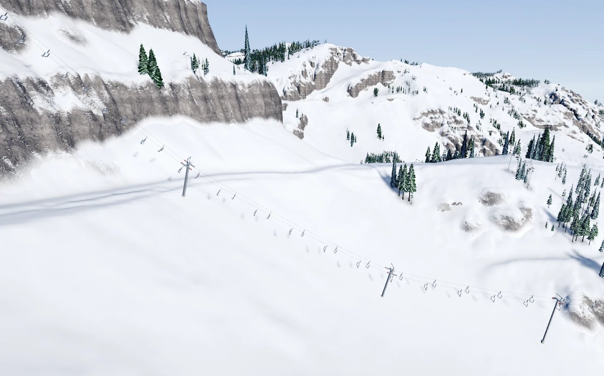
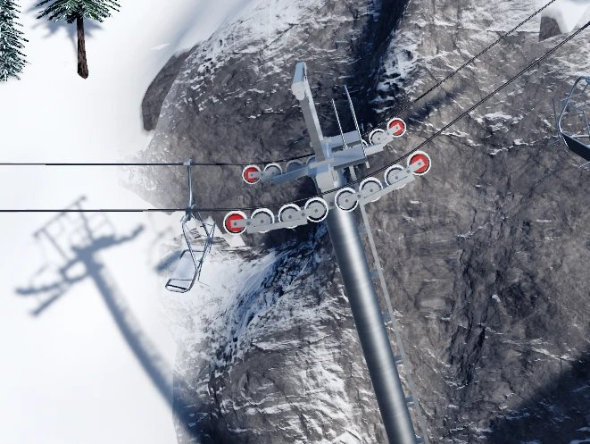
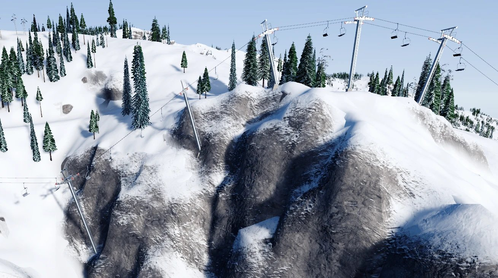
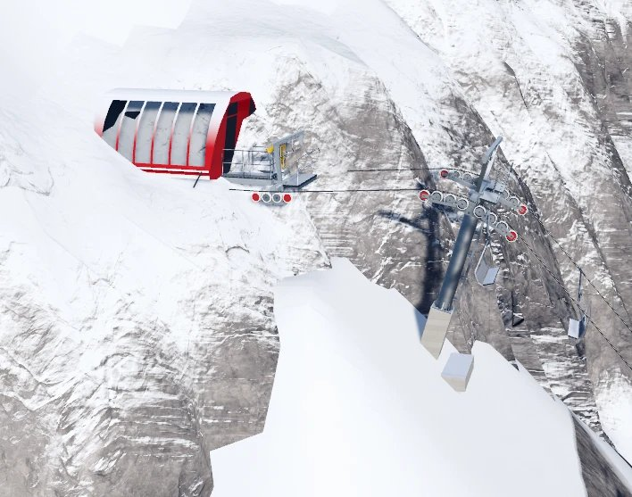
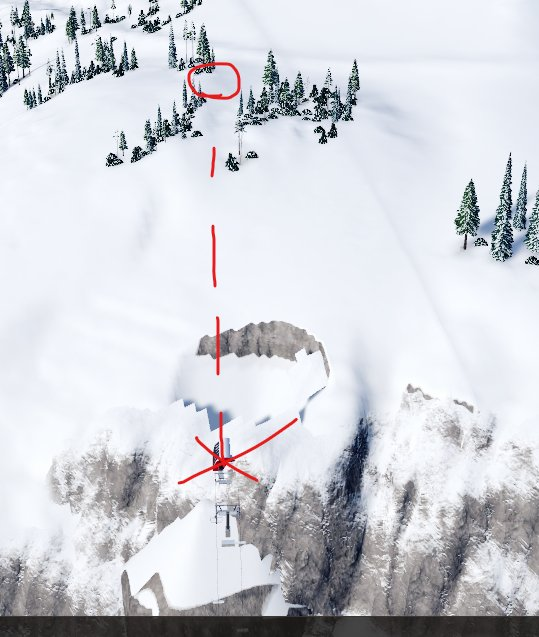

# Phase 3 · 07 Style tile: the owner's in-game findings, round 4

**Audience:** the project owner and coding agents.

**Status:** closed: the owner approved the look on 2026-10-19 ("Amazing, approved").

**Build reviewed:** `feature/p3-07-style-tile` at a9ea046, round 3's fixes:
- one build path for every lift;
- station towers aimed at their terminals;
- TW-01 v2;
- the trench and the ramp;
- pads that hug the terminal.

**Earlier rounds:**
- [p3-07-findings.md](p3-07-findings.md) (rounds 1 and 2);
- [p3-07-findings-r3.md](p3-07-findings-r3.md) (round 3).

Each finding records what the owner saw, the likely cause, and what happens to it: fixed in 07, or handed to 08, 09 or
Later with the owner's OK. Screenshots live in `images/p3-07-findings-r4/`. Round 3's rule holds for every fix: it lives
in the rules and the engine, so anything a player draws gets it with no tweaks.

| # | Finding | Where | Cause | Status |
|---|---|---|---|---|
| 1 | A long span goes steeply uphill over the cliff band. Two hold-down towers before the rise make sense, but there's barely any support for the rope up the steep stretch, with only one tower near the top. It doesn't look like enough. Will the game calculate actual tensions in a later step? | The check lift (`-extralift -600,200`) on harsh terrain, the climb over the cliffs.  | **What the game computes today:** <ul><li>RP-03's tension along the line (counterweight + load × height gained; this lift's top tension is 79% of the rope's rating, RP-05);</li><li>each tower's head from the rope's bend and load: 4.5° and 1,500 lbf per sheave, 8 sheaves at most, else too sharp (TW-04/TW-05 in simple form);</li><li>TW-01 v2's clearance.</li></ul> **What it doesn't compute yet:** <ul><li>TW-05 in full (each sheave's load in every case, and the 750 lbf group minimum that keeps the rope seated on a hold-down);</li><li>any limit on span length: TW-07 says "no fixed number", so a long steep span passes as long as the chairs clear 15 ft and the heads at either end can take the bend.</li></ul> Spans here are 250 ft or less (TW-12 places them evenly), but nothing asks for more support where the rope is steep and heavily loaded. **Likely general fix:** task 09's TW-04/TW-05 per-sheave forces in both load cases, plus a span rule from the rope's sag and the tower loads (to settle with the owner: in 07 or 09) | **Handed to task 09** (owner, SK29): TW-05's forces and any span rule, shown on the tool's load gauges |
| 2 | Going down over the cliff is a great attempt. **(a)** A hold-down tower has the rope drawn **on top of** its sheaves instead of beneath them (photo 1). **(b)** The number of towers on the crest is a little strange, though probably right; more breakovers might be expected, which the tension calculations should decide (photo 2) | The check lift on harsh terrain, the descent over the cliff.   | **(a)** A drawing bug, to confirm on this tower. The posing puts the rope under a d8's row and, on a c8, picks the row from the rope's bend, but that bend is estimated from the first pass's angles. Since round 3 the rope is also drawn empty (RP-08), while the head is chosen from both load cases. So a head picked for pulling up can end up with the drawn rope pressing down, or the reverse. **General fix:** the side the rope runs on, and the row it loads, follow the drawn rope's own bend at each head, re-checked after posing; a head whose drawn bend disagrees with its type is reported. **(b)** The same question as #1: the tower count on a crest comes from TW-04/TW-06's bend limits (4.5° and 1,500 lbf per sheave), not yet from TW-05's full forces. Task 09's per-sheave forces (or a span rule, if the owner wants it in 07) settle it | **(a) Fixed (17b4c1c):** each head's rope side follows the drawn rope's bend; a head that disagrees (too sharp) is listed in the `[Built]` line. **(b) Task 09** (SK29). Also from this finding: a too-sharp head with no room for a TW-06 partner on one side gets one on the other (the style tile's top now shares its turn over four breakovers, none too sharp) |
| 3 | **(a)** The top terminal is in a very goofy spot: on the cliff edge, its pad cut into the rock face, floating over a sheer drop. **(b)** A callback to #1: only one tower follows a massive run of hold-down-only towers; it needs a lot more support. **(c)** Move the terminal a little uphill, to the circled spot above the cliff (photo 2) | The check lift's top terminal.   | **(a)** The check lift's top is wherever 650 m up the fall line lands; here that's on the cliff. Nothing in the build checks LF-08 (the natural ground under a terminal's footprint may vary by at most 10 ft): the build grades a pad anyway. Its 1:1 faces never meet ground steeper than 45°, so they're clipped at the 50 ft envelope (a 48 ft step, which already marks the lift not OK, but it still draws). **General fix:** LiftBuild checks LF-08 at both ends and reports the lift red with the reason ("the top terminal stands on ground that varies 40 ft"), as the tool will when a player places it. A clipped pad face shows red rather than as a floating cut. **(b)** Same as #1 and #2(b): support from TW-05's full forces or a span rule. **(c)** For the check lift: `-extralift` slides each end along its line to the nearest spot that passes LF-08 (here, up past the cliff to the circle), the way task 09's terminal ghost shows green only where a terminal can stand | **Fixed** (owner's rule, SK30): steep sites are allowed. The terminal stands higher on its pier (cutting at most 10 ft into the hill) and pads only cut, with nothing filled. The check lift's top slides to the bench past the cliff. The style tile's own top stands 3 ft up on its pier. **(b) Task 09** (SK29) |
| 4 | The check lift's bottom terminal looks great: exactly what a very steep climb should look like. The towers are perfect too. The owner asked whether tower places are judged by Claude or picked by the algorithm | The check lift's bottom terminal and first towers | No AI at runtime: the game's own engine (`TowerPlacement` inside `LiftBuild`, Domain code) places every tower by the rules, deterministically. The same line on the same ground always gets the same towers, on any machine. Claude wrote the rules and the code, not the placements | **Approved** (owner, 2026-10-18) |
