# Phase 3 · 07 Style tile: the owner's in-game findings

**Audience:** the project owner and coding agents. **Status:** round 2 fixes in, for your review (2026-10-18). **Task:** [p3-07-plan.md](p3-07-plan.md); report [p3-07-style-tile.md](p3-07-style-tile.md).

Each finding: what the owner saw, the likely cause, and what happens to it (fixed in 07, or handed to 08, 09 or Later
with the owner's OK). Screenshots live in `images/p3-07-findings/` when committed.

| # | Finding | Where | Cause | Status |
|---|---|---|---|---|
| 1 | A leaning tower stands on a plumb plinth: the foundation isn't parallel to the mast, against the ruling that plinths are always in line with the tower (SK13) | Lift line, any leaned tower. 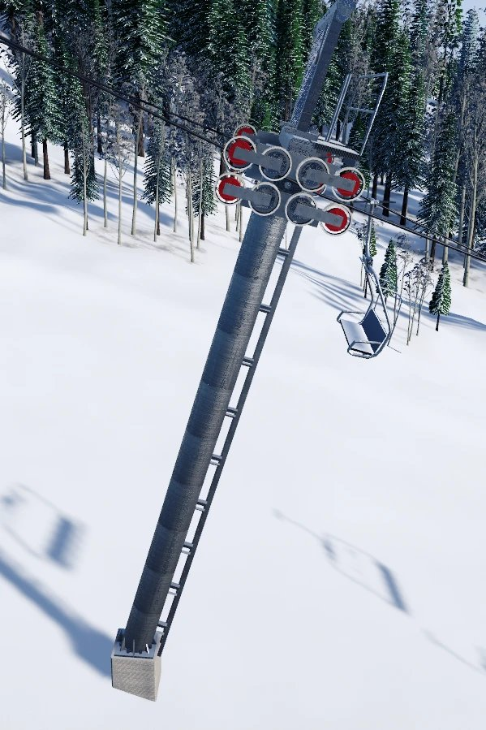 | The leaned base models (`tower_base_l025`–`l150`, pier parallel to the mast) are built in Blender but not imported yet (awaiting model approval), so `LiftView` falls back to the plumb base under a leaned mast. Once imported, every lean picks its matching base | **Fixed:** leaned bases imported; the pier, plate and gussets lean with the mast. 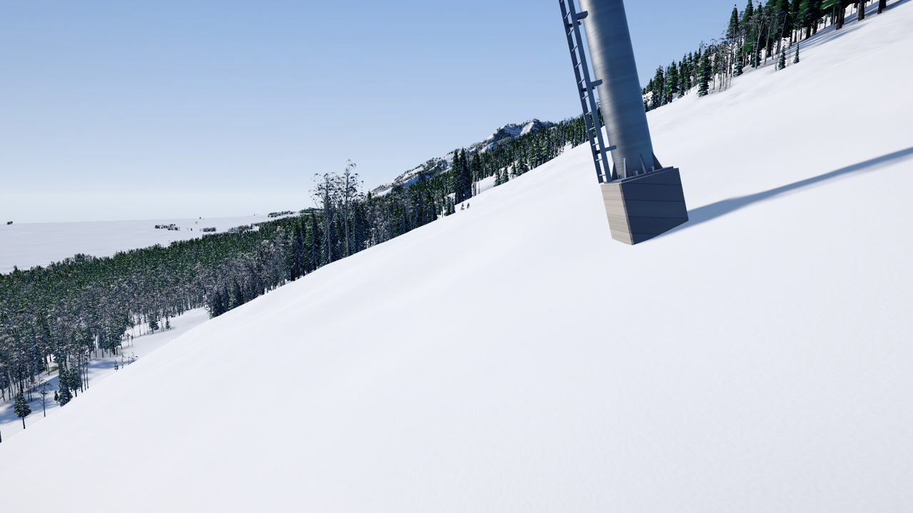 |
| 2 | The sheave trains don't follow the haul rope (or the rope doesn't follow the trains). Owner: the trains can be static in game, but their positions must be computed at build so the rope looks like it's holding them in place, as in real life | Tower heads along the line. 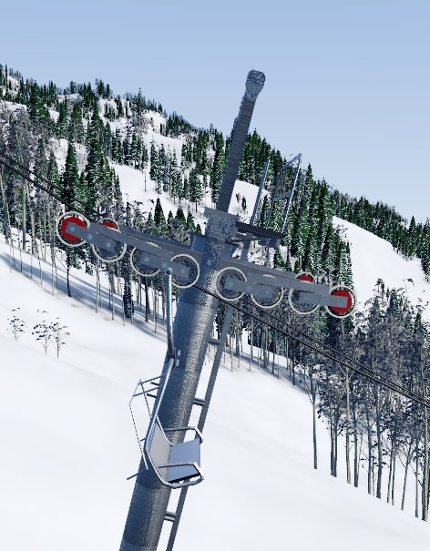 More evidence: a combination (c8) head, whose trains should lie nearly parallel to the line, not locked at an arbitrary angle. 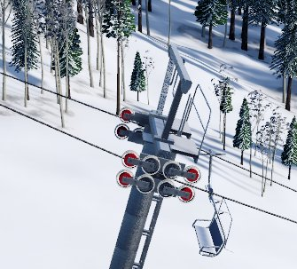 | Two simplifications: the heads are placed with their trains in the model's display pose (C10: flat arcs, not rocked to the rope), and the rope is two catenaries meeting at one point over the head instead of wrapping the sheaves (RP-02's tangent solve is task 09's). Each train hangs on a pin and is free to turn, so the rope's tension settles it where its sheaves share the load: the train's chord lies along the bisector of the arriving and departing rope (nearly the line's slope), whatever the mast's lean; on a leaned tower the model's pose also turns with the mast. Fix: at build, turn each train on its pin to that angle (and each train's sheaves along its own arc), and run the rope over the sheaves' grooves, tangent in and out  **The owner adds:** the trains rock naturally, level by level, as real equalising trains do: each pair of sheaves pivots on its rocker's centre, each pair of rockers on its yoke, and the whole set of eight on the equaliser pinned to the crossarm. So at build each pivot, from the equaliser down, takes the angle at which its two halves share the rope's load, and the sheaves end up on the rope's curve. **Model change needed:** today only the sheaves are separate parts (for spinning); the rockers, yokes and equaliser are merged into the head. They must become nested parts with their pin pivots (a Blender change, approved before import), for the line heads and the terminals' rows (#6) | **Fixed:** trains posed level by level to the rope at build (RopeOverSheaves; tangent within 0.18° on the style tile), the rope over the sheaves; the c8 rope runs between its rows. The drive's row is held flat (its rebuild is your open decision in the model thread). 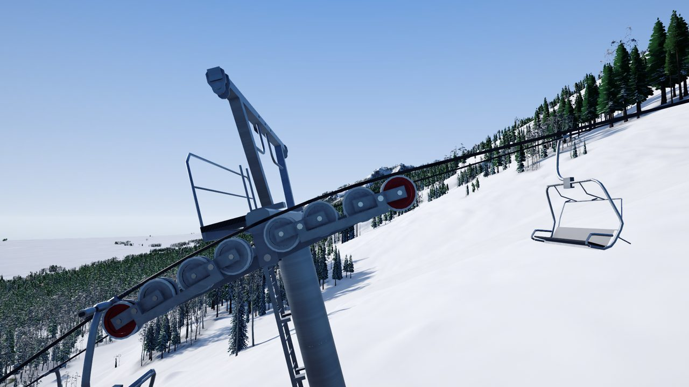 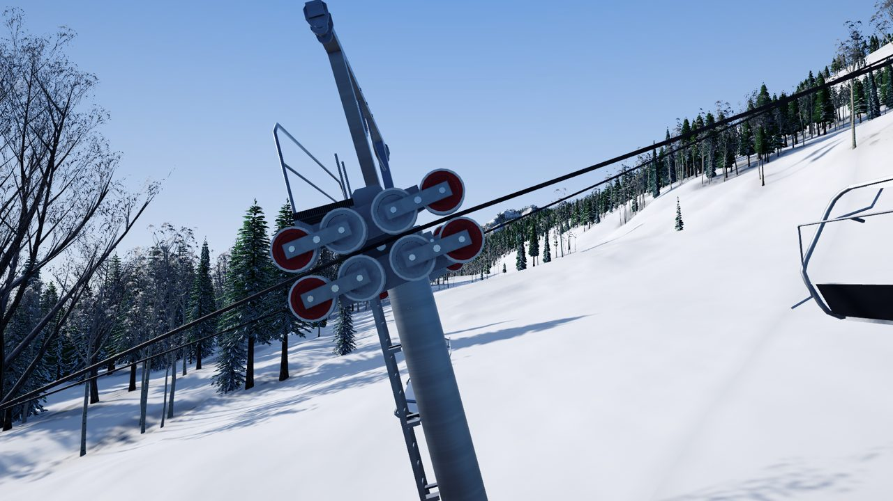 |
| 3 | The chair grips don't follow the rope line; they should sit along the rope | Chairs on any sloping span. 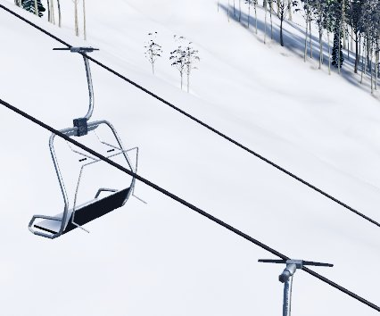 | The chair is one rigid model, hung plumb and turned only to face its travel, so its grip stays level while the rope slopes (up to about 30° here). On a real fixed-grip chair the grip clamps along the rope and the hanger swings plumb from it. Fix: split the chair model so the grip is its own part, with the hanger's pivot across the rope (a Blender change, approved before import); at build, the grip takes the rope's slope and the hanger and chair stay plumb, still instanced | **Fixed:** the grip follows the rope's slope, the hanger hangs plumb from it (instanced, 0 B per frame). 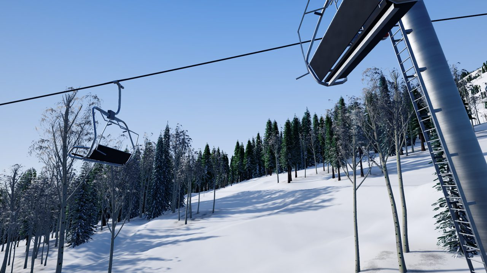 |
| 4 | Tower two's head looks good, but the haul rope looks too thin and sits too low: it should ride just above the tops of the sheave flanges | Tower two (a breakover). 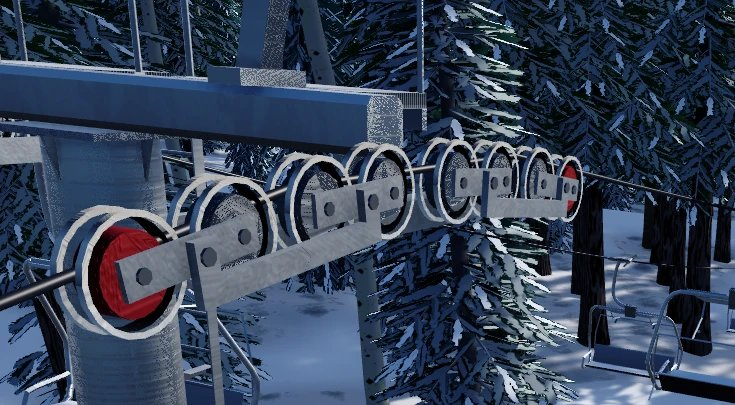 | **Height:** the head's rope socket already puts the rope's centre one rope radius above the flange tops (the model's `ropeR + dia / 2`). It drops into the sheaves because the rope is a straight chord meeting the head at one point while the trains sit unrotated (#2); fixing #2 lays it over the grooves, tangent in and out. **Thickness:** drawn at LC-02's true 1⅝ in (41 mm), about a third of the sheave's 135 mm width, which is real proportion; it can be drawn thicker for readability (style), or at LC-02's top of range, 1¾ in | **Fixed:** rope 1¾ in (SK17), riding on the flange tops. 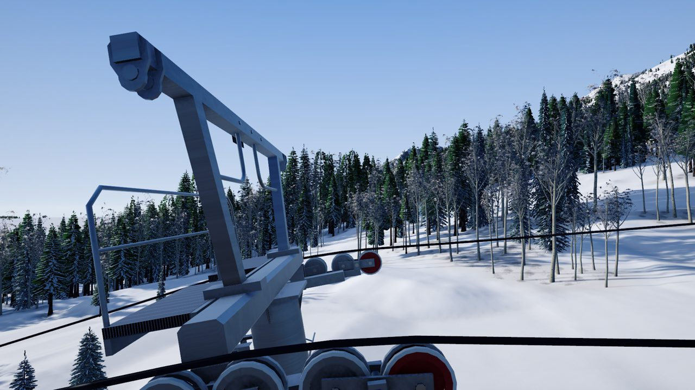 |
| 5 | The bottom terminal floats: its below-grade footing shows. Only the plinth should come out of the ground. Owner: placing a terminal should also add a predetermined flattened area to the terrain | Bottom (return) terminal. 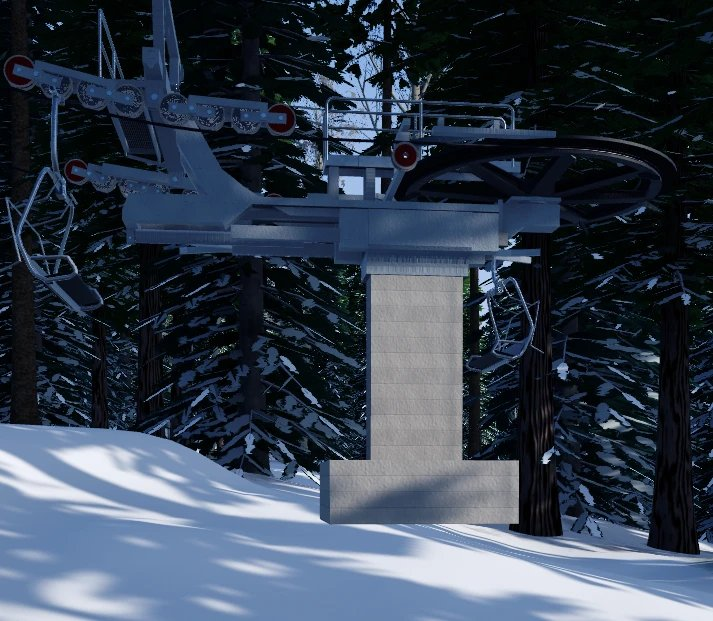 | The terminal was raised 10 ft (TW-16, to let its hold-down row send the rope off within 15.9°) with the ground left as it was, so the model's footing, built to sit 2.5 m below grade, stands in the air. Fix: a **terminal pad**: when a terminal is built, the grader levels a pad under it (its footprint plus a margin, at the terminal's base elevation) with 1:1 cut and fill faces, the same engine as trails. A raised terminal then stands on fill, its footing buried and only the plinth showing. The pad is ordinary terrain edits (no save change); a new rule (LF-12) next to CL-09's clearing | **Fixed:** terminal pads (LF-12); the tall pier is buried in the pad, the footing at grade. 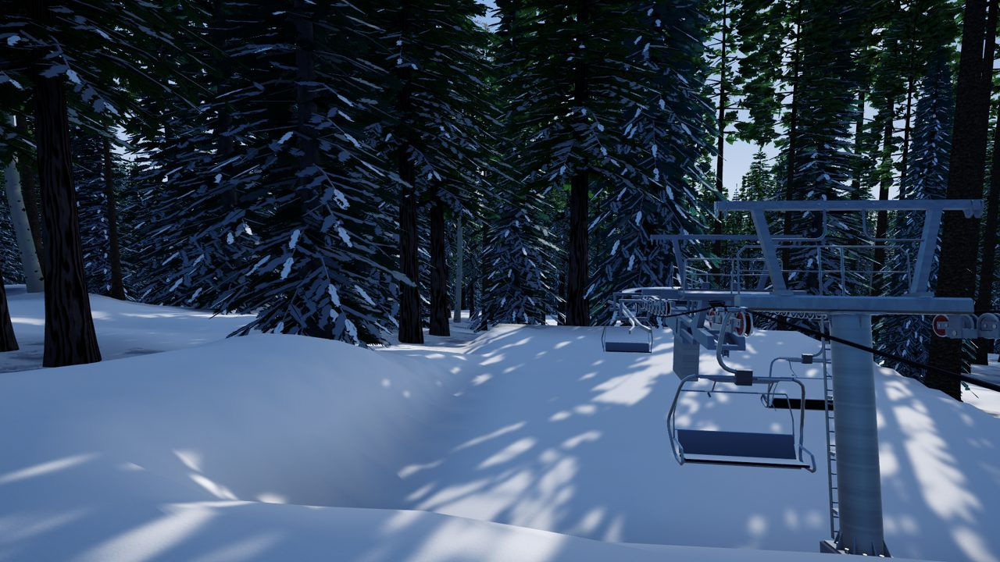 |
| 6 | (With #2 and #5.) The terminal's own sheave trains should be dynamic too, set by how steeply the rope has to leave the terminal; if that's too steep, an additional hold-down (depression) tower is needed right away | The bottom terminal's built-in hold-down row. 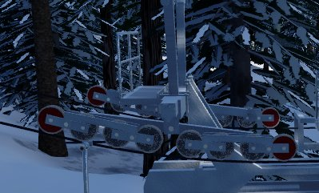 | The station rope follows the model's fixed row (levelled at its first sheave, leaving at 15.9°) whatever the line needs, and TW-16 today raises the terminal when the rope must leave steeper. Fix: at build, rock the terminal's trains (on their pins, as on line towers) to the angle the rope actually leaves at, up to the row's limit; past the limit, placement adds a hold-down tower just beyond the station (at TW-03's 50 ft) instead of raising the terminal. TW-16 changes to match (the terminal raise would then stay for ground too steep for a pad, #5) | **Fixed:** TW-16 v2 (hold-downs before a raise; the return row works from 8.3° to 15.9°); the rows rock with #2. 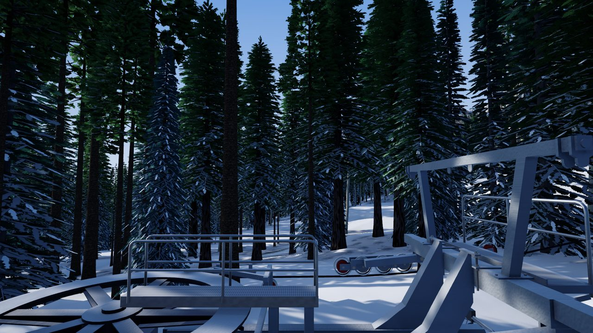 |
| 7 | The final breakover before the top terminal stands too far out, so on ground falling away from the terminal it has to be very tall (50 ft here), high in the wind. Default: closer to the terminal; how close can be a player's choice later (shorter tower against wind exposure) | The top (drive) terminal and the last tower. 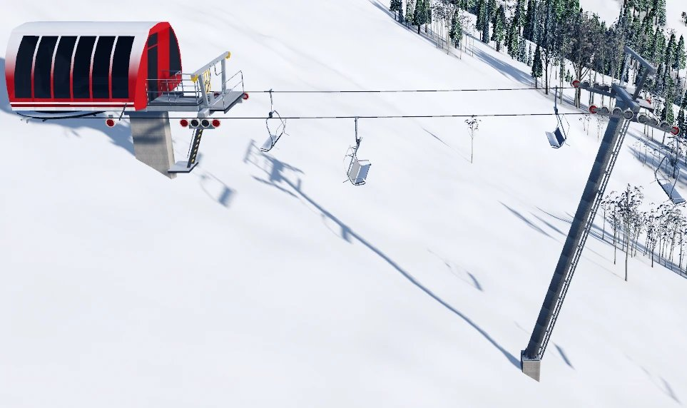 | TW-16's station breakovers go 70 ft from the bullwheel *(tuned at 07)*, and the rope there must already be near the terminal's rope height, so the falling ground makes the tower tall. Fix: put the station breakovers as close as the terminal allows: just past its front (the drive reaches 24 ft in front of its bullwheel) plus a working gap, about **40 ft from the bullwheel** by default; TW-03's 50 ft from a terminal is relaxed for station breakovers (measured from the terminal's front, 15 ft). A player setting later trades closeness for height | **Fixed:** station towers 45–50 ft from the bullwheels, from 15 ft tall (TW-02/03 v2). 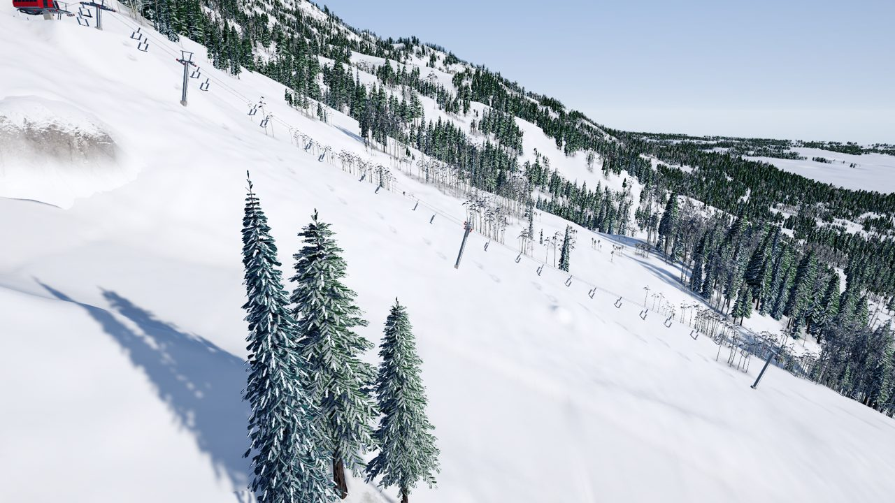 |
| 8 | The top terminal sits inside the hillside. It should automatically flatten the terrain about **60 ft from the bullwheel on its uphill side**, to make room for the unload zone. The concrete pylon must take a variety of heights | The top (drive) terminal. 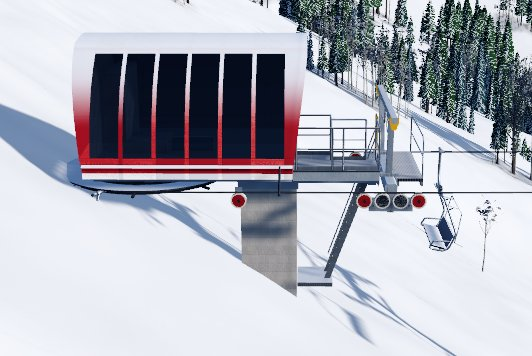 | The terminal stands on the ground at its origin, and the slope keeps rising behind it, so the hill swallows its back half. Fix, with #5's pads (LF-12): the top terminal's pad runs from the line side to **60 ft behind its bullwheel** (the unload zone), levelled at the unload level with 1:1 faces, cut into the hill. **Pylon heights:** the terminal's concrete pier becomes its own part that stretches (or stacks, like the mast) to the terminal's elevation, so a raised or lowered terminal (SK14's adjustable elevation) always stands on a pier to the ground; a model change (Blender, approved before import) | **Fixed:** the top pad cuts 60 ft behind the bullwheel into the hill. 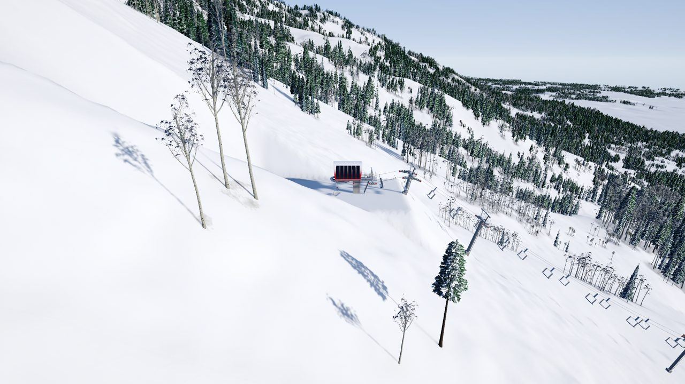 |
| 9 | The towers look amazing, but the mast's repeating sections show as bands; towers should look consistent along their height | Any tower's mast. 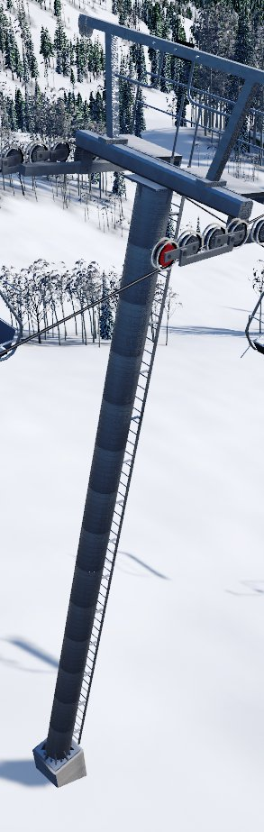 | Each 1 m mast section had its ambient occlusion baked on its own, standing on a ground plane (`build_lifts.py` bakes every kind but chairs with `ground=True`), so every section darkens toward its foot and the stack reads as rings. Fix: re-bake the mast section without the ground and as if stacked (its top and bottom open, so both ends get the same light), and check the texture tiles vertically; the ladder likewise. A model rebuild, so it goes through your photo approval with the others | **Fixed:** mast re-baked without the ground plane, with ghost neighbours: no bands. 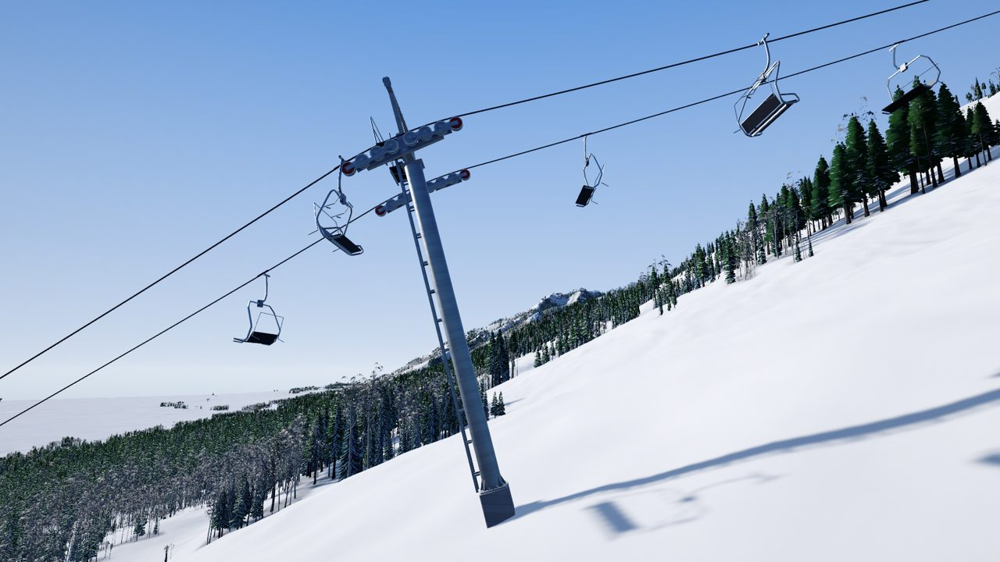 |
| 10 | Weird visual artifacts on the inside faces of the tower heads | A tower head's portal, inside faces. 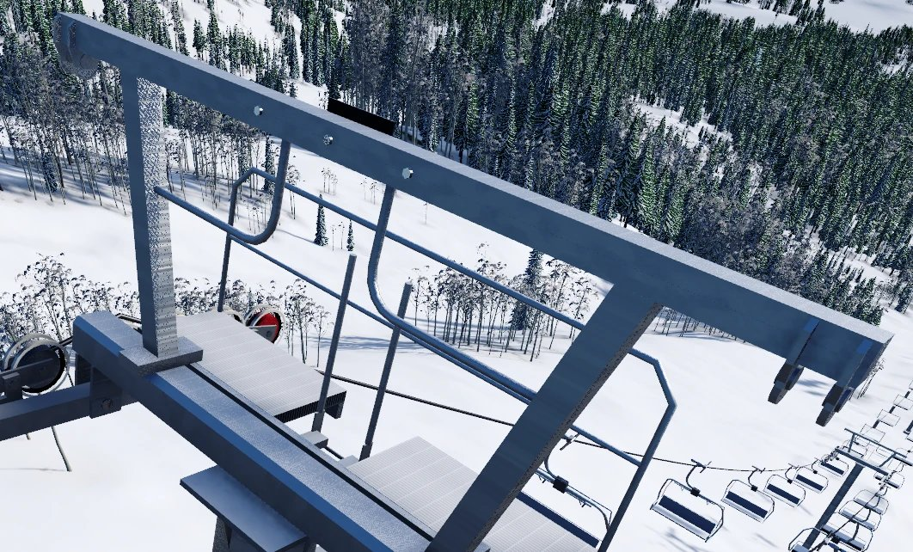 | To investigate. The portal post's inner face shows a speckled, tread-plate-like pattern, which suggests either the deck's tread-plate detail texture landing on the post's faces (a UV or material assignment in the head model) or that detail texture shimmering without filtering at this distance. It shows in the game but wasn't in the Blender review photos, so the first check is the head in the Lift Lab against the model's UVs | **Fixed** in the lift shader: the detail atlas no longer bleeds at grazing angles (no model change). |
| 11 | The corduroy looks good, but it's spaced far too wide: bring it in to a realistic spacing | The groomed bench, close up. 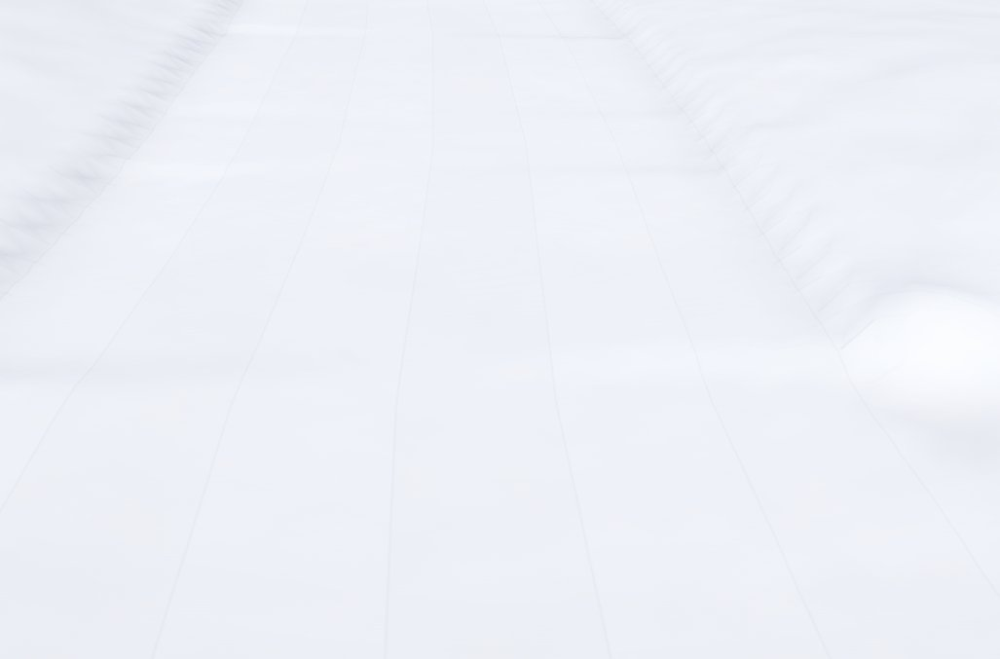 | The lines in the picture are the **seams between groomer passes**, every 15 ft; the real corduroy (ridges about 1 in apart) fades out before it would alias, so close up it's barely there and the seams read as the corduroy. Fix: make the fine corduroy visible (finer ridges carried further, turning into a directional sheen rather than flat white as they shrink below a pixel), and make the pass seams subtler, so the surface reads as dense corduroy with faint lanes | **Fixed:** dense 1 in corduroy from a full-float offset map; lanes faint (3%). 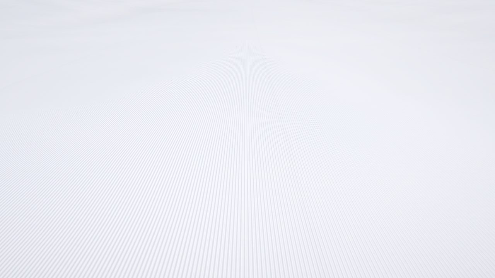 |
| 12 | (Spotted in #11's picture.) The crest of each face still shows a saw-toothed edge along the trail | Both edges of the bench in #11's picture | The 1 m heightmap stair-steps a crease that runs diagonally across its grid; GR-12's 10 ft rounding softened it but didn't remove it. Options: a wider rounding (15–20 ft); or smoothing the edited heights' normals in the shader across the crease; or both | **Fixed:** 10 ft rounding with the toe inside the footprint, plus smoothed shading on earthwork. 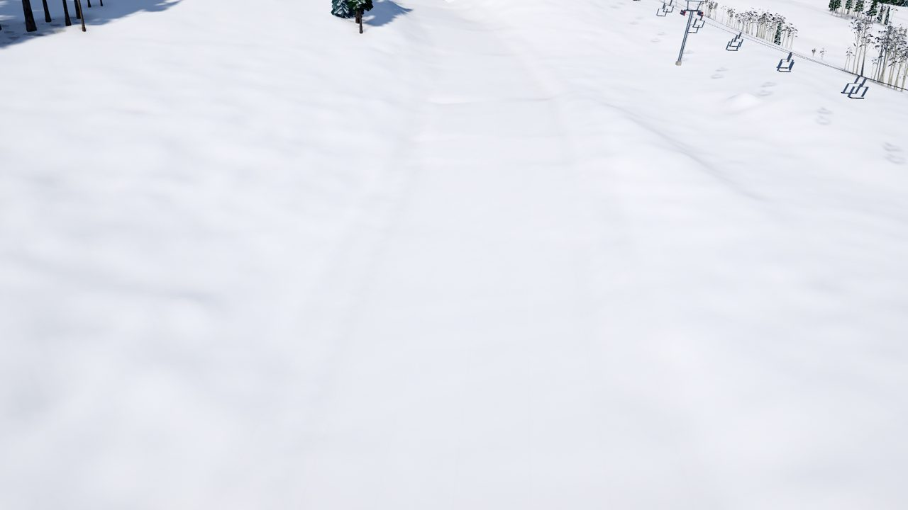 |
