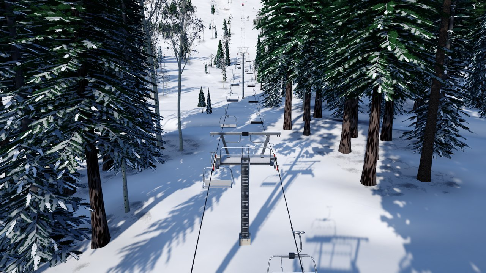
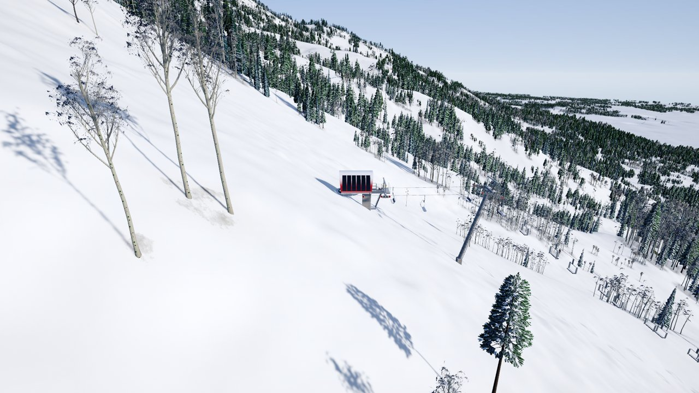
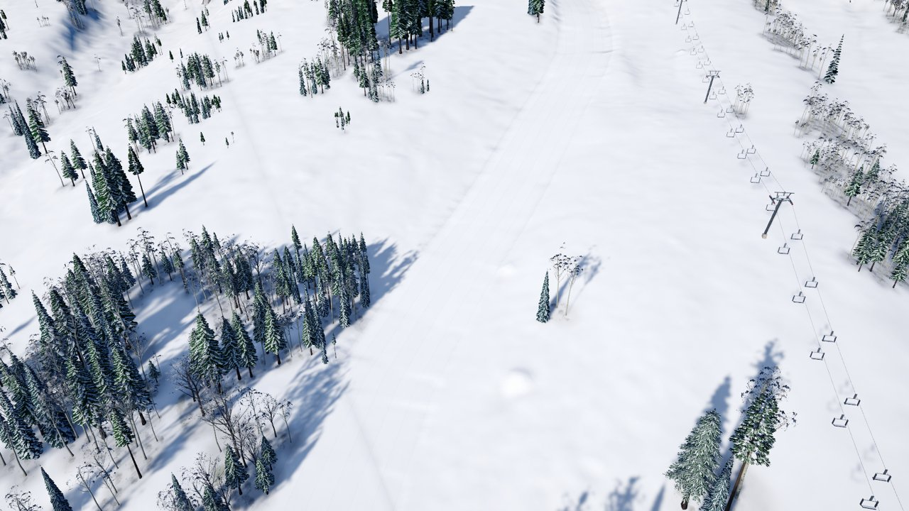
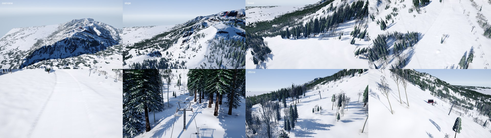
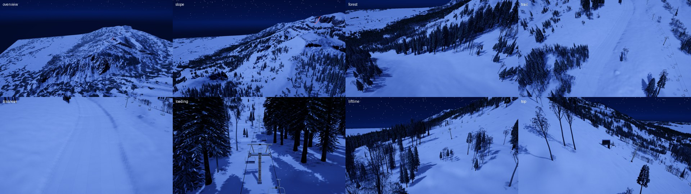
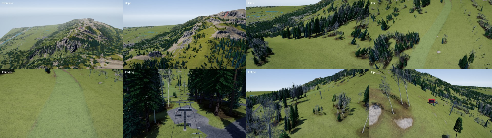
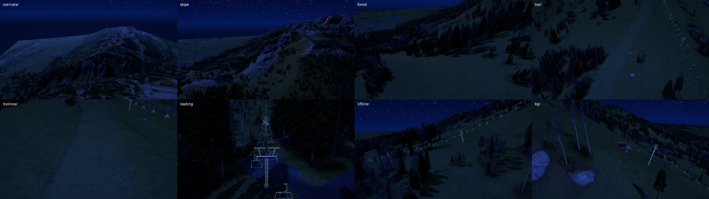

# Phase 3 · 07 Style tile: one trail and one lift (report)

**Audience:** the project owner and coding agents. **Status:** for your review (task 07 ⛳: the look and the benchmark).
**Plan:** [p3-07-plan.md](p3-07-plan.md). **Decisions:** SK1–SK15 in
[phase0-decisions.md](phase0-decisions.md#phase-3-task-07-style-tile-decided-2026-10-17). **Demo:** `demo.bat` 65 (winter),
65s (summer), 65c (every capture), 65b (the benchmark with the style tile).

## 1. What was built

On Jackson Hole 5 km, by command (`-styletile`), through the design's commands and the terrain edit pipeline:

| | |
|---|---|
| **Style Tile Run** | 2,821 ft along a centreline traced down the fall line, 100 ft wide; graded all the way (no ungraded stretches); cut 11,500 yd³, fill 4,100 yd³; 24,200 cells cleared with CL-02's ragged 10 ft band; faces rounded over 10 ft (GR-12) |
| **Style Tile Quad** | Sessellift FGQ-4, 2,334 ft, 842 ft of rise (top tension 95% of the rating, RP-05); 10 towers, 25–55 ft, with TW-16's station breakovers at 70 ft from the bottom and 2,265 ft; heads s4 b8 s4 s4 c8 s6 b8 s4 d8 b8 by the rope's bend (the bottom station breakover bends the rope little, so it carries an s4); the bottom terminal raised 10 ft (TW-16, for now); 112 chairs at 450 fpm; the lowest chair 15.4 ft over the ground (TW-01); the rope leaves the bottom at 14.7° and reaches the top at −0.3° |
| **Clearing** | CL-03's 55 ft corridor and CL-09's terminal clearings (the footprint + 20 ft, + 50 ft station zone) |

The design saves and loads through save v1 unchanged (a Core test), and the same command line builds the same design
every run: its points and towers are frozen in `App/StyleTile/StyleTile.cs`.

## 2. The look

- **Winter:** the bench and gentle faces are groomed: full snow, the snow's grain smoothed, corduroy about 1 in apart
  up close (faded before it aliases) and the seams between 15 ft groomer passes, each pass a shade apart, which is
  what reads from a distance. Steep faces keep the natural snowpack.
- **Summer:** the bench is a mown, more even green; graded faces are fresh earth (stonier in cut) instead of the rock
  the cover would give anything this steep.
- **Night:** the existing moonlight; nothing special was needed.
- **The lift:** the models (terminals, the tower kit stacked from 1 m sections, heads by the rope), a round cable that
  never thins below about a pixel, and instanced chairs moving with the clock.
- **Edges:** the crest stair-stepped on the 1 m heightmap with sharp faces; GR-12's rounding at 10 ft (5 ft was too
  narrow, under two cells) softened it. Some stepping remains up close at grazing angles.

| Winter day | Winter night |
|---|---|
|  |  |

| Summer day | Summer night |
|---|---|
|  |  |

Each sheet: overview, slope and forest (the benchmark's views), then the trail, the trail close up, the loading area,
the lift line and the top terminal.

## 3. Benchmark

Release and Development players at 1920×1080, the measure lane, PC idle (`tools/perf/compare.mjs` against P3-01's
baselines). The before-run is clean main a4c315b; the after-run has the style tile shown.

| Run | Baseline p95 | Main (before) | Style tile (after) | Result |
|---|---|---|---|---|
| High | 7.94 ms | 8.28 ms (+4.2%) | **7.89 ms (−0.6%)** | PASS |
| Medium | 4.67 ms | 5.07 ms (+8.6%) | **4.86 ms (+4.1%)** | PASS |
| High, Development | 8.19 ms | 8.11 ms | 8.07 ms, 0 B garbage | PASS |
| Medium, Development | 4.83 ms | 5.28 ms | 4.69 ms, 0 B garbage | PASS |

The before-run's Medium legs failed four per-view checks and its HUD run showed 11.8 KB of garbage in 5 frames; both
are on main, not this branch (Medium is partly CPU-bound, like Low).

## 4. Values tuned here

| Value | Rule | Set to |
|---|---|---|
| Rope to chair bottom | LC-02 | 8.7 ft (2.66 m), measured on the model |
| Sessellift line gauge | LC-02 | 13.5 ft (4.12 m) |
| Lean cap; lean steps | TW-14 v2 | 15° (unchanged); 2.5°, one base model each |
| Leaning where needed | TW-14 v2 | the rope over 10° at the head, or a b8, d8 or c8 head |
| Face rounding | GR-12 | 10 ft (3 m) |
| Terminal clearing | CL-09 | the footprint + 20 ft, + 50 ft in front |
| Station rows | TW-16 | out of the return at ≤15.9°, into the drive at ≤18°; station breakovers 70 ft from the bullwheels |

Measured terminal footprints (for LF-08's 60 × 30 ft stand-in, task 09): the return 34 ft long (8 ft behind the
bullwheel, 27 ft in front) × 20 ft wide; the drive 32 ft (8 ft, 24 ft) × 22 ft.

## 5. For tasks 08 and 09

- **08:** `TrailGrader` takes a centreline and a width; painted footprints, the automatic centreline and TF-10's overlaps
  come next. `TrailSurfaceMap` is one world texture over the built trails' bounds (up to 2,048 m square); a resort-wide
  set needs tiles.
- **09:** `LiftRope` is the simple model (closed-form catenaries from RP-03's tension, TW-04 from the bend); RP-02's
  tangent solve and per-sheave forces replace it. `LiftView` builds any FGQ-4; the Lift Lab still has its own copy of
  the stacking and station rope. The loaded rope's sag means every tower bends it by about span ÷ (H ÷ w), roughly 25°
  on a 300 ft span at LC-02's tension, so most heads come out b8 (as #87 found).
- **Owner asks for 09 (SK14):** terminal elevation adjustable like towers (save v2, through the coordinator) and ramps
  for top terminals; the bottom terminal's raise here is derived until then.
- **The leaned tower bases** (`tower_base_l025`–`l150`) are built in Blender and await your approval before import;
  until then a leaning mast stands on the plumb base.
