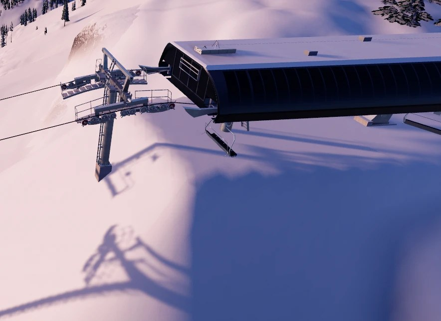
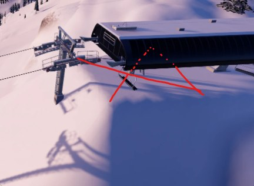
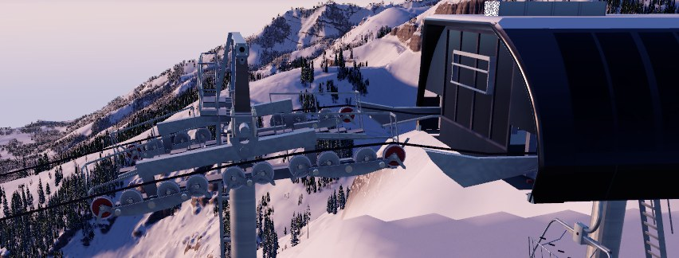
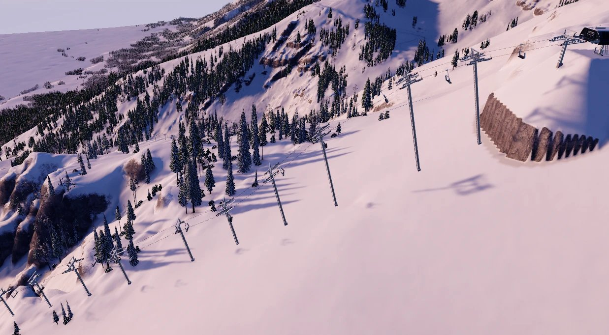
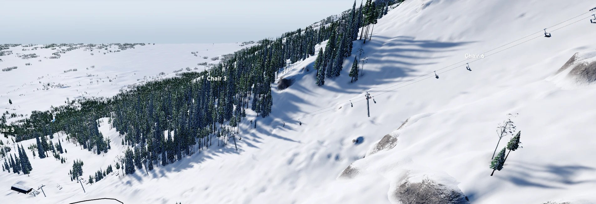
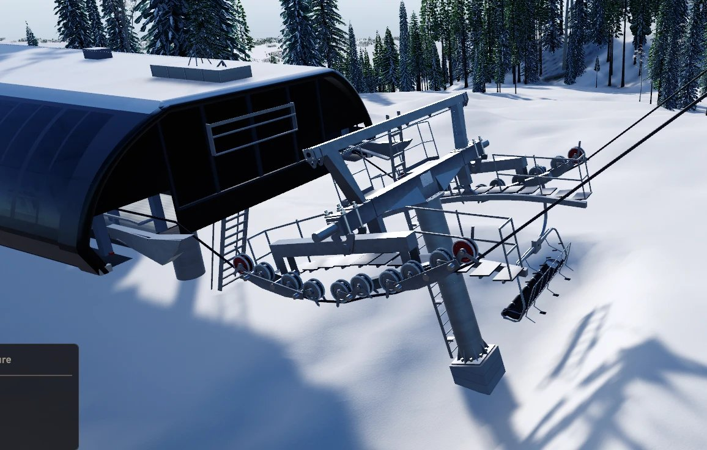
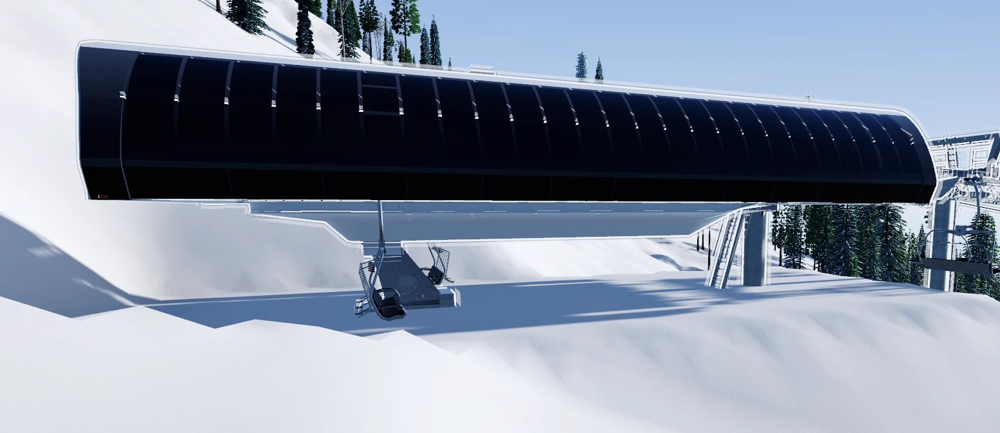
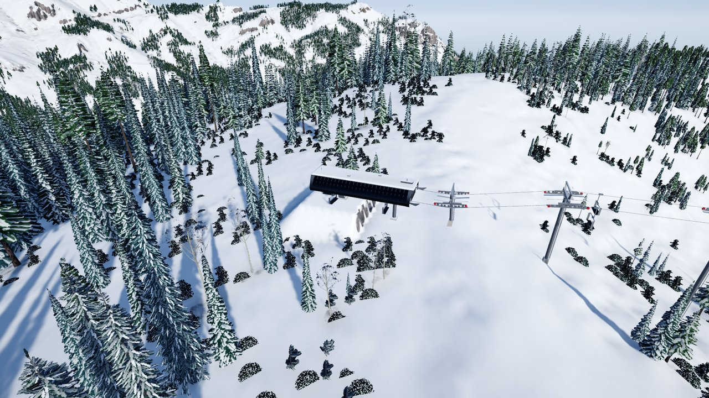
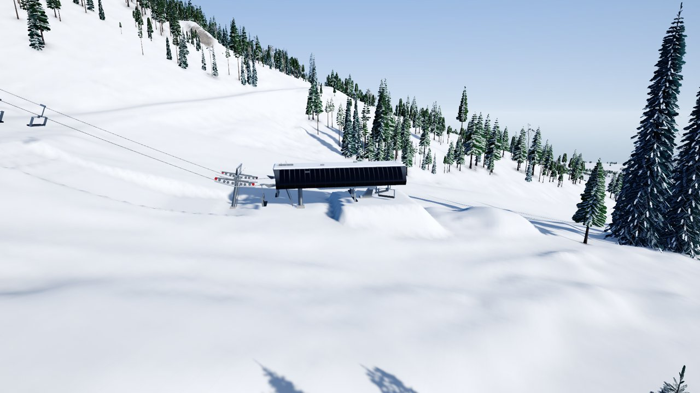

# P3-09 · Detachable lifts: owner findings, second review (PR C)

The owner's findings from the second review gate on `feature/p3-09-detachables` (demo 68, at 347773e0: after the
first review's fixes for D1, the lag, and D2, the slow tower placing; see
[p3-09-detachables-findings.md](p3-09-detachables-findings.md)). Logged as given, one at a time. No fixes until the
plan that follows the list is agreed. The build's plan is [p3-09-detachables-plan.md](p3-09-detachables-plan.md); its
rulings are LT41.

| # | Finding | Where | Notes |
| --- | --- | --- | --- |
| E1 | **The ground pad should only reach halfway under the terminal.** Cut the D6 top terminal's pad at the line drawn; the ground under the X (the terminal's front half, toward the line) shouldn't be edited. | A Sessellift D6 top terminal, from above, its first line tower in front.  The owner's markup: the pad stops at the red line, nothing under the X.  | The red line runs across the terminal at about its middle. The X covers the front half: the overhanging nose, the bullwheel and the station rail, which stand clear of the ground. The pad's cut and fill (LF-12 v3) now covers the terminal's whole footprint, `Behind` to `Ahead` of its origin. To settle in the plan: where exactly the pad ends (the terminal's legs or its origin), and whether the D6 bottom terminal and the quads' terminals follow the same rule. |
| E2 | **At the last tower, the line should always come out with zero slope at the correct elevation.** | The last line tower before a D6 terminal, from beside its head.  | The rope leaves the last tower's sheave train at a slope and meets the terminal's entry at an angle, not level at the station's rope height. For the quads, TW-16 v3 (P3-07 round 3, #1) already makes the last span level: the last tower carries the rope at the station's rope height. The D6's catalog rows (LT41) take the rope anywhere from 4.5° (one sheave's bend limit) to level at either end, and placement accepts any angle in that range. So a D6 line can arrive sloped. To settle in the plan: the D6's ends taking only level, as the quads' drive does (TW-16 v3 for every type), and whether the bottom terminal follows the same rule (the first tower's rope leaving level at the return's rope height). |
| E3 | **The bottom half of the line looks great, but the top portion after the steep rise has way too many towers.** Clustered breakovers right before the terminal or immediately after a steep rise are acceptable, but this doesn't look right. | A D6 line on the owner's save. The top half, too many towers:  The bottom half, which looks right:  | The save has two D6 lines, both named Chair 6. The long one (6,926 ft) is spaced about 240 ft all along, with three tight pairs at its breaks. The upper one (2,144 ft, bottom at its top) is probably the one pictured. Its towers, from the save: <ul><li>its lower 1,410 ft has spans of about 225 ft, on 35–50 ft of steel;</li><li>its top 550 ft, from 1,535 to 2,085 ft, has **10 towers 50–75 ft apart**, the steel rising to 60, 80 and 90 ft, then 20 ft at the station.</li></ul>So after the rise, TW-12's placement fills the line with towers at the 50 ft minimum and tall steel rather than a few breakovers. Likely causes, to check in the plan: the D6's wider, heavier heads bending at most 4.5° a sheave over its 3-sheave terminal rows, so each tower takes little of the turn; the rope having to arrive level at the top (TW-16 v3, E2) after a steep climb; and placement's minimum-span fallback where a bend is too sharp (TW-06). To confirm with the owner: which Chair 6 is in the pictures. |
| E4 | **The first tower after the bottom terminal should have the line coming into it with no slope, at the perfect height for the terminal.** | The first line tower past a D6 bottom (return) terminal, from beside.  | The bottom half of E2, which settles E2's open question: both ends get the same rule. The rope leaves the return terminal falling to the first tower's train, which then turns it up into the line through a large angle: one long, wrapped sheave train right at the station. The D6's return row, like its drive's, takes anything from 4.5° to level (LT41), and the long Chair 6's first towers stand 60, 110 and 160 ft out on 15, 30 and 40 ft of steel. Wanted: the span from the terminal to the first tower level, the tower carrying the rope at the terminal's own rope height; the climb out starts at that tower (and the towers after it). P3-07's TW-16 v3/v4 did this for the quads' top and aimed the quads' bottom exit at the top of its row's range; the plan settles one level-end rule for every type at both ends, and how it sits with the low zone's 15 ft chair rule (TW-01 v2) and the trench (GR-11 v2). |
| E5 | **The ability to select a tower and edit it appears to have disappeared.** | Not yet known: New lift's Towers step or review, or Edit lift (M); the D6 or every type. | F1 (#94) made towers selectable by clicking them in 3D (`LiftView.Pick`, the tower editor) and editable with Page Up/Down, `,` `.`, drag and Delete. Two changes since the owner last used it could have broken it: <ul><li>**this branch's D6 work (LT41):** the D6's towers are new models with many more pieces, and the pointer may hit the rope's pick capsules, which run along each tower head, before the tower;</li><li>**D2's two-step review (6b80fe5a, the build just reviewed):** when the level hints arrive, the lift as built is replaced without telling the tower editor, which may drop or lose its selection.</li></ul>To find: where and on which lift type, then a PlayMode test that clicks a tower in New lift and Edit lift, on a quad and a D6. |
| E6 | **When placing towers by hand, there is no way to control what kind of tower it is.** | New lift, Towers by hand (and Edit lift's tower editor). | Today the player sets a tower's place and height; its head (support, hold-down or combination, and how many sheaves: the D6's s4–s10, b8/b10, d8/d10, c8) comes from the rope's bend at it (TW-04). That was ruled twice: LT5 ("physics picks the heads") and LT38 (F4: "the player doesn't choose heads"). So E6 asks to change a ruling. To settle in the plan: <ul><li>what the player chooses (the head's kind, its sheave count, or both);</li><li>what happens when the choice can't carry the rope's bend or load (red with TW-05's reason, or the game steps it up);</li><li>whether automatic placement keeps choosing, with Edit towers able to override one tower;</li><li>how a chosen head is saved: a tower now stores only its place and height, so this is a save-format change (0.3 §5: a version bump, a migration and a fixture).</li></ul> |
| E7 | **Chair spacing seems too sparse:** in game there are only really two chairs in the terminal at any given time, while a real terminal holds many more (the owner's photo). This makes the owner wonder whether chair spacing on fixed grips needs evaluating too. | A D6 terminal from the side, two chairs under it.  The owner's photo of a real detachable terminal, about five chairs under it at once, is kept locally (`test-results/p3-09-detachables/E7-reference.webp`): it shows a real resort's signs. | How the game spaces them now (LT41): <ul><li>one chair every 7.2 s (3,000 an hour), 120 ft apart on the rope at 1,000 fpm;</li><li>in the station, 1.0 m/s boarding and 1.4 m/s unloading, so about 7 m and 10 m apart on the slow stretch;</li><li>the tyre conveyors ramp at 1.0 m/s² (a game choice): from 5.1 m/s down to 1.0 m/s takes about 4 s and 12 m at each end of each side. On the D6's ~40 m station rail that leaves little slow stretch, so few chairs bunch.</li></ul>The real photo looks closer to 3–5 m apart under the canopy. To research in the plan: real terminals' conveyor lengths and decelerations, the speed round the bullwheel, and how many carriers a six-pack's terminal holds. Then set the ramp rate and the station speeds from that, keeping the interval and capacity. **Fixed grips:** both quads run at 450 fpm with 45 ft spacing (LC-02 v2), a chair every 6.0 s, 2,400 an hour, all at line speed. That's within published fixed-grip figures, but it's checked again in the same research. |

## The plan's results (2026-10-23)

The owner's rulings: **LT42** (E1), **LT43** (E2, E4), **LT44** (E6), **LT45** (the owner's question about tower heights).
Each fix is general: it works for any line a player draws, on any site.

| # | What changed | Commit | Checked by |
| --- | --- | --- | --- |
| E5 | **Clicking a tower selects it again.** The rope's pick capsules and the terminals' world-axis boxes took clicks meant for a tower, and the tower editor read a click on the rope as "add a tower here", so a tower came into hand. Now a tower the pointer meets wins over the rope in front of it, terminals pick by boxes along the line, and a click on the rope beside a tower selects that tower. | a29c84c3 | `TowerPickTests` (every tower of a quad and a D6 picked by its head, its mast, and along the line); `E5_AClickOnTheRopeBesideATowerSelectsTheTower` |
| E3, E2, E4 | **The line's towers are planned together** (TW-12 v2, TW-06 v2, TW-16 v5). The old search gave every head that was too sharp a partner 50 ft away, and stopped raising towers at 60 ft (20 ft beside a crest). It now chooses the towers between the station towers as the fewest whose spans keep the chairs up and whose every head carries its bend, the station towers' included. It uses height up to 100 ft before adding towers, and leaves the first span's shortfall to the trench. A detachable's rope runs level into both terminals, and the turn is shared by the towers after them. | 3075fca0 | `LiftLineShapeTests` on the owner's two Chair 6 lines, sampled from the demo package |
| E1 | **A detachable terminal's pad ends at the hood's middle** (LF-12 v5). In front of that line the ground is left as it is, except where it would rise into the terminal, which is cut back. The quads' pads are unchanged. | fd45dff1 | `LF12v5_ADetachablesPadEndsAtTheHoodsMiddle` |
| E7 | **Chairs bunch in a detachable's terminals.** The conveyors slow the chairs at 1.5 m/s² (was 1.0), and the bullwheel turn is slower than boarding (0.55 m/s at 1,000 fpm, scaling with the line speed within 0.5–0.8 m/s). The interval and capacity are unchanged. | 4277edf2 | `DetachableTests`: 9.1 chairs in the D6's two terminals at a time (was about 6), at least 3.98 m apart |
| E6 | **The player chooses a hand-placed tower's kind** (TW-04 v3): Auto, Support, Hold-down or Combination, with K in the tower editor. The game sizes the head within that kind. A kind that can't carry the rope there shows red, with its reason and what would carry it. Saved with the tower (save v3; v1 and v2 saves open with every tower Auto). | 438ff1c1 | `TW04v3_*`, the v3 save fixture and migration tests, `E6_KTurnsASelectedTowersKindRoundAndApplyKeepsIt` |

**The lines, before and after** (towers listed as feet up the line / feet of steel, with each head):

| Line | Before | After |
| --- | --- | --- |
| Upper Chair 6 (D6, 2,144 ft, 1,188 ft of rise) | 19 towers. The top 550 ft has 10 of them 50–75 ft apart (1535/30 … 2035/100), on steel rising to 90–100 ft. The first and last two heads are too sharp. | **13 towers.** The top is a group of 80–100 ft towers 100–125 ft apart (1635/80, 1735/100, 1835/100, 1960/95, 2010/85). No head is too sharp, and the rope is level at both ends (0.07° and 0.01°). |
| Long Chair 6 (D6, 6,926 ft) | 35 towers, with a too-sharp first tower (a 33° bend) and three tight pairs. | **29 towers**, about 250 ft apart. The first tower is a D10 hold-down taking the turn up from level, and no head is too sharp. |
| 40% into a flat summit (made-up, quad) | 17 towers, five of them 50 ft apart before the summit, kept to 60 ft. | 14 towers within every rule, the breakovers 60–80 ft tall and spread out. |

**Speed.** A one-mile line now places in about 37 ms (the TW-12 budget is 50 ms; it was about 8 ms). The repair step
afterwards takes 0.2 ms, because the plan is already final. On the real package, the review of a 7,888 ft D6 shows in
1.0 s (it was 1.1 s), with its level hints 1.7 s later (they took 3.2 s).

**Fixed grips** (E7's question): 450 fpm and 45 ft spacing give a chair every 6.0 s, 2,400 an hour, all at line speed.
That's in line with published fixed-grip quads, so it's unchanged.

**Research for E7.** One real detachable quad's terminal runs at about 0.8–0.95 m/s, with chairs 13.5 ft (about 4.1 m)
apart in the terminal and 67.5 ft apart on the line ([Breckenridge, SAM](https://www.saminfo.com/detachable-quad-at-breckenridge/)).
Terminal speeds are typically about 1 m/s ([Wikipedia, Chairlift](https://en.wikipedia.org/wiki/Chairlift)). No source
found gives a conveyor's deceleration or a terminal's chair count, so 1.5 m/s² stays a game choice. It's set so that
the D6's 40 m station rail holds about five chairs, as on the owner's photo.

**For the owner to look at:** in front of a D6 pad's middle the ground isn't filled. On a terminal standing above
falling ground, the pad's front edge is a step under the hood, rather than a face reaching under the X.

**In the game** (the release build at 438ff1c1, Jackson Hole 5 km): a new D6 built from the upper Chair 6's bottom up the
fall line, over the same steep pitch (2,142 ft). It gets 13 towers with no head too sharp; the rope is level at both
ends (0.0°); the trains follow the rope within 3.1° (the long Chair 6's were 9.1°); 49 chairs.
The top terminal, its pad ending at the hood's middle, with the last towers before it:

The bottom terminal and its first tower:

**Lifts already built keep their towers:** a save stores each lift's towers, so the owner's two Chair 6 lines look as
before until they're placed again (Edit lift, then Revert to auto). A save written by this build is v3, which the
build before it refuses to open, as 0.3 §5 requires.
