# Phase 3 · 10 Trails made of sections: the owner's findings in the game

**Audience:** the project owner and coding agents.

**Status:** findings 1–6 fixed at the owner's word ("Create a plan to address and fix these findings", plan approved 2026-10-27), on PR #106, and finding 8 with them ("Proceed with fix"), merged 2026-10-28; no mockup work this round (owner). Finding 7 is fixed on its own PR (save v8, "Proceed", 2026-10-28), for review. New findings are recorded only until the owner says go.

**Build reviewed:** `feature/p3-10-segments` at 31adba18 (PR #106, B2): Edit sections in the game, played with
`demo.bat` 70s (the owner's Kearsarge save). The captures are from 70sc in `test-results/p3-10-sections`, and the
Run 20 + Run 26 join is in `test-results/p3-10-join-20-26`. The owner's screenshots live in `images/p3-10-findings-sections/`. Earlier findings are in
[p3-10-findings.md](p3-10-findings.md) (mockup) and [p3-10-findings-game.md](p3-10-findings-game.md) (Network view).

| # | Finding | Where | Fix idea | Status |
|---|---|---|---|---|
| 1 | After trails have been reworked into different sections, the selection screen still shows the original trails (owner, 2026-10-27) | Toolbox › Trails › Edit, picking a trail (the selection before and in Edit sections); which display shows the old trails (outlines, names or the pane) is to be confirmed | Fixed: Edit trail's hover and pick light the whole trail made of sections along its centrelines (the trail a click picks), not the run's strokes or paint; the run's paint shows only for Repaint and Move ends. Remove trail lights the run it removes. 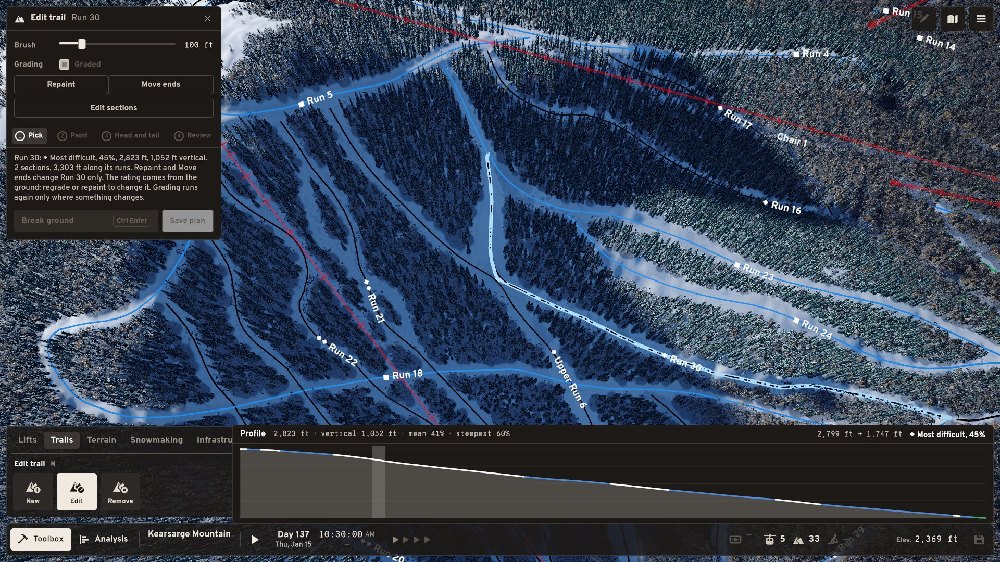 | Fixed, for review |
| 2 | The trail edit menu offers Graded or Natural as a choice. Make it a checkbox, so a natural trail can be graded after the fact; grading is a permanent decision (owner, 2026-10-27) | Toolbox › Trails › Edit, the trail's pane: the Graded/Natural switch (`TrailTool`) | Fixed: a Graded checkbox (New and Edit). NT47: a plan ticks and unticks freely, a built natural trail can be graded later, a built graded trail's box is ticked and locked, and the commands refuse to ungrade it. The trail bench's mixed run now goes in Natural and its edit grades it. 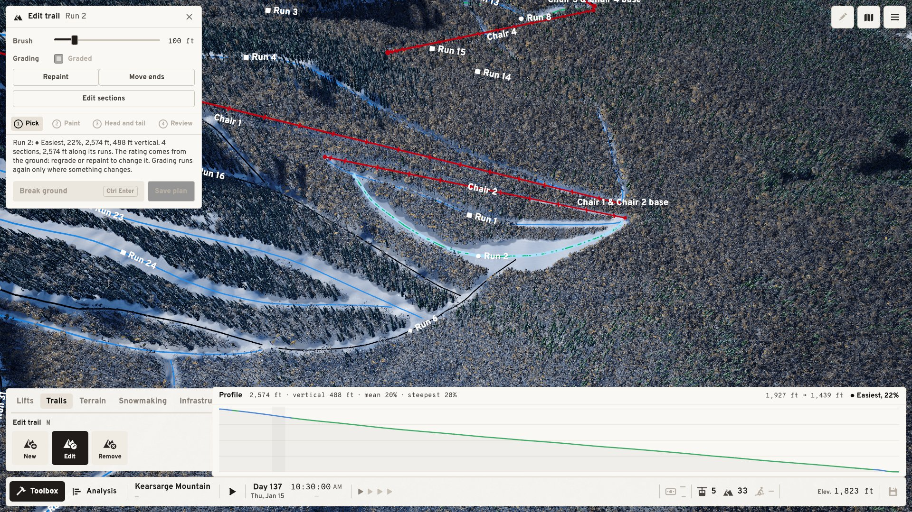 | Fixed, for review |
| 3 | Rename should not be an option (a button); renaming should always be available by clicking the name in the pane (owner, 2026-10-27, picture: Edit trail on Run 21) | Toolbox › Trails › Edit, the pane's Repaint / Move ends / Rename row and its Name field (`TrailTool`). 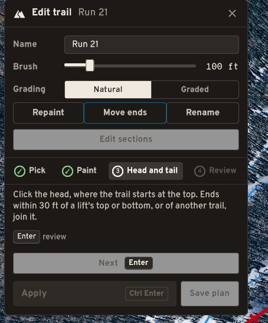 | Fixed: the Rename button and the Name row are gone; the window's title renames on a click (or F2), at once and as one undo step (a shaped trail as a trail, a run's own trail as the run). The trail card's name renames the same way, as the lift card's does. 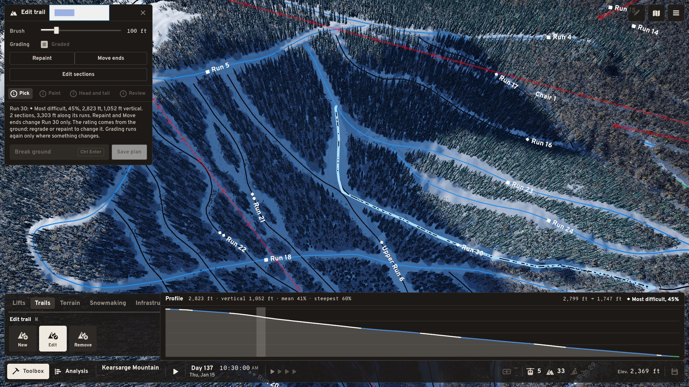 | Fixed, for review |
| 4 | Trails should be selectable in the main game screen, the way lifts are (owner, 2026-10-27) | The main view with no tool armed: a click on a trail (as a click on a lift does today) | Fixed: with no tool armed, a trail line within 8 px of the pointer lights its whole trail (lifts first), and a click (not a drag) opens its card. 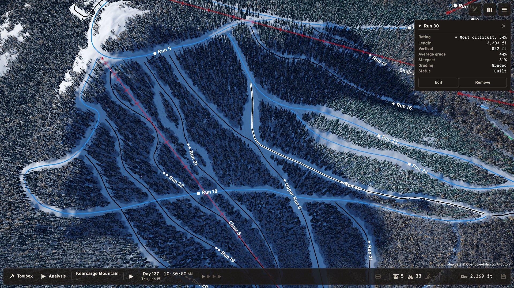 | Fixed, for review |
| 5 | When trails have their sections swapped, the trail lines should be redrawn. In the owner's picture Run 30 and Upper Run 6 don't overlap, but their lines look as if they do. Lines should make it clear which trail goes where; maybe some slight smoothing is needed (owner, 2026-10-27, picture: Run 30, Upper Run 6, Run 18 and Run 21 above Chair 5) | The map's trail lines (`TrailMapView`, drawn per painted run, not per resolved trail) where reworked trails meet or cross. 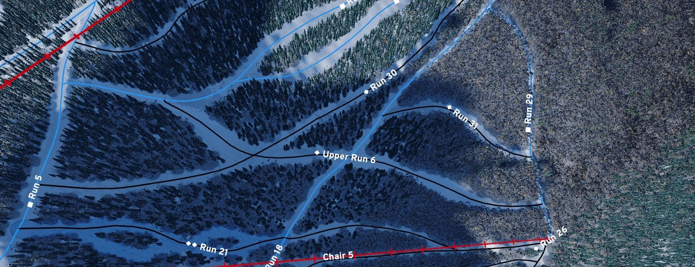 | Fixed: the map draws one line per trail, not per run, so a run shared by two trails is no longer one line; where a trail turns onto another run its corner is rounded over about 30 m, so two trails through one junction read as two curves. 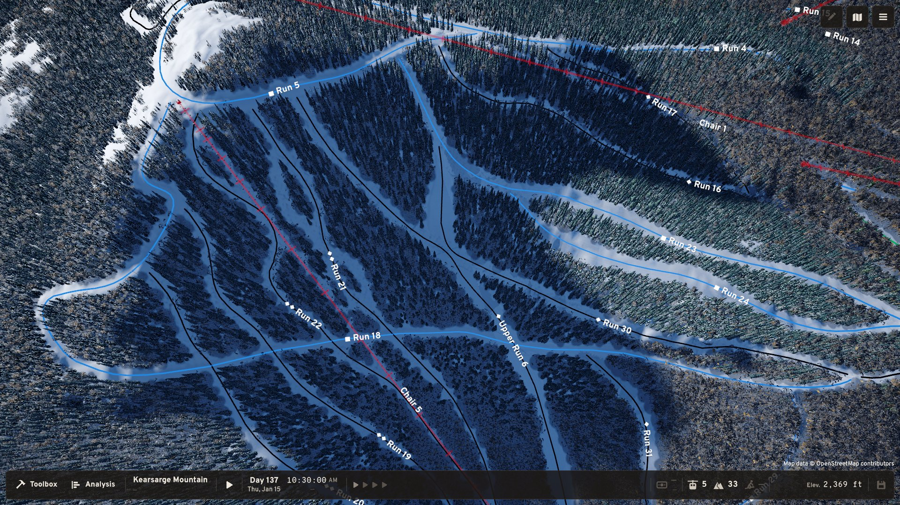 | Fixed, for review |
| 6 | Trail lines should stop short at each end, by about 50 ft, to leave space where the trail starts and ends; it looks cleaner (owner, 2026-10-27) | The map's trail lines (`TrailMapView`), at each trail's top and bottom | Fixed: each trail's line stops 50 ft short of its top and bottom (a short trail keeps its middle third); labels, the focus casing and the main-screen pick use the same line. Same picture as 5. | Fixed, for review |
| 7 | When the game loads, and on hover in the edit menus, runs show every paint stroke used to build them. Once a trail is built those strokes shouldn't exist. It feels strange to keep them instead of, say, a shape for the trail's clearing. Correct this in every phase of the game (owner, 2026-10-27; picture: Upper Run 6's strokes in beige) | The Edit trail outline (`TrailTool.DrawOutline`, which draws every stroke's two edges for the piece) and the saved model: a `Trail` piece keeps `Parts[].Strokes`, and the footprint and earthwork are rebuilt from them. 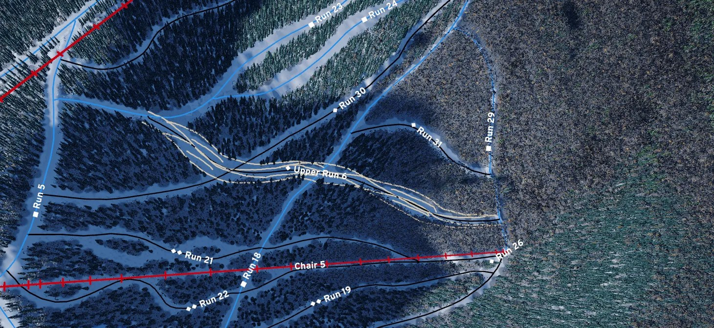 | Fixed (its own PR, save v8, NT48): a trail keeps its clearing's shape, not strokes. Strokes live only in the trail tool while painting; Repaint paints onto the trail's own clearing (every trail, split ones too) and the paint layer fills the clearing itself; the design overlay draws the clearing's outline. Saves before v8 convert once; an older save is regraded once on opening, in memory only, with a notice. Your Kearsarge save converts with no footprint cell changed and nothing moved; it doubles in size (307 KB to 616 KB). 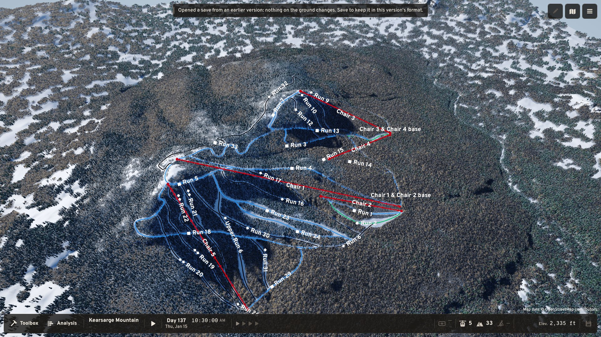 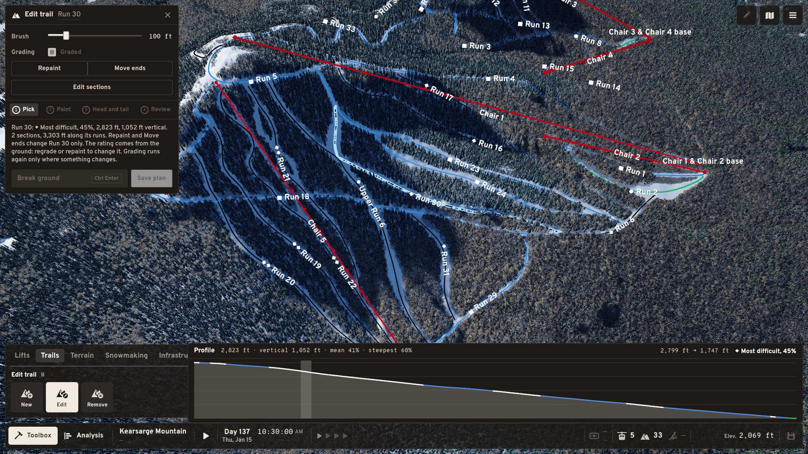 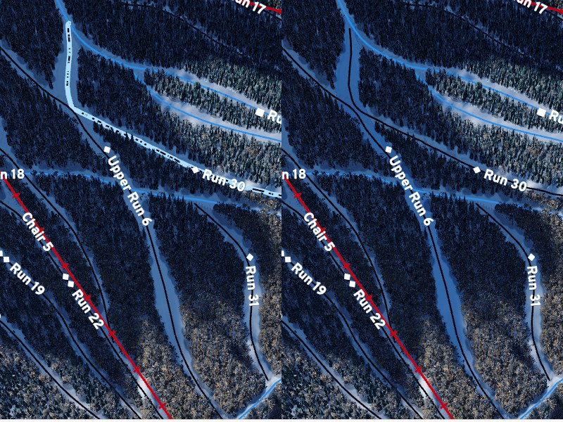 | Fixed, for review |
| 8 | Editing a name in place in a properties card looks weird; it's unclear whether it's a dark mode issue. The owner doesn't want a text box to open: they want to edit the name in place (owner, 2026-10-27; pictures: the Network view's Area card for "Chair 3 & Chair 4 base". In dark mode the open field is a white box whose text is hidden under a pale blue selection; in light mode a boxed field with the name selected; at rest, the underlined name)    | Every click-to-rename name: the Area card in the pictures, and the same name field in the trail card, lift card and tool window titles | Fixed: the name is typed in place. The field takes the name's spot, font, size, margins and width, with no box: no fill or frame, the name's underline, the hovered name's colour and the theme's own selection (Unity's pale blue is gone). One helper (InlineName) for the tool window title and the lift, trail and Area cards; the trail card's rating symbol stands apart, so the name doesn't jump. Picture: the trail card, then the Edit trail title, at rest and renaming, dark then light. 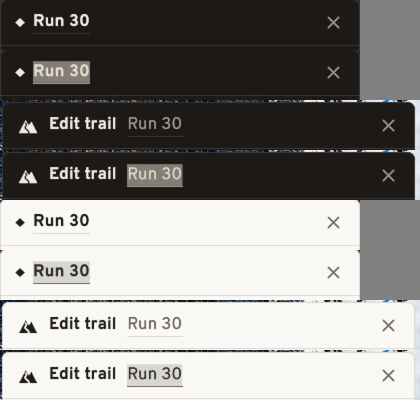 | Fixed, for review |
