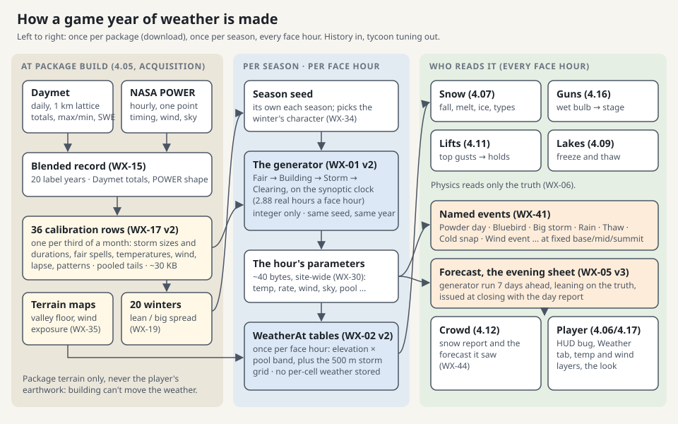
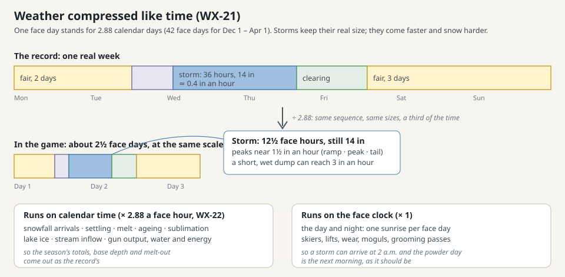
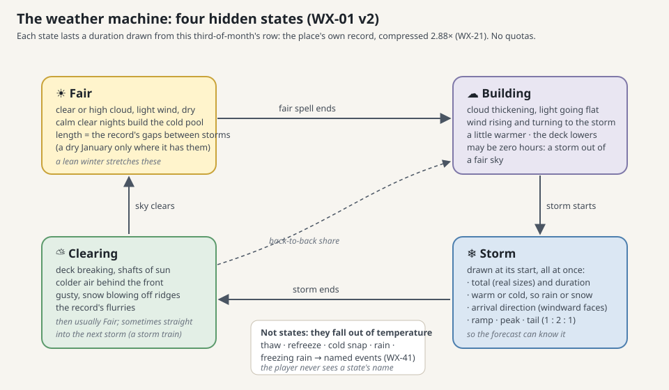
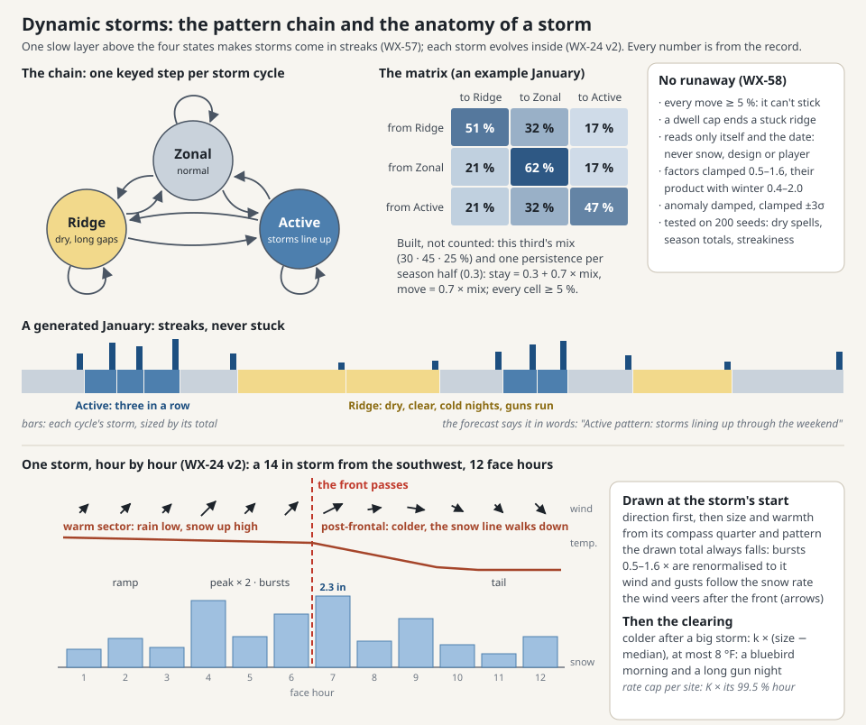
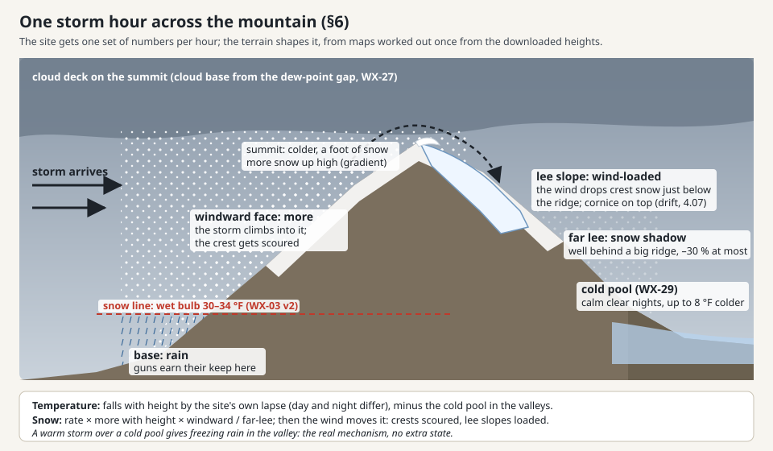
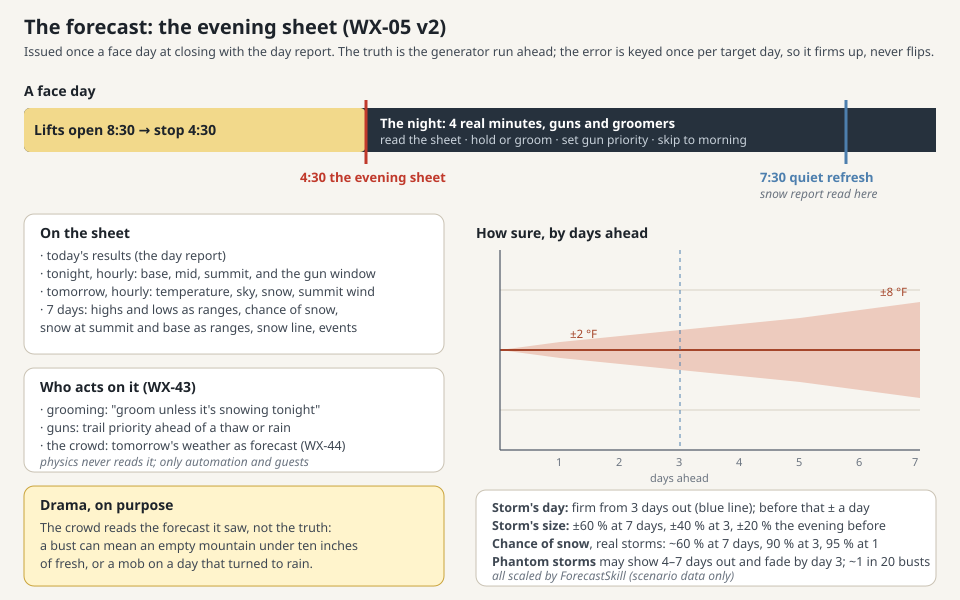

# Phase 4 · 04 Weather design

**Audience:** the project owner and coding agents. **Status:** ⛳ for the owner's approval. Decided in the design
interview of 2026-11-08 (two rounds by voice, plus a tycoon-fun adversarial review folded in); §15 records every
ruling. **Date:** 2026-11-08. **Plan:** [Phase 4 plan](phase3-13-phase4-plan.md), task 04, as revised by
[P4-02 simulation rules](p4-02-sim-rules.md) §13. **Sources:** the site's record (Daymet, NASA POWER), the MapLibre
game at `maplibre-final` (re-specified, never copied: [archive index](../reference/maplibre-archive.md)), and
[snow rendering design](snow-rendering-design.md).

**⛳** marks a gate: the plan waits there for the owner's approval.

## 0. How to read this document

- **Rules carry IDs** in 4.02's `WX` prefix. 4.02 owns WX-01…08; this document refines the ones 4.02 left to it
  (WX-01 v2, WX-02 v2, WX-03 v2, WX-05 v3, WX-07 v3) and adds **WX-10 onward**. Tests cite the ID
  (`WX33_SameSeedSameYear`). A rule holding a formula has a version; a behaviour change bumps it.
- **Imperial first, metric in brackets.** The simulation computes in its own integer units (WX-31).
- **"(tuned at 4.NN)"** marks a value the named task may change without a rule change; every such value is a named
  `Pacing` constant (SI-01).
- **Who implements what** is §14. 4.05 builds the data and the engine, 4.06 the look and the Weather tab, 4.07 the
  snow that reads it, 4.12 the crowd that reads it, 4.16 the guns, 4.17 the HUD and the evening sheet.

**The design in one paragraph.** The game's weather is a small machine that plays the site's own climate, fast. At
package build the real record (20 years of Daymet days and NASA POWER hours) is boiled down to 36 rows of tuning,
one per third of a month: how often storms come and how big they are, how long the fair spells run, how warm and
how windy, which way storms arrive, how temperature falls with height. At play the machine rolls a season from
those rows and the season's seed, hour by hour, with **weather compressed exactly as time is**: a face day stands
for 2.88 calendar days, so storms come 2.88 times as often per face day, last a third as long and snow three times as
hard, and the season's totals, storm sizes and dry spells come out as the record's. Nothing is replayed and nothing
is quota'd: a dry January happens where the record has dry Januaries. The map shapes each hour (colder and snowier
up high, rain at the base, more snow on faces that meet the storm, cold pooling in the valley on calm clear
nights), from static gradients worked out once. The player sees weather, never the machine: named events (a powder
day, a rain-on-snow, a cold snap), a forecast issued each evening with the day report that firms as the day nears,
a crowd that reads the snow report, and a mountain whose operations can be set to react to the forecast.

## 1. Sources and their terms

- **WX-10, the sources.**
  - **Daymet V4, daily, 1 km** (ORNL DAAC, single-pixel extraction service; no account or key). Variables `tmax`,
    `tmin` (°C), `prcp` (mm/day), `vp` (Pa), `srad` (W/m²), `swe` (kg/m²), `dayl` (s). Coverage: continental
    North America **including Alaska** (sparse stations there), most of Canada and Mexico, Hawaii and Puerto Rico;
    1980 to the latest complete year (4.05 checks the pixel answers at build rather than trusting a bounding box).
    Its calendar has 365 days: in a leap year December 31 is dropped. Daymet is station-interpolated with
    elevation, so its daily totals and temperatures at a mountain pixel are the best free daily truth we can get.
    It has no hours and no wind, and its day runs on the stations' observation times, not midnight (WX-15 v2).
  - **NASA POWER, hourly, point** (MERRA-2 based, about 0.5° × 0.625°; no account or key). Endpoint
    `/api/temporal/hourly/point`, at most 15 parameters a request, hours from 2001-01-01, in **local solar time**
    (`time-standard=LST`, the default). Parameters: `T2M`, `T2MDEW`, `RH2M`, `WS10M`, `WS50M`, `WD50M`,
    `PRECTOTCORR`, `ALLSKY_SFC_SW_DWN`, `CLRSKY_SFC_SW_DWN`, `CLOUD_AMT`, `PS` (11, under the cap). POWER owns what
    Daymet lacks: the shape of the day, the timing of precipitation within it, wind, humidity hour by hour and the
    sky. Its cell is far coarser than a ski area and smooths mountains flat, so its totals and temperatures are never
    used raw, and **it has no hourly gust** and its hourly rates are smeared (a 0.15 in day comes out as 15 hours of
    drizzle), so the generator takes gusts, bursts and peak rates from `Pacing` constants and fitted tails, never
    from POWER's hours (WX-17 v2).
  - **SNOTEL, a cross-check only** (NRCS Air and Water Database web service; free, no key; Western US). The nearest
    station within 15 km and ±300 m of `zref`, if any: its daily SWE and winter precipitation are recorded beside
    Daymet's in the manifest for 4.05's report (WX-07 v3). Never an input to the rows.
- **WX-11 v1, the record window (owner).** The **20 most recent complete label years** (October 1 to September 30)
  both sources cover: 20 of every third and 20 whole winters (WX-19), spanning 21 calendar years (Daymet lags POWER
  by a year or so; at a build in 2026 that is likely October 2003 to September 2023). The years are recorded in the
  package manifest; a rebuilt package recomputes. Older years are dropped on purpose: the player is skiing today's
  climate.
- **WX-12, terms and credits.** Both are free open data with attribution required; neither restricts commercial
  use as far as their pages state. The package records, and the Credits screen (P2-07) shows:
  - Daymet: *Thornton, M.M., R. Shrestha, Y. Wei, P.E. Thornton, S-C. Kao, and B.E. Wilson. Daymet: Daily Surface
    Weather Data on a 1-km Grid for North America, Version 4 R1. ORNL DAAC, Oak Ridge, Tennessee, USA*, with the
    DOI and the access date, plus the single-pixel tool's own citation (ORNL DAAC, DOI 10.3334/ORNLDAAC/2361).
  - POWER: *"These data were obtained from the NASA Langley Research Center POWER Project funded through the NASA
    Earth Science Directorate Applied Science Program"*, plus the data reference the project asks for, *"The data
    was obtained from the POWER Project's Hourly 2.x.x version on YYYY/MM/DD"*, with the version the API reports.
  - 4.05 confirms each DOI and version string at fetch and stores what the service returned, never a typed copy.
    POWER *asks* (does not require) to be told of redistribution and publications; whether to email them at release
    is the owner's call (§15 open question O1).
- **WX-13, outside Daymet (owner: US first).** Phase 4 serves US sites. A site outside Daymet still opens: its rows
  are built from POWER alone (POWER's daily sums and extremes as the anchor, lapse from WX-36's defaults) and the
  package is flagged **limited**, with one line on the Weather tab. **Later**, a better free anchor for the rest of
  the world: **TerraClimate** (monthly, about 4 km, 1958 to date, global, no account; its page states no licence, so
  4.05's successor must confirm terms before use) or **ERA5-Land** (hourly, 9 km, global, free but needs a Copernicus
  account). Since the record is calibration, not playback, a coarse monthly anchor is enough (owner: "the resolution
  of data can be a bit bigger").
- **WX-14, where we sample.** Daymet at the **reference pixel** (the one holding the box's centre; its elevation is
  the rows' reference elevation `zref`) and on a **1 km lattice over the box plus its 3 km surround** (up to 7 × 7 =
  49 pixels on a 2 km box, more on a 5 km box, capped at 81), for the elevation regressions (WX-17). POWER at one
  point, the box centre. The surround's 10 m heights (the offline surround buffer) give every pixel its own
  elevation check against Daymet's.

## 2. Blending: one daily-anchored hourly record

- **WX-15 v2, the blended record** (built in Acquisition at package build, off the game's threads). First the
  **observation-time lag**: Daymet's day follows its stations' reading times (often 7 a.m. to 7 a.m.), so the blend
  cross-correlates Daymet's daily `prcp` with POWER's 24-hour sums at lags 0, +12 and +24 hours, shifts POWER's day
  boundary to the best lag and records the lag in the manifest. Then, for each real day of the window, at the
  reference pixel:
  - **Temperature:** POWER's hourly `T2M` gives the day's shape; it is stretched and shifted so that the day's
    maximum and minimum equal Daymet's `tmax` and `tmin`. (POWER's absolute level, set by its cell's smoothed
    elevation, is discarded; no lapse correction is needed because Daymet is already at the pixel.)
  - **Humidity:** POWER's hourly dew point, shifted so the day's mean vapour pressure equals Daymet's `vp`, and
    never above the hour's temperature.
  - **Precipitation:** Daymet's `prcp` is the day's total. POWER's hourly `PRECTOTCORR` gives the timing: the
    total is shared over POWER's wet hours in proportion. If Daymet has precipitation and POWER has none that day,
    the total is shared over the day's hours with RH ≥ 85 % (else evenly over 24). If Daymet has none, the day is
    dry whatever POWER says.
  - **Wind and sky:** POWER's `WS50M`/`WD50M` (the free wind above the canopy, nearer to a ridge than 10 m), its
    `CLOUD_AMT` (%) around the clock, and in daylight the clearness index `ALLSKY ÷ CLRSKY` (0–1), as they are. The
    clearness index is 0 ÷ 0 for the 14 dark hours of a winter day, so **state boundaries use cloud amount** (WX-18
    v2) and clearness is kept only for the daytime sun (WX-40).
  - **Snow on the ground:** Daymet's `swe` per day, kept for the report beside the reference SWE model (WX-07 v3).
  - The 365-day calendar (LabelCalendar has no leap day): in a leap year Daymet keeps February 29 and drops
    December 31, and POWER has both. Both sources are **aligned by calendar date, never by index**; February 29 is
    dropped from both, and Daymet's missing December 31 is filled from its December 30. A leap-year fixture tests it.
- **WX-55 v2, blending checks** (4.05's fixture tests): the blended day's max and min equal Daymet's to 0.1 °F; its
  liquid total equals Daymet's to 0.01 in; its mean vapour pressure equals Daymet's to 1 %; no hour's dew point is
  above its temperature; the lag chosen is recorded, and the blended record's storm count is within 10 % of a count
  of Daymet's runs of wet days.
- **WX-16, missing stays missing.** A suspect or missing POWER hour (fill values) stays missing and is left out of
  every statistic; it never becomes zero rain or calm wind. A day without Daymet is dropped whole. The row records
  its sample counts; a row built from fewer than 60 % of its possible days is flagged in the manifest (4.05).

## 3. Calibration rows: history in, tycoon tuning out

The owner's rule for this section: **the algorithm takes the real weather history as its input and produces tycoon
tuning inputs as its output. There are no quotas.** Nothing forces a count of storms, thaws or dry spells: the rows
describe how this place's weather behaves, and the machine plays dice with them.

- **WX-17 v2, the rows are hierarchical (calibration review, 2026-11-08).** A third of a month holds about 400 days
  and 100–200 storms over 20 years: enough for a mean or a median, far too few for a tail, a 3 × 3 matrix or a
  per-direction effect, which would come out as noise. So the calibration has **two levels**:
  - **Pooled once per site** over the winter (November–April, or per season half where stated; n ≈ 400–600 cycles):
    the **shapes** of the distributions and their **fitted tails** (WX-31), the pattern chain's persistence and
    per-pattern effects (WX-57), the compass-quarter effects and the frontal and post-storm regressions (WX-24 v2,
    WX-25 v2), the per-site rate cap, the season character (WX-19).
  - **Per third of a month** (36 rows, October first; LabelCalendar's thirds): only **means, medians and scales**,
    plus the third's octant histogram and pattern mix. Each is **shrunk toward the level above** by its sample size:
    stored = (n × third + n₀ × parent) ÷ (n + n₀), with n₀ = 50 for a scale and 60 for a mean, so a thin third
    borrows from its neighbours instead of inventing a climate.
  - **The pooling ladder.** Every field records its n and the level it was estimated at: **third → month → season
    half → winter → site constant → default**. A field whose n at a level is below its minimum (30 events for a
    histogram or a per-quarter effect, 20 for a scale) moves up a level. If any December–March field has to pool
    past the month level, the site is flagged **limited** (WX-13's flag and line), so a thin record is said, not
    hidden.
  - **No windows on events.** Every gap, storm and cycle is assigned to the third of its **start hour** on the full
    record, and measured whole (a 9-day gap that starts on January 8 is a January-early gap of 9 days, never cut at
    the third's edge). The ±5-day smoothing applies to **daily fields only** (climate means, the anomaly, humidity).
  - **From `Pacing`, not the record**, because POWER can't see them (WX-10): the **gust factor by state**
    (`Pacing.GustFactorStorm` ≈ 1.6, within the 1.5–1.8 measured on ridge tops in storms; `Pacing.GustFactorFair` ≈
    1.3), the **burst spread** (`Pacing.BurstMin` 0.5, `Pacing.BurstMax` 1.6, WX-24 v2) and the **wind-vs-rate
    slope** (`Pacing.StormWindPerRate`, WX-24 v2). Stated as constants, tuned at 4.05, never claimed as the site's.
  - All values integers in the units given; the bytes are the rows' truth (WX-31). About 0.8 KB a row plus 2 KB of
    pooled fields: about 30 KB a site.

  | Group | Fields (units) | Level | Derived from |
  |---|---|---|---|
  | Climate | mean daily max and min at `zref` (0.1 °F); the 10 % quantile of daily max (0.1 °F, for Cold snap); the 24-hour diurnal shape for fair days and for storm days (‰ of the day's range, 24 + 24 values) | Third (daily, smoothed) | Blended record |
  | Temperature anomaly | its persistence per face hour, φ = φ_real^K, and its innovation spread × √(1 − φ²) (both Q16, 1/65,536, precomputed so the game takes no root or power); its stationary spread (0.1 °F, for the October 1 draw) | Third (daily, smoothed) | Daily mean minus the hour-of-day climate **and minus the state offsets** (residuals, so the variance isn't counted twice) |
  | Durations | Fair gap, Building, Clearing, Storm: the **Weibull scale** per third (real hours, shrunk); the **Weibull shape** per state | Scale: third; shape: site | WX-18 v2 |
  | Storm totals | the **log-normal median** per third (0.01 in, shrunk); the log-normal spread; the rank correlation between duration and total (‰) | Median: third; spread and correlation: site | WX-18 v2 |
  | Quantile tables | for each distribution above, the **fitted** 0.5, 1, 2.5, 5, 10, 25, 50, 75, 90, 95, 97.5, 99, 99.5 and 99.9 % points (WX-31), as the game reads them | Third (from its scale and the site's shape) | Fit |
  | Storm character | the arrival direction as an 8-octant histogram (‰); the storm-hour temperature offset, mean and spread (0.1 °F, against the hour-of-day climate) | Third, pooling up when n < 30 | WX-18 v2 |
  | Compass quarters | per quarter (storms from N, E, S, W ± 45°): a size factor (‰, clamped 500–1,600), a **warm-sector** and a **post-frontal** temperature offset (0.1 °F, de-diurnalised) | Winter, or site constant when a quarter has n < 30 | WX-24 v2 |
  | Patterns | the third's pattern mix (‰ × 3) and the derived 3 × 3 matrix (‰ × 9); per season half the persistence ρ (‰); per pattern the gap factor and size factor (‰, clamped 500–1,600), the temperature lean (0.1 °F) and, where n ≥ 30, a direction histogram; the dwell cap (cycles) | Mix and matrix: third; the rest: season half or winter | WX-57 |
  | Post-storm cold | the slope `k` of clearing temperature on storm size (0.1 °F per 0.1 in above the median, capped so it never exceeds 8 °F) | Winter | WX-25 v2 |
  | Rate cap | K × the fitted 99.5 % real hourly rate (0.01 in per face hour), floor 0.40 in | Site constant | WX-24 v2 |
  | Back-to-back | the share of storms that follow a clearing straight into building again (‰) | Third, shrunk | WX-18 v2 |
  | Humidity | mean dew-point depression by state (0.1 °F) | Third (daily, smoothed) | Blended record |
  | Wind | mean free wind and its spread by state (0.1 mph); direction histograms for fair and clearing (‰) | Third, pooling up when n < 30 | POWER |
  | Sky | mean cloud amount by state (‰) for both day and night; mean daytime clearness by state (‰) | Third | POWER |
  | Lapse | daytime and night-time temperature lapse (0.01 °F per 100 ft); dew-point lapse (same, from `vp`); precipitation gradient (‰ per 100 ft, wet days); each with its n in days and, for the night lapse, how often it hit the floor (WX-36) | Third (daily, smoothed) | Daymet lattice (WX-14), WX-38 |
  | Targets | WX-07 v3's rows | Third and month | Record |
  | Site constants | the reference points' elevations (WX-35); `PowderDayIn` (WX-41); the observation lag (WX-15 v2); the season character table (WX-19) | Site | Terrain; record; a calibration play |

- **WX-18 v2, finding the states in the record.** Storms are found **by day on Daymet, then timed by hour on
  POWER**, so neither source's artefacts make or break a storm:
  - A **wet day** is a Daymet day with ≥ 0.05 in. A run of consecutive wet days is **one storm**, unless POWER shows
    a dry gap of ≥ 12 hours inside it (then two). A storm's total is its days' Daymet totals.
  - Within its days the storm is **timed** from POWER's blended hours (WX-15 v2) at a shaping threshold of
    0.004 in/h (MERRA-2 smears precipitation thin, so an hourly 0.01 in/h test would delete most dry-climate snow
    days), allowing dry gaps of up to 3 hours: its start, end and duration in real hours. Less than 0.05 in on a day
    is a flurry, credited to the state around it.
  - **Building** is the run of hours before a storm in which cloud amount is above 60 % or the wind is rising,
    capped at 24 real hours; **Clearing** the run after it until cloud amount is back below 60 % and the wind below
    the third's mean, capped at 36 real hours; **Fair** is everything else.
  - A **storm cycle** is a Fair spell plus the Building, Storm and Clearing that end it; each cycle is labelled for
    the pattern chain (WX-57). Every gap, storm and cycle belongs to the third of its **start hour** (WX-17 v2).
  - These four are the only states (WX-23); thaws, refreezes, cold snaps and rain fall out of temperature and phase
    (WX-41). The archive's five air masses and per-month transition matrix are dropped (§13).
  - Fixture tests (4.05): detected storm days ÷ Daymet wet days ≥ 0.9; Clearing ends are not concentrated in
    daylight hours (their share in the 10 daylight hours is under 60 %), which would mean the night was misread.
- **WX-19 v2, the season character table.** For each of the window's 20 winters (October–April, WX-11), two numbers: the
  winter's total liquid as a share of the 20-year mean (‰) and its mean temperature anomaly (0.1 °F). Twenty pairs,
  80 bytes. They keep the record's real spread and its real coupling (cold winters that are also snowy, or not) for
  WX-34. This is the record's year-to-year variety, not a replay: two numbers per year, never its days.
  - **Shrunk before storing (v2, calibration review).** A winter's share already contains the storm-to-storm luck the
    generator will add again, so stored raw it would make season totals too spread out. Each share is pulled toward
    1.0 by √(1 − σ²sampling ÷ σ²record), where σ²sampling is the spread of season totals the rows alone would give
    (computed at calibration by playing the rows with the character switched off, 200 seeds) and σ²record is the
    record's; likewise each temperature anomaly. If the rows alone already spread as much as the record, the shares
    become 1.0 and the character carries temperature only. Test (WX-07 v3): over 200 seeds the generated
    season-total coefficient of variation is within ±15 % of the record's.
- **WX-20, between thirds.** The machine reads the row of the label date's third, blended linearly with the
  neighbouring third by the date's distance from the third's middle (integer weights), so January doesn't change
  climate at midnight on the 11th.
- **WX-07 v3, the targets and how they are tested (refines 4.02's WX-07; v3 from the calibration review).** Per
  third and per month, for checking, never for forcing: mean temperature; total liquid and snowfall (at `zref`);
  storm count; thaw days (max > 40 °F) and rain days; the clustering of storms (WX-58); **peak snow on the ground and
  its date** (owner Q1: base depths and how long you can stay open must look real); and the
  **precipitation-by-elevation** of the Daymet lattice pixels. At `WinterScale` typical, the tests come in **two
  parts**, because one band can't tell a generator bug from twenty years of luck:
  - **(a) The generator against its rows** (catches code bugs). Over 200 seeds on the fixture, each statistic is
    compared with the value the rows themselves imply (their means, medians and fitted distributions), band ±5 %
    for totals, counts and durations and ±0.5 °F for temperature.
  - **(b) The rows against years they didn't see** (catches calibration bugs). Leave one year out: build the rows
    from 19 years, generate, compare with the 20th; repeat for each year. **Gates only on season totals (±10 %) and
    monthly aggregates** (liquid ±15 %, temperature ±2 °F, storm count ±20 %). Per-third numbers are reported with
    the rows' own leave-one-out spread as the stated noise floor, not gated: with 20 years, a ±15 % band per third
    would fail about 9 of 36 thirds on sampling noise even for a perfect generator.
  - **Snow on the ground.** Daymet's `swe` is itself a model, with 20–50 % errors in mountains, so it can't be the
    gate. One **shared reference snow model** (a degree-day accumulation and melt, the same code, fixed constants)
    runs on the blended record's hours and on the generator's: its peak from the generator is within ±15 % of its
    peak from the record and within one third of the date. Daymet's SWE and, where there is one, the nearest
    SNOTEL station's (WX-10) are recorded beside it, report-only; the manifest records the Daymet ÷ SNOTEL winter
    precipitation ratio and flags it outside 0.7–1.4 (the site's anchor may be off; 4.05 reports it, the owner
    decides).
  - **Thin sites.** Where a field's n is small (shoulder thirds; the Southern Appalachians' few big storms),
    `PowderDayIn`'s share test (WX-41) and the compass-quarter effects are reported, not gated.
  - Freezing rain is tracked, not fitted (the record can't see the warm layer aloft): on the fixture it happens on
    0–3 face days a typical season. A miss is a calibration bug, fixed in the rows' derivation, never by a quota.

## 4. Weather runs on the calendar, compressed like time

The owner's ruling (Q17, superseding an earlier size-and-frequency split): *storm frequency over duration; use
really high snowfall rates to make storms feel bigger and more impactful, while not making them linger for days;
because we compress time, we compress weather events accordingly; it is a tycoon now, not a simulator.*

- **WX-21, the synoptic clock.** The face clock's season is 42 face days for 121 calendar days (TM-08), so one face
  hour stands for **K = 121 ÷ 42 ≈ 2.88 real hours** (`Pacing.SeasonCalendarDays ÷ Pacing.SeasonDays`, derived,
  never typed). The weather machine keeps a synoptic clock in integer units: each face hour advances it **121
  units**, and **a real hour is 42 units**, so every duration from the rows (real hours) is converted exactly with no
  rounding drift. States, storms and the temperature anomaly run on this clock; **the diurnal cycle alone runs on
  the face clock** (one night and one day per face day, the sun of WX-04).
  - So a real 36-hour, 14 in storm is a **12½ face-hour, 14 in storm, snowing about 1½ in an hour at its peak**
    (a short, wet 24 in dump reaches 3 in an hour and more); a real
    5-day fair spell is under 2 face days; a 3-week January drought, where the record has one, is a week of face
    days. Storm sizes, season totals and dry spells are the record's; only their speed changes.
  - The same K holds before and after the season (October, November, summer: TM-14's days nobody skis), so the
    weather year is one clock.
- **WX-22, what else runs at K (cross-task, supersedes 4.02 §2's "snow, water and money are tuned to the game's
  own days").** Anything that integrates weather over time must integrate over the same calendar time, or the
  season's base depth and melt-out go wrong. Per face hour, ×K: **compaction (SN-08), melt in all three terms
  (SN-09), refreeze and holding water (SN-10), sublimation (SN-12), age in the quality term (SN-16, SN-18), lake ice
  growth and melt (LK-*, 4.09), stream and catchment inflow (WS-03, WS-04), evaporation (SI-10's water ledger)**, and
  (owner's Q19 left as guessed) **gun output and the water it draws (SG-05, SM-03)**: a face hour of a gun is K real
  hours of its snow, so the player's cold hours buy the share of the mountain they buy in real life.
  `Pacing.SnowmakingTimeScale` (default K) is 4.16's to tune. **SI-10's operations ledger follows its source:**
  gun-hours, compressor-hours and pump energy go ×K with the guns and pumps, so snow per gallon, per gun-hour and
  per kWh in the day report read as real (a test checks they don't change with K); groomer-hours, lift-hours and
  lift rides stay ×1 (motion clock). **Not ×K:** anything on the motion clock (skier passes, wear, moguls, grooming
  passes, lift rides) and anything per event (a groomer pass per night). Each owner
  task re-versions its rule when it builds it (SN-09 v2, SG-05 v2, …); none is a format change. SM-07's acceptance
  numbers get re-derived by 4.16.

## 5. The generator

- **WX-01 v2, the states (refines WX-01).** Four states, cycling **Fair → Building → Storm → Clearing → Fair**,
  each held for a duration drawn from its row's fitted quantiles (WX-17 v2, WX-31 v2) on the synoptic clock. Two shortcuts come from the
  record: a Clearing goes straight to Building with the row's back-to-back share (storm trains), and a Building may
  be zero hours long (a storm out of a fair sky). 4.02's "thaw" and "refreeze" are no longer states: a thaw is a warm
  stretch and a refreeze its night (WX-25), and both are named events when they happen (WX-41). "Storm cycles
  2–3 face days" becomes "cycles as the record has them, compressed" (WX-21). Above the four states sits one slower
  layer, the **pattern** (WX-57), which sets how the next cycle's fair spell and storm come out, so storms arrive in
  streaks as they do in a real winter.
- **WX-23 v2, a state change.** When a state's synoptic units run out, the next state starts **with the leftover
  units carried** (a negative remainder shortens it), and its duration is drawn then; several changes may happen
  inside one face hour, and the hour reports the state it ends in plus any liquid from storm units inside it. So
  short states keep their real length on average and the storm count isn't biased by rounding (tested against WX-07
  v2's storm count). When a **Fair** spell begins, the pattern chain steps first (WX-57); the spell's duration is
  then drawn from the third's fitted gap distribution (WX-17 v2) × the new pattern's gap factor ÷ √share of the
  season character (WX-34): long dry spells come only where the place has them, and mostly under a ridge. Durations
  are drawn in real hours and converted (WX-21).
- **WX-56, the start of the weather year.** At **00:00 on October 1** of every label year (and when a new game's
  clock starts, at October 1's opening), the generator is re-initialised from that season's seed alone: Fair, with a
  keyed duration; the anomaly drawn from the row's stationary spread; pool 0; the season character drawn (WX-34);
  the first pattern drawn from October-early's pattern mix with its dwell count at 0 (owner Q24: the chain resets
  with the year). No
  state carries from the previous September, so year N's weather never depends on year N − 1's seed. A new game
  starting at the opening runs the first hours of October 1 from midnight, so it gets the same hours a played year
  would. **A seed changed mid-year** (a dev pin, or the resort seed changing in `SetDesign`, SI-15) re-runs the
  site-level generator from that October 1 under the new seed to the current face hour (≈ 3,000 hours × < 0.01 ms),
  so the hour after the change is the hour that seed would have given.

- **WX-57 v1, the pattern chain (owner, 2026-11-08: "storminess is a great metric… something of a probability
  matrix… no runaway feedback loops… a cool weather pattern is part of making a fun tycoon").** Real winters come in
  streaks: a stuck ridge and ten dry days, then the storm door opens and three storms line up. One slow layer above
  the four states gives the machine that streakiness, from the record:
  - **Storminess and the three patterns (owner Q21: three).** In the record, each storm cycle (WX-18 v2) gets a
    **storminess**: its liquid ÷ its length in days, ÷ the third's mean liquid per day. Below 0.5 it is a **Ridge**
    cycle (a long gap, a small storm, or both), above 1.5 an **Active** one (a short gap, a big storm, or both), else
    **Zonal**. The third's **pattern mix** is the share of its cycles under each (shrunk, WX-17 v2). Arctic cold isn't
    a fourth pattern: it comes from the anomaly and the Ridge's cold lean (WX-25 v2).
  - **The matrix, derived, not counted.** Counting 9 transitions per third from 20 years would be noise, so the
    record gives one number per **season half** (November–January, February–April): the **persistence** ρ, how
    often a cycle's pattern repeats beyond chance, pooled over all the half's cycles (ρ = (same − Σπ²) ÷ (1 − Σπ²),
    standard error about 0.04; the lag-1 autocorrelation of storminess is recorded beside it as a check), clamped
    0–0.7. Each third's 3 × 3 matrix is then **built** from ρ and its mix π: stay with ρ + (1 − ρ) × π(self), move
    to another pattern with (1 − ρ) × π(that one). Every entry is floored at **5 %** and the row renormalised (in
    ‰, integers). This is the owner's probability matrix, one the record can actually support: its long-run mix is
    the record's, its streakiness is the record's.
  - **When it steps (owner Q22: per cycle).** Once per cycle, **when a Fair spell begins**, by a keyed draw (SI-06,
    a new `pattern` tag, the cycle's ordinal) against the matrix of the label date's third. The **dwell cap** guards
    the tail: when a pattern has held for its cap (the run length the chain itself exceeds 1 % of the time, at least
    3 cycles), the next step must leave it (the draw is made over the other two, renormalised). It only cuts a tail
    the record doesn't have.
  - **What a pattern does** (each from the pooled winter, per season half where n allows, and each **normalised so
    the third's mix-weighted mean is neutral**: the patterns move dry time and snow between cycles, never add or
    remove it on average):
    - the **gap factor** on the Fair spell's duration (Ridge long, Active short; the gap distribution's shape is fitted
      to gaps divided by their pattern's factor, so the mixture has the record's spread, not more);
    - the **size factor** on the storm's total (typically Active × 1.2–1.4, Ridge × 0.6–0.8; clamped 0.5–1.6);
    - a **temperature lean** (0.1 °F, the mean de-diurnalised anomaly under that pattern: a midwinter ridge is often
      cold, clear and inverted; an active pattern runs warm at a Pacific site and cold under northwest flow);
    - a **direction histogram** where the record has ≥ 30 storms under that pattern, else the third's.
  - **Reset with the year (owner Q24).** WX-56 draws October 1's pattern from the third's mix; nothing carries from
    September, so "same seed, same year" stays exact.
  - **Told to the player in words (owner Q23: the line and the strip).** The evening sheet carries a **pattern
    outlook** line read from the forecast's run-ahead ("Active pattern: storms lining up through the weekend",
    "A ridge is building: dry and cold for several days", WX-05 v3), and the season strip shades the patterns the
    season has lived (WX-46). Forecaster's words, never a probability; the four states stay unnamed.
- **WX-24 v2, a storm.** When Storm starts it draws, at once (so the forecast can know them, WX-05 v3):
  - **first, its arrival octant** from the pattern's histogram (or the third's), and a direction within it: where it
    comes from is its personality (owner, 2026-11-08: "these give storms character and help users plan");
  - its **duration** and **liquid total** from the third's fitted tables (WX-31), with the site's rank correlation
    (a long storm is usually a big one), times its quarter's size factor, the pattern's size factor, the season
    character (WX-34) and `Pacing.WinterScale`; **the product of the four factors is clamped to 0.4–2.0**, so stacked
    factors never make a storm the record couldn't;
  - its **front**: a **frontal hour** drawn in the middle half of its face hours. Before it the storm's temperature
    offset is its quarter's **warm-sector** value, after it the **post-frontal** value (both de-diurnalised, WX-17
    v2), plus one draw from the third's spread for the whole storm, eased across one face hour. So a southwest storm
    can rain at the base at noon and the snow line walks down the mountain by evening: the classic storm-day story,
    and at a place where the northwest storms are the cold, light ones, they are here too;
  - its **veer**: from the frontal hour to its end the direction turns toward a clearing direction drawn from the
    third's clearing histogram (fronts turn: southwest ahead, northwest behind), so the windward face gets the storm
    and the other side is loaded as it clears (SN-07);
  - its **shape, with bursts and lulls**: each face hour's weight is the ramp (first quarter), peak (middle half) and
    tail (last quarter) weight 1 : 2 : 1 **times a keyed burst factor** in `Pacing.BurstMin`–`BurstMax` (0.5–1.6),
    and the weights are renormalised to the drawn total by largest remainder in 0.01 in. A storm of 3 face hours or
    fewer skips the ramp and tail. The face-hour rate is capped at the site's **rate cap** (WX-17 v2: K × the fitted
    99.5 % real hourly rate, never below 0.40 in of liquid, 3–7 in of snow by SN-05's ratios), so a Sierra
    atmospheric river can dump at its own rate and a Colorado storm never reaches the cap. Excess over the cap moves
    to the storm's lightest hour still under it; if every hour is capped the storm is lengthened by whole face hours.
    **The drawn total is always what falls**, and is what the forecast talks about;
  - **wind that follows the snow**: each storm hour's free wind is the storm's drawn speed × (1 +
    `Pacing.StormWindPerRate` × (the hour's weight ÷ the mean weight − 1)), clamped 0.6–1.6 ×, and its gust factor
    rises with it from `Pacing.GustFactorStorm`, so the heaviest bursts are the gustiest and the lift holds come with
    the best snow.
  - **Clearing** carries the record's flurries: the third's share of liquid that fell in clearing hours, spread
    evenly over them. Fair and Building are dry.
- **WX-25 v2, temperature at `zref`.** Each face hour: the third's climate (WX-20) on the diurnal shape + the slow
  **anomaly** + the state's offset + the **pattern's lean** (WX-57) + the season's offset (WX-34).
  - **The diurnal shape** is a blend of the fair-day and storm-day shapes by a storm weight that moves linearly to 1
    over 2 face hours after a storm starts and back to 0 over 2 face hours after it ends, and every state's offset is
    eased the same way. Because the offsets were measured against the hour-of-day climate (WX-17 v2), a compressed
    storm that starts mid-afternoon causes no 6–10 °F step.
  - **The state's offset**: the storm's warm-sector or post-frontal value (WX-24 v2); Building warms and Clearing
    cools by the third's offsets; and **after a big storm the clearing is colder**: the Clearing offset −
    `k × (storm total − the third's median)`, `k` from the record's pooled regression (WX-17 v2), the extra cold
    capped at 8 °F and never a warming. Big dump → crisp bluebird → a long gun night.
  - **The anomaly** is a persistent random walk stepped once per face hour (anomaly ← φ × anomaly + innovation ×
    keyed normal draw, with the row's Q16 coefficients already raised to K, WX-17, so the game does no root or
    power), **clamped at ±3 × its stationary spread** (WX-58). Its residuals were measured net of the state offsets
    and the pattern lean, so nothing is counted twice. Thaws (a warm anomaly meeting a fair afternoon), cold snaps (a
    cold anomaly under a ridge, after a clearing) and January rain all come from here.
- **WX-58 v1, stability guards: no runaway (owner, 2026-11-08).** Streaks yes, stuck no. Each guard and its test:
  - **The chain can't stick:** three patterns, every transition ≥ 5 %, so it is finite and ergodic; the dwell cap
    ends a run the record doesn't have. Unit tests: no row has an entry under 50 ‰; no generated run exceeds its cap.
  - **Nothing feeds back.** The pattern reads only itself, the calendar and its keyed draws; the states read the
    pattern; the snow, the design, the guests and the player are never read (WX-08). The post-storm cold acts on one
    Clearing's offset, never on the anomaly, so a run of big storms can't ratchet the season colder; the anomaly is
    damped (φ < 1, checked at calibration) and clamped at ±3σ.
  - **Every multiplier is clamped**: pattern and quarter factors 0.5–1.6, their product with the character and
    `WinterScale` 0.4–2.0, the character's share within the record's own range (WX-34), the rate cap per site.
  - **Acceptance over 200 seeds on the fixture** (4.05): the generated pattern mix within ±5 points of each third's;
    the 99 % point of generated dry spells within ±20 % of the fitted 99 % (per month); no season's total outside
    0.5–1.8 × the record's mean; and the **clustering statistic** (the variance ÷ mean of storms per 10-face-day
    window, per season half; 1.0 is "evenly random", higher is streakier) within ±20 % of the record's: streaky
    enough, never stuck.

- **WX-26, dew point at `zref`:** temperature minus the state's depression (row), never above the temperature. Near
  saturation in storms, dry in fair weather.
- **WX-27 v2, the sky.** **Cloud cover** (%) by state from the row (POWER's cloud amount, day and night, WX-15
  v2) with a keyed hourly wobble; by day, **clearness** (‰) for the sun (WX-40) from the row's daytime clearness by
  state, with the same wobble; **cloud base** above `zref` = **228 ft per °F** of dew-point depression (the lifting
  condensation level, 125 m per °C; a test pins 10 °F → 2,280 ft) so a storm's deck sits on the summit and a clearing
  lifts it; **visibility** (mi) from the precipitation rate
  and phase (heavy snow ¼ mi and under) and fog (WX-29).
- **WX-28 v2, the free wind.** Speed by state from the row with a keyed hourly draw, and in a storm following the
  snow's bursts (WX-24 v2); direction: a storm's own, veering after its front (WX-24 v2), and the Clearing continues
  from where the storm's veer ended; else the state's histogram (fair days light and variable, clearings from the
  record's clearing quadrant). The **gust factor** is a `Pacing` constant by state (`GustFactorStorm` ≈ 1.6,
  `GustFactorFair` ≈ 1.3, WX-17 v2: POWER has no hourly gust), raised in a storm's heavy hours, × a keyed hourly
  ±10 %.
- **WX-29, the cold pool.** One number per hour, the **pool strength** (0.1 °F at the valley floor). It builds by
  `Pacing.PoolBuildPerHour` in each night hour that is clear (cloud cover < 30 %) and calm (free wind < 8 mph), up
  to `Pacing.PoolMax = 8 °F` (tuned at 4.05); after sunrise it burns off over 2 face hours; under cloud it fades
  slowly (half each 6 face hours), and it is scoured in an hour only when the **wind at the valley floor** (the free
  wind × the sheltered exposure factor, WX-39: 0.4) exceeds 15 mph, i.e. a free wind above about 37 mph. Because it fades slowly
  under cloud, a warm storm arriving after a cold calm spell rides over cold valley air: that is how freezing rain
  happens (WX-38). When the pool is strong and the depression is under 2 °F the valley floor has **fog** (for 4.06).
- **WX-30, the hour's parameter set** (the contract WX-02 needs; one per face hour, site-wide, about 40 bytes):
  label third weights, state, the pattern, temperature and dew point at `zref`, the lapse coefficients for the hour
  (day or night, WX-36), pool strength, liquid rate at `zref`, the storm's arrival direction and whether its front
  has passed, free wind speed, direction and gust factor, cloud cover, clearness, cloud base, visibility, a fog flag,
  the season offset. Everything over the map (§6) is a pure
  function of this set and a cell's static inputs.
- **WX-31 v2, integers and keyed draws (owner Q11).** The generator works entirely in integers: tenths of °F,
  hundredths of an inch of liquid, tenths of mph, per-mille shares, the synoptic units of WX-21. Every random number
  is a keyed hash (SI-06) of (table version, season seed, tag, face hour or storm ordinal, ordinal), turned into a
  draw by **inverse lookup in integer quantile tables** (the rows' quantiles, and one fixed 256-entry standard-normal
  table in the code); no `Math.Exp`, `Pow`, `Sqrt` or trig on the generator's path. Transcendental work happens once,
  at calibration, and is stored in the rows. New `Simulation` tags (registered in 4.05, never reused): weather state,
  storm, anomaly, wind, sky, forecast, season character, almanac, pattern, burst. Display rounds to whole °F, snow to
  0.1 in and liquid to 0.01 in (WX-49).
  - **Fitted tails, not counted ones (v2, calibration review).** The quantile tables hold the points of a **fitted**
    distribution, never the record's own order statistics: storm totals log-normal, gaps and durations Weibull, the
    shape pooled per site and the scale per third (WX-17 v2), out to the 99.9 % point. Between table points the
    draw interpolates linearly; past 99.9 % it is clamped there. So a 200-season game can see a storm a little bigger
    or a drought a little longer than the 20 years held, as a real place would, and a third's tail never rests on its
    two biggest storms. 4.05 tests each fit against the record (a Kolmogorov–Smirnov distance under 0.1 at the site
    level) and records the fit's parameters in the manifest.
- **WX-32, the state and the save.** The generator's state is a few dozen integers: state, synoptic units left,
  the current storm's draws (including its frontal hour) and its hour index, the anomaly, the pool strength, the
  storm weight of the diurnal blend, the pattern and its dwell count, the cycle ordinal, the season character, the
  label year.
  It is saved in the sim sidecar (SI-12; 4.05 takes the `SidecarVersion` bump through the coordinator). The forecast
  is not saved: the sidecar keeps the face hour of the last issue, and the issue is recomputed exactly by re-running
  the generator from October 1 to that hour (WX-56) and ahead; a test saves at 10 PM, reloads and finds the forecast
  fields byte-identical.
- **WX-33, same seed, same year (WX-08 kept).** The weather is a function of (the package's rows, the season seed,
  the face hour) and nothing else: never the design, the snow, the skiers, the speed or a skip. A golden in
  `Tests/Core` generates a whole label year of hour sets from fixture rows and a seed, from WX-56's reset, and pins
  the hash; being
  integer, **it is byte-identical on CoreCLR, Mono and IL2CPP** (unlike SI-08's field goldens). The rows' bytes come
  from the package, whose id and manifest version are in the replay header (SI-22).
- **WX-34 v2, the season's character.** At October 1 of each label year the season's seed (SI-15 v2) picks one of
  the record's 20 winters from WX-19 (its shrunk shares, WX-19 v2) and adds a small keyed jitter (±10 % liquid, ±1 °F), the share clamped to the
  record's own lowest and highest: storm totals are × √share and Fair spells × 1/√share (so both size and frequency
  carry half of it; √share is a Q16 table value from calibration), and its anomaly is the season's temperature
  offset. So a lean winter and a big winter both happen, as often as the place has them,
  and a second season is a different winter. The character is never shown as a number; the Almanac hints at it
  (WX-48) and "season so far vs normal" reveals it (WX-46).
  - **`Pacing.WinterScale` (lean / typical / big)**, owner Q8: lean = liquid × 0.75 and +3 °F, big = × 1.25 and
    −3 °F (more of the precipitation falls as snow). **`Pacing.ForecastSkill` (sharp / normal / poor)** scales WX-05
    v3's wobble and its pull toward normal (1 − w) × 0.6 / 1 / 1.6. **Both are scenario data and dev switches only (TM-16): no menu, no player control of
    the weather** (owner Q16). They apply on top of the character; WX-07 v3's acceptance is at typical only.

## 6. The weather over the map

All of this is the shared pure function `WeatherAt(hourParams, staticCell)` of WX-02, evaluated once per face hour
into tables, never stored per cell.

- **WX-35 v1, the static inputs, from the package's terrain only.** Computed once per package (at build, or at
  first open, cached in the terrain cache; engine-free) from the downloaded heights, **never from the player's
  earthwork**, so no design can move the weather (WX-08) and no pit can be dug to farm a warmer night:
  - the **reference points**: base = the 10th percentile of the box's elevations, summit = its 95th, mid = halfway,
    each with its `hvf` and exposure; named events, alerts, the crowd's reads and the forecast's base/mid/summit
    lines use these, never lift positions;
  - per 8 m cell, **height above the valley floor** (`hvf`): the cell's elevation minus the lowest within 1 km (a
    running-minimum filter), in 1 byte at 10 ft steps (0–2,550 ft, continuous for the pool's profile);
  - per cell, the **exposure class** (8 classes) from the package heights' ridge exposure (SN-01's 7 × 7 rise, on
    the untouched terrain) and `hvf`: valleys sheltered, ridges and summits exposed;
  - on a **coarse 500 m grid over the box and its surround** (WX-02's ≥ 500 m; ≤ 576 cells, 22 × 22 for a 5 km box),
    per arrival octant, the **orographic factor** (v2, owner 2026-11-08): from the upwind terrain within 3 km (the
    surround buffer), cells the storm climbs into get more (up to +40 %); the first `Pacing.SpilloverReach = 1 km`
    past a crest gets **spillover** (snow still falling as it blows over: never below 1.0, up to +10 % just behind
    the crest); only beyond that, behind a ridge that stands well above the cell, does the **snow shadow** set in
    (down to −30 %, growing with the barrier's height). Then each octant is **normalised so its mean over the Daymet
    lattice pixels is 1.0**: the elevation gradient (WX-38), regressed on the same pixels, carries "higher gets
    more", and this factor only moves snow from far-lee terrain to windward faces, never adds any. This is the
    windward-face effect the owner asked for. A whole region's snow (a peak that catches every storm off a lake
    50 km away) is already in Daymet's totals.
  - **A design choice, said plainly (calibration review).** Daymet's 1 km field is interpolated from stations with
    elevation and has no windward or lee structure of its own, so the record **cannot validate** this factor; its
    sizes (+40 %, +10 %, −30 %) are `Pacing` constants, tuned by eye at 4.05 and 4.07, not calibrated. What the
    lattice can check is that it moves no snow overall (WX-38 v2's test).
  - on a **100 m steering grid over the box and its surround** (≤ 12,100 cells for a 5 km box), per arrival octant,
    how the terrain bends the wind (owner, 2026-11-08): a **turn** (degrees, 1 byte) toward the axis of a valley or
    saddle where the ground rises steeply across the wind, and a **speed factor** (‰, 1 byte): faster through gaps,
    saddles and over crests, slower in bowls and behind ridges. Worked out once from the package heights by a
    static terrain-following estimate (no flow solver; 4.05 picks the method and tests it on the fixture: arrows
    run along the valley floor when the wind blows across it). ≤ 200 KB a site; no cost per hour beyond a lookup.
  - **Two scales, two rules.** This factor is where the snow *falls*, at 500 m. Where the wind *puts* it once it is
    down, at 8 m, is 4.07's drift (SN-07): it strips windward slopes and crests and **loads the lee slopes just
    below ridges** (cornices, wind-loaded bowls), so the near lee ends up with the most snow on the mountain after a
    windy storm. The weather gives the drift what it needs each hour: the wind at each cell, its direction and the
    gust (WX-39). Handed to 4.07 as a recommendation (its rule, its call): **SN-07 v2** moves not only the hour's new
    snow but also loose recent snow (type P, age under 24 face hours) when the wind is above `DriftWind`, and lets
    the deposit run further down a lee slope (up to about 100 m, not 40), so a windy clearing after a storm loads
    the lee bowls the way the owner expects.
- **WX-36 v2, temperature at a cell.** `T(z) = T(zref) − lapse × (z − zref) − pool`, where the lapse is the row's
  daytime regression by day and its night-time one by night (a well-mixed storm uses the daytime lapse at any hour),
  and `pool = strength × (p(hvf) − p(hvf_ref))` with `p(h) = max(0, 1 − h ÷ Pacing.PoolDepth)` and
  `Pacing.PoolDepth = 500 ft`: measured against the reference pixel's own height above its floor, so the pixel Daymet
  describes keeps Daymet's temperature (Daymet's night-time regression already holds the average inversion; the
  pool adds the night's own), deeper cells are colder and cells above a pooled reference are warmer, as under an
  inversion. Base temperatures are checked by WX-07 v3. Defaults where a row has no lattice (a limited site): 3.6 °F
  per 1,000 ft by day (the standard atmosphere), 2.0 by night. Clamped to 1.0–5.5 °F per 1,000 ft.
  - **How the lapse is measured (v2, calibration review).** Daymet's lattice pixels share one station
    neighbourhood, so a regression across them recovers Daymet's own regional elevation coefficient for the day: one
    usable value a day, not 49 independent points. So each day's `tmax` and `tmin` are regressed on **Daymet's own
    pixel elevation** (not our 10 m heights) with the pixels' x and y as covariates (so a tilt across the box isn't
    read as lapse); the third's lapse is the mean of its days' coefficients, its **n is reported in days**, and the
    share of nights whose coefficient hits the 1.0 floor is logged (a strong-inversion site: 4.05 reports it, and the
    pool does the rest).
- **WX-37, humidity and wet bulb.** Dew point at a cell = dew point at `zref` minus the row's dew-point lapse,
  never above the cell's temperature; RH from the two; **wet bulb by Stull's formula** (kept, WX-02) from T and RH,
  computed once per hour per table entry, so its `atan` and `sqrt` never run per cell (SI-09). Stull is fitted for
  −4 to 122 °F and RH 5–99 %; outside it the inputs are clamped (RH ≥ 99 % gives wet bulb = air; below −4 °F the wet
  bulb is the air temperature minus the depression Stull gives at −4 °F and the same RH, never above the air), and a
  test checks the function against psychrometric values at −10, 0, 20 and 30 °F. Stull ignores pressure, so at
  10,000 ft it reads up to about 1 °F warm in dry air: the guns are a touch conservative up high. A pressure-aware
  wet bulb is a Later line.
- **WX-38 v2, precipitation at a cell.** `rate × (1 + gradient × (z − zref)) × orographic(octant, coarse cell)`, the
  gradient from the row (clamped 0–20 % per 1,000 ft; regressed on wet days the same way as WX-36 v2's lapse, n in
  days), the orographic factor bilinear between coarse cells and blended between the two octants nearest the
  storm's direction. **Lattice test** (4.05, 200 seeds): over the Daymet lattice pixels, the generated season liquid's
  **mean is within ±10 %** of Daymet's and its **slope with elevation within ±30 %** of the row's gradient. No
  per-pixel band: Daymet can't tell windward from lee (WX-35), so a per-pixel match would only test the factor
  against an answer that doesn't hold it.
  - **WX-03 v2, phase (refines WX-03):** by the cell's wet bulb, **snow at ≤ 30.2 °F, rain above 33.8 °F, mixed
    between with the snow share falling linearly**. **Freezing rain** when the cell's wet bulb *without* the pool is
    above 33.8 °F (it would rain) but its air *with* the pool is at or below 32 °F: warm air riding over cold valley
    air, the real mechanism. Then the whole hour's liquid is freezing rain (liquid that glazes on contact, for 4.07),
    whatever the pooled wet bulb says. (4.02's WX-03 test, air < 32 °F and wet bulb < 35.6 °F, overlapped the snow
    rule: since the wet bulb is never above the air, it fired on every sub-freezing hour.)
  - So the **snow line** is wherever the wet bulb crosses 30–34 °F on that hour: rain at the base and a foot on top
    is one storm, and investing in snowmaking low and running thinner up high (owner Q6) is the strategy it teaches.
- **WX-39, wind at a cell.** An integer product per cell: free wind × the exposure class factor (an 8-entry table,
  0.4 in a deep sheltered valley to 1.6 on an exposed summit; tuned at 4.05) × the steering grid's speed factor for
  the hour's direction (WX-35: faster through saddles and over crests, × 0.7 in the air behind a crest, which is why
  the drift drops its snow there) × 0.6 under dense canopy (the canopy's only effect on the air); gust = speed × the
  hour's gust factor. **Direction at a cell** = the hour's direction + the steering grid's turn, bilinear between
  the two octants nearest the hour's direction (owner, 2026-11-08): the wind follows valleys and wraps round peaks,
  and the drift (SN-07), gun plumes and the Wind layer all use the cell's own direction. **Top-station gust** for LO-11 is the function sampled at each lift's top station.
  POWER's smoothed wind runs low in mountains; `Pacing.WindScale` (default 1.0) is 4.05's to tune against the
  owner's sense of how often a fixed-grip holds.
- **WX-40, shortwave at a cell.** Clear-sky shortwave from the sun's elevation (WX-04, one shared Domain function,
  float, once per hour) × the hour's clearness, onto a horizontal surface; SN-09's slope factor does the rest. Kept
  out of the integer generator because it has a sine in it.
- **WX-02 v2, the tables (refines WX-02).** Each face hour the field step fills tables over **(elevation bin ×
  pool band)** for temperature, dew point, RH, wet bulb and phase share: elevation bins of 10 m over the package's
  real range, up to 256 bins (coarser bins only past 2,560 m of relief), and 16 pool bands (`hvf` 0–500 ft in 32 ft
  steps, plus one for above: the pool is the only way `hvf` touches the air): ≤ 4,096 entries, so Stull runs at most
  4,096 times an hour. Precipitation comes from a per-coarse-cell table (≤ 576 × 2 octants) and the wind from the steering grid;
  wind is WX-39's per-cell product. **Aspect leaves the air tables** (4.02's WX-02 had an aspect octant): aspect
  changes the sun on the snow, not the air, so it enters only through SN-09's sun factor; canopy enters only the
  wind (WX-39) and SN-06/SN-09. Guns, lifts, the HUD and the forecast sample the same function at points.

## 7. Storms and events: what the player can name

The machine's states are hidden (owner Q4). What the player sees, hears about in alerts and reads in the day
report and season history are **named events**, each detected from the hour's fields at the **fixed reference
points** (base, mid and summit from the package's terrain, WX-35), never from the hidden state and never from lift
positions, so a name is always honest and the same seed names the same weather whatever the player builds (WX-08).
The lift windows and the HUD may also show the weather *at the player's lifts* (point samples of the same function),
but no event, alert, crowd line or automation reads those.

- **WX-41 v1, the named events.** Every window and threshold is in **face time**, chosen for the compressed weather
  (WX-21), and those that measure snow are set from the site's own record, not a fixed number. The weather step
  emits the site events; the snow step (4.07) emits the ones that need snow or trails, after SN-05 (SI-05's order).

  | Event | When (face time) | By | What it does to the game |
  |---|---|---|---|
  | **Storm** | ≥ 0.05 in liquid in 2 face hours at the summit, snow phase there | weather | Snow banner; visibility down |
  | **Big storm** | the storm's `zref` total drawn by WX-24 is above the third's fitted 75 % storm total (WX-31 v2) | weather | Alert; a storm the region talks about |
  | **Storm of the season** | the season's largest storm so far, when above the third's fitted 95 % | weather | Named in the season history |
  | **Powder day** | the overnight snow at mid-mountain (from yesterday's stop to the 7:30 landing) ≥ `PowderDayIn` | weather | The crowd line (WX-44); banner |
  | **Bluebird** | a day with clearness > 800 ‰ from opening to stop, within one face day of a storm's end | weather | The crowd line; the look |
  | **Rain** | rain or mixed phase at the base for ≥ 2 face hours | weather | Crowd line; alert from the forecast |
  | **Freezing rain** | WX-38's freezing rain at the base | weather | Alert |
  | **Rain on snow** | rain on snow-covered open trail cells | 4.07 | Trails go wet; the rain arc (WX-52) |
  | **Glaze** | freezing rain on open trail cells | 4.07 | Ice; the rain arc |
  | **Thaw** | mid-mountain air > 34 °F for ≥ 3 face hours, December to February | weather | Snow goes wet (4.07) |
  | **Refreeze** | after a thaw or rain, mid-mountain < 28 °F for 2 face hours | weather | "Icy" on the report; SN-14 rule 4 |
  | **Cold snap** | the day's `zref` high below the row's 10 % quantile of daily max | weather | Crowd line; guns at full stage |
  | **Wind event** | summit gust ≥ `Pacing.WindEventGust = 45 mph` | weather | Holds (LO-11); scoured crests, loaded lee slopes (SN-07) |
  | **Inversion** | base colder than mid by ≥ 4 °F | weather | A tag on the hourly strip (WX-46) |
  | **Corn morning** | SN-14 rule 5's spring cycle on a trail | 4.07 | Spring banner |

  **`PowderDayIn`** is a site constant set at package build (4.05): the generator plays the rows for 20 seeds and
  picks the overnight amount (never below 6 in) at which powder mornings come as often, as a share of season
  mornings, as the record's days with ≥ 6 in of new snow come as a share of its winter days. So a powder day is as
  special at a dry mountain as at a snowy one, and always at least six inches. Acceptance: over 20 seeds the share
  matches the record's within ±25 %.

- **WX-42, alerts (extends TM-12; tuned at 4.17).** From the *forecast* (WX-05 v3), on the morning or evening it
  first becomes firm (lead ≤ 2 face days): Big storm coming, Rain coming, Freezing rain possible, Thaw coming, Cold
  snap coming, Wind event coming (with the lifts above their hold line named). Each has TM-12's stable id, a dedupe
  key of **(alert type, target face day)** and a cooldown of one face day, so a storm the forecast keeps showing
  alerts once. 4.02's `Pacing.StormAlertIn = 6 in` is retired: "big" is relative to the site's own storms (a
  Jackson storm and a Vermont storm aren't the same size). From the *truth*, as it happens: Rain on snow, Glaze,
  Wind holds (LO-11), keyed (alert type, face day). Critical ones pause per TM-12.
- **WX-52, rain as a crisis arc.** Rain is the best crisis in the game, so it gets a beginning, a middle and an end:
  the alert two days out (time to push guns on the low trails tonight), the event on the day, and **attribution** on
  the trail window and the day report ("Icy since the rain on Day 18 · groomed once · one more grooming to Loose
  granular"), so the player can see the recovery. 4.07 and 4.17 build it: each trail keeps the id of the event that
  last changed its type, and the recovery line reads SN-14's transitions. Test: on the fixture, a scripted rain then
  refreeze leaves an open trail Icy with the rain's event id and day, and two groomings bring it to MG.

## 8. The forecast

- **WX-05 v3, the forecast (refines WX-05; owner Q7 and Q12; v3 owner 2026-11-08).** **Issued once a face day at the resort's stop**
  (TM-02 v2, 4:30 by default; on days nobody skis, at 4:30), with the day report (TM-15): one **evening sheet** the
  player reads in the 4-minute night. It holds:
  - **tonight, hourly**: temperature and wet bulb at base, mid and summit, and the **gun window** (hours ≤ 27 °F
    wet bulb by elevation band, SM-02's AutoOn);
  - **tomorrow, hourly**: temperature, sky, snow and rain, wind at the summit;
  - **days 1–7**: high and low at base and summit, chance of precipitation, snow at summit and base as a range, the
    snow line's elevation, wind and gusts, **the storm's direction and its turn** ("from the southwest, turning
    northwest overnight"; firm with the storm's day), the named events expected.
  - **the pattern outlook**: one line from the run-ahead's patterns (WX-57), in forecaster's words.
  - It is **refreshed silently at the morning landing** (TM-06 v2's 7:30) for the HUD; the refresh is the same
    forecast with the lead a little shorter, so it shifts a little, never jumps.
  - "Tonight" is from the stop to the next opening, so it follows the player's hours (LO-07 v2), but nothing the
    forecast *says* does: its truth and its wobbles are keyed by the **target face day and the lead in face hours from
    the issue**, never by the resort's hours, and every reference-point line uses WX-35's fixed points. On days
    nobody skis the issue is at 4:30 and the refresh at 7:30.
  - **How it is made:** the issue runs a copy of the generator ahead 7 face days from its current state (cheap: the
    site-level machine only) to get the truth, then shows a softened, slightly wobbled version of it.
  - **It teases the truth (v3; owner, 2026-11-08: "±8 °F is a lot; the game should tease the true
    temp, weather type and precip amounts farther out").** The forecast is never noise around the truth; it **leans
    toward the truth at every lead**, softened toward normal the farther out it is:
    - **shown value = w(lead) × truth + (1 − w) × the climate for the date + a small keyed wobble**, with w = 0.95 a
      day out falling linearly to **0.65 at a week** (`Pacing.ForecastLeanDay1`, `ForecastLeanDay7`). So the 7-day
      card always points the right way: a cold snap reads cold, a warm storm reads warm, a big storm reads big, just
      less so than it will be.
    - Each target day draws its wobble **once** (by the target day's key) and the lead scales it, so tomorrow's
      forecast is the same story told more sharply each evening, never a new story.
    - **Temperature**: the wobble is ±2 °F a day out and **±4 °F at a week** (was ±8), on top of the pull toward
      normal; shown as a range that narrows as the day nears ("high 18–26 °F", then "high 21 °F").
    - **Weather type**: the true day's dominant phase and sky, hedged by lead in words ("snow" a day or two out,
      "snow likely" at 3–5, "unsettled, snow possible" at 6–7). A day the truth has a storm on is never shown as
      fair, only in a softer word; a fair day may be shown as "unsettled" when a phantom sits near it.
    - **Precipitation**: a range centred on the blended amount, ±60 % wide at a week, ±40 % at 3 days, ±20 % the
      evening before, around a value that is now mostly the truth; about one storm in twenty still lands outside the
      evening-before range (a bust: a forecast is worth checking and still sometimes wrong).
    - **The storm's day** is firm from 3 days out; at 4–7 days it is shown as a **two-day window** that contains the
      true day ("Thursday or Friday", which side drawn once per storm). Its direction and turn are named once the
      day is firm.
    - **Phantom storms** are rare: at a tenth of the third's storm rate, only at 5–7 days, and they fade by day 4,
      shown as "unsettled", never as a sized storm.
    - **Chance of precipitation**, for a true storm: about 80 % a week out, **90 % at 3 days** (owner), 95 % the
      evening before; shown as a percentage on the day cards, as a weather report does.
    - **The pattern outlook** reads the patterns of the cycles that start in the run-ahead ("Active pattern: storms
      lining up through the weekend"; "A ridge is building: dry and cold for several days"; nothing when the
      pattern is Zonal throughout), with the same lean: firm in words inside 3 days, "likely" beyond.
    - `Pacing.ForecastSkill` scales the wobble and the pull toward normal (1 − w) (WX-34). There is no omniscient
      mode.
  - The forecast's own wobbles are integer draws (WX-31), but its samples (wet bulb, gun window) go through WX-37's
    float function, so like the fields it follows SI-08 (player-build goldens), not WX-33's cross-runtime one. It
    runs in the night's first slice (BG-02's 2 ms night slice, with the hour step's own work in later slices).
- **WX-54 v2, forecast skill acceptance** (4.05, over 50 seeds on the fixture, `ForecastSkill` normal): the shown
  high is within 2 °F of the truth 90 % of the time a day out, and **within 5 °F 90 % of the time at a week**, on the
  right side of normal 85 % of the time at a week; **a true storm's 7-day card shows precipitation 95 % of the
  time** (any wording but fair); chance of precipitation for true storms 80 ± 10 % at a week, 90 ± 5 % at 3 days,
  95 ± 3 % the evening before; the two-day window holds the true day on every storm, and the day is wrong on ≤ 5 %
  of storms at 3 days; storm size outside the evening-before range on 5 ± 3 % of storms; phantom storms none at
  ≤ 4 days.
- **WX-43, who reads the forecast (owner Q14: "all of these systems will need to read the actual weather and the
  forecast so the user can automate accordingly").** The physics never reads it (WX-06 kept: snow, lakes and guns
  step on the truth). The **player's automation** may, as a player would, because the forecast is part of the
  simulation's state and is itself a function of the seed (WX-08 holds). Phase 4 offers:
  - **Grooming (4.07, SN-22 v2):** a new setting, *Groom unless it's snowing tonight* (skip the night's grooming
    when tonight's forecast snow at the trail ≥ `Pacing.HoldForPowderIn = 4 in`), so powder lands untouched; the
    player can still order or hold a trail by hand for one night. (A design-shape bump, 4.07's, via the coordinator.)
  - **Guns (4.16):** the trail priority is the player's lever ahead of a thaw or rain; the automatic rules read
    tonight's gun window to stagger starts (SM-02's details are 4.16's). Guns still start and stop on the truth.
  - **Trails (4.07):** Auto opens by readiness; the trail window shows the forecast melt beside it so the player can
    hang on or close early by hand.
  - **Lifts (4.11):** the hold is physics (LO-11); the lift window shows tomorrow's forecast summit gusts against
    the lift's hold line. A per-lift "slow" or "close ahead of the gusts" is Later.
  - Each consumer reads **named forecast fields** from the snapshot (tonight's gun window by band, tonight's and
    tomorrow's snow by band, tomorrow's summit gust, the next thaw's day), never the generator.

## 9. The crowd reads the weather

- **WX-44, handed to 4.12 (GU-04 v2; owner Q13 left as guessed).** GU-03's conditions line grows two sub-lines,
  shown in the Guests tab's stack:
  - **Snow report:** the overnight snow at mid-mountain (WX-41's window, from yesterday's stop to the 7:30 landing;
    GU-04's 6:00 read moves there, so there is one morning number): × 1.0 at 0 in, rising to × 1.5 at twice
    `PowderDayIn` and flat above (`Pacing.PowderPull`, tuned at 4.12). Powder days fill the mountain the morning
    after the storm, as they do.
  - **Today's weather, as forecast:** read from the forecast the crowd saw the evening before, not the truth: rain or
    mixed at the base × 0.5, a storm with summit gusts above 40 mph × 0.7, bluebird × 1.1, a cold snap × 0.7 (tuned at
    4.12). So a busted forecast is drama: an empty mountain under ten inches of fresh, or a mob on a day that turned
    to rain.
  - The day report names the cause ("Powder day: 1,840 came on a weekday").

## 10. What the player sees

- **WX-45, the HUD weather bug (owner Q10; 4.17 builds it, mockup first).** The existing weather bug in the status
  bar shows: the sky icon and temperature now (base · summit, WX-35's reference points), **new snow overnight**
  (the snow report's number, WX-44), **snowmaking tonight** ("Good
  from 9 PM" / "Too warm below 8,000 ft" / "No window"), **wind** with a warning when any open lift's top gust is
  within 5 mph of its hold line, and the current named event as a banner. Humidity, shortwave, cloud % and
  confidence percentages stay off the HUD. **Clicking the bug opens the Weather tab** under Analysis.
- **WX-46 v2, the Weather tab: the command centre (4.06 mockups it first, 4.17 wires it).**
  - **The evening sheet** (WX-05 v3): tonight and tomorrow hourly (base, mid and summit lines, with an *Inversion*
    tag where base is colder than mid), and the 7-day cards.
  - **Season so far**: snowfall to date at summit and base against the normal for the date, the named events of the
    season, and the past days (from SeasonHistory, TM-15). **The season strip** (v2, owner Q23) shades the patterns
    the season has lived behind its daily snowfall bars (dry ridge spells, active stretches), so the player can see
    the streaks they rode. Lived weather is fair game: "keep 'em guessing" is about the climate before it happens.
    The shading is recomputed when the tab opens by re-running the site generator from October 1 (WX-56's re-run,
    < 50 ms), so nothing new is saved.
  - **Climate (owner Q15: "monthly temps and expected precip and that's it; keep 'em guessing")**: per month, the
    normal high and low and the normal precipitation (liquid and its snowfall at `zref`). Nothing else: no snow-line
    table, no wind rose, no hold-hour estimates. The player learns the mountain by living on it.
  - The Almanac card (WX-48) in summer; the "limited data" line on a WX-13 site.
- **WX-47, two weather info layers (owner Q18; 12b's rules: display only, exclusive).** **Temperature**: a heat map
  of the hour's air temperature over the map, its ramp breaking at 32 °F so the freezing line shows by itself.
  **Wind**: speed as a heat map with direction arrows on a coarse lattice, each arrow the cell's own steered direction
  (WX-39), so they curve with the valleys. Both are drawn from the static inputs
  (elevation, `hvf`, exposure, as textures) and the hour's parameter set in a shader, refreshed once per face hour:
  no per-frame CPU and no per-cell weather (WX-02). 4.06 builds them.
- **WX-48, the Almanac (owner Q16).** Each summer month of the label year, an in-game almanac (a fictional title,
  never a real almanac's name, as with lift makers) prints one line about the coming winter in almanac voice ("a
  long, white winter, with a thaw in the new year"), never a number. The next season's seed is already known in
  summer: the almanac reads `DrawSeasonSeed(resort seed, season number + 1)` (SI-15, as 4.03 built it) and that
  seed's WX-34 character, with a keyed noise: **right about two times in three** (owner's Q20 left as guessed), so it
  is worth reading and still keeps them guessing. A dev pin (SI-15 v2) is ignored by the almanac, which may then be
  wrong about a pinned winter; players never pin. Lines may disagree from month to month; that is the charm. Test:
  over 300 resort seeds the line matches the drawn character's class 67 ± 5 % of the time.
- **WX-49, units.** Display: whole °F, wind in whole mph, snow to 0.1 in, liquid to 0.01 in, elevations to 10 ft;
  metric in brackets where the unit setting asks. Internals per WX-31.
- **SI-15 v2, the season seed (owner Q16: no player control of the weather).** Each season draws its own seed (a
  keyed hash of the resort seed and the season number, as 4.03 built it). The seed is **not shown or typeable in the
  player's UI** and there is no "replay this winter": it stays in the save, the replay header and the problem-report
  zip, and a dev switch (`-seasonseed <n>`, and 4.03's `PinSeasonSeed` command) pins it for tests and tuning.

## 11. The storm as the player lives it (the brief for 4.06)

The weather has to look and feel like weather: the build-up, being in the storm and the clearing are the most
exciting thing the mountain does, and the player should feel them (owner). 4.06 owns the shaders, particles and
sound; this section is what the weather *is*, so the picture can be true to it. The snapshot carries the hour's
parameter set (WX-30) and the samples at base, mid and summit; the view eases between hours for the eye (WX-02),
the simulation steps.

- **WX-50, what the eye gets each hour** (in the snapshot, SI-16): cloud cover and **cloud base** (ft), **visibility** (mi), precipitation
  rate and phase at base, mid and summit (so the snow line shows as falling snow turning to rain partway down),
  wind speed, gust and direction (trees, plumes, blowing snow off ridges when > 20 mph and fresh snow lies), fog in
  the valley (WX-29), clearness (light and shadows), the named event, and fresh-snow age from 4.07 (sparkle).
- **WX-53, the arc, per event** (4.06's acceptance: the style tile's winter week, task 10, shows each of these
  from a scripted seed, and the owner signs the look):
  - **Before a storm (Building):** high cloud thickening, the light going flat and grey, the wind rising and turning
    to the storm's direction, the deck lowering toward the summit. The evening sheet has said it's coming.
  - **Storm:** snow streaming in the wind, heavy enough at the peak (1–3 in an hour in a big storm, more in a short dump; WX-24) that the far ridge goes
    and the lift towers fade into it; gun plumes bent flat; at the snow line, flakes turning to rain lower down.
  - **Big storm:** the same, harder, longer; the banner and the alert make it an occasion.
  - **Clearing:** the deck breaking from the upwind side, shafts of sun, snow blowing off the ridges.
  - **Bluebird / Powder day:** deep blue sky, hard shadows, the fresh snow sparkling, the crowd arriving.
  - **Thaw and rain:** wet grey light, a low ceiling, dripping trees, the snow going dull; rain hissing on the base.
  - **Cold snap:** crisp, sharp and still; gun plumes standing tall; sea smoke over open water.
  - **Inversion night:** fog pooled in the valley under clear stars, the summit above it.
- Budgets are 4.06's (the frame's, demo 41); nothing here asks for per-frame simulation work.

## 12. Budgets and determinism

- **WX-51, budgets** (inside BG-02's 40 ms hour step and BG-08's memory, measured by the harness, SI-23):
  generator step < 0.01 ms per face hour; WX-02 v2's tables (≤ 4,096 entries + ≤ 576 coarse cells) < 1 ms, the
  first slice of the hour step; the forecast issue (168 face hours of the site machine, samples at the 3 reference
  points and, for display only, up to 64 lift tops) < 2 ms once a face day, in the night's first slice; a mid-year
  seed re-run (WX-56, also the season strip's shading) < 50 ms; static inputs (WX-35) < 1 s per package, cached.
  The pattern chain adds one draw per cycle and the storm's bursts one per storm hour: inside the generator's
  budget. Memory: rows and pooled fields about 30 KB, `hvf` and
  exposure 1 B each per 8 m cell (≤ 4 MB), the orographic grid 8 × 576 B, the steering grid ≤ 200 KB; 4.05 adds these static inputs to BG-08
  (v3) beside the snow fields. **No per-cell weather is stored.** 0 B allocated per tick or per hour (preallocated tables).
- **Determinism:** the generator is integer (WX-31) and its golden is cross-runtime (WX-33); the tables and
  everything downstream follow SI-08 (player-build goldens). Weather never reads the design (WX-08), so building
  can't farm a storm. Skips run every face hour (SI-11), so a skipped night has the same weather as a played one.

## 13. The MapLibre ledger

The archived game (`weather-engine/`, `weather-service/` at `maplibre-final`) compiled a month-level climate and
simulated hours from it. Each number or idea: **K** kept, **C** changed, **D** dropped.

| MapLibre | | Here | Why |
|---|---|---|---|
| Daymet daily totals as anchors, POWER (MERRA-2) for hourly structure | K | WX-15 | The right split |
| Missing hours stay missing | K | WX-16 | |
| Climate compiled per month (12 models) | C | Per third of a month, 36 rows, blended (WX-17, WX-20) | 4.02's thirds; no steps |
| Five macro air masses (arctic, continental-polar, maritime-polar, warm-wet, frontal) with a Markov matrix | D | Four states with record durations (WX-01 v2, WX-18 v2) | Cold, warm and rain come from temperature; the smallest machine that emits the events |
| A counted per-month transition matrix | C | A 3-pattern chain over storm cycles, its matrix built from one persistence per season half and each third's mix, 5 % floors (WX-57, WX-58) | Owner: a probability matrix for streaky weather; counted cells from 20 years are noise |
| Quantiles straight from the record | C | Fitted tails, shape pooled per site, scale per third, shrunk (WX-17 v2, WX-31 v2) | A third's tail can't rest on its two biggest storms |
| Gamma-distributed hourly precipitation | C | Storms drawn whole: duration, total, front, bursts (WX-24 v2) | A storm is the unit the player and the forecast talk about |
| Storm detection on hourly reanalysis with 3-hour dry gaps | C | Found by day on Daymet, timed by hour on POWER (WX-18 v2) | MERRA-2's hourly rates are smeared; an hourly test deletes dry-climate snow days |
| Real-time weather (one hour per hour) | C | Compressed with the calendar, K ≈ 2.88 (WX-21) | Owner: frequency over duration |
| Lapse 6.5 °C/km (3.6 °F/1,000 ft) everywhere | C | Per third, day and night, from the Daymet lattice; 3.6 is the default (WX-36) | The site's own lapse |
| Cold pooling 1.5 °C when clear and calm | C | Pool strength state, up to 8 °F, by height above the valley floor (WX-29, WX-36) | Matters to guns; cheap |
| Stull wet bulb | K | WX-37 | |
| Phase thresholds −1 / 1 / 2 °C wet bulb | C | WX-03 v2: snow / mixed / rain kept; freezing rain by the pool | The old test could never fire |
| Fixed snow ratio 10 | D | SN-05's SLR by wet bulb | 4.02 |
| Gust factor per month ± 0.08 noise | C | A `Pacing` constant by state, raised in heavy hours, ± 10 % keyed (WX-28 v2) | POWER has no hourly gust |
| High wind hazard 40 kph / 60 kph gust | C | Wind event at 45 mph summit gust (WX-41) | Ties to the fixed-grip hold |
| Nine difficulty multipliers | C | Two: Winter, Forecast skill, as data only (WX-34) | Owner: no player control |
| 168-hour forecast, hourly noise per lead | C | 7 days, leaning toward the truth at every lead with a wobble drawn once per target day (WX-05 v3) | Forecasts tease the truth and firm up instead of jittering |
| Historical replay seed | D | Generated only (WX-01) | 4.02 |
| A live weather service | D | Built into the package at download (4.05) | Offline after download |

## 14. Who implements what, contradictions, formats, Later

| Task | Rules |
|---|---|
| 4.05 Weather data and engine | WX-10…20, WX-07 v3's two-part tests and the SNOTEL cross-check, WX-21, WX-23…40, WX-54…58, WX-02 v2, WX-03 v2, WX-05 v3's engine, WX-41's weather events, WX-42's triggers, WX-51; the Acquisition provider and fixtures, the weather chunk (manifest v2, already reserved), the sidecar bump (WX-32) |
| 4.06 Weather on screen | WX-50, WX-53, WX-47's layers, the Weather tab mockup (WX-46) |
| 4.07 Snow | WX-22's ×K in SN-08…18, SN-22 v2's hold-for-powder, WX-41's Rain on snow, Glaze and Corn morning, WX-52's attribution |
| 4.09 Lakes | WX-22's ×K for ice |
| 4.11 Lift operations | WX-39's top-station gust into LO-11; the forecast gust on the lift window |
| 4.12 Guests | WX-44 (GU-04 v2) |
| 4.15/4.16 Water and guns | WX-22's ×K for inflow, gun output and draw; tonight's gun window |
| 4.17 Sim bar, tabs | WX-45, WX-46's wiring and the season strip's pattern shading, WX-42's alerts, the evening sheet with the day report, WX-48's Almanac card, SI-15 v2's UI |

- **Contradictions with 4.02, resolved here:** WX-01's thaw and refreeze states and "2–3 face-day cycles" (WX-01
  v2); WX-03's freezing-rain test, which overlapped the snow rule (WX-03 v2); WX-02's aspect octant leaves the air
  tables (WX-02 v2); WX-41's events come from fixed terrain points, not lifts (WX-35); WX-05's "morning ritual" becomes the evening sheet (WX-05
  v3); §2's "snow, water and money tuned to the game's own days" yields to WX-22 for weather-integrated processes;
  SI-15's "shown to the player and typeable" (SI-15 v2); TM-12's fixed `StormAlertIn` (WX-42); GU-04's 6:00 read
  moves to 7:30 (WX-44).
- **Formats (for the coordinator; this document bumps nothing):** the package manifest's weather chunk (v2,
  reserved for 4.05); the sim sidecar's `SidecarVersion` for WX-32's state (4.05); the design shape for SN-22 v2's
  grooming setting (4.07). Saved formats follow 0.3 §5.
- **Later:** non-US anchors (WX-13); calibrating the orographic factor against SNOTEL where stations sit on both sides of a ridge (WX-35); a pressure-aware wet bulb (WX-37); a moving-storm grid finer than 500 m for
  10 km maps; freezing rain icing lifts (rime, holds); a per-lift slow or close-ahead command; a precipitation info
  layer; "first to open / last to close" challenges reading WX-07's rows; difficulty settings exposed through
  scenarios (TM-16); an omniscient forecast for a sandbox.

## 15. Owner decisions ⛳ and open questions

Decided in the design interview of 2026-11-08:

- **Q1 → real totals** (base depths, how long you can stay open), and **Q17 → frequency over duration**: weather
  compresses with the calendar (WX-21, WX-22), superseding a first idea of doubling storm sizes.
- **Q2 → the latest 20 complete years** (WX-11). **Q3 → US first**, a free non-US source documented (WX-13).
- **Q4 → the states are internal drivers** for the snow conditions, never shown by name and never one per third
  (WX-01 v2); **no quotas anywhere: history in, tycoon tuning out** (§3).
- **Q5 and Q18 → cold pooling kept, cheap** (WX-29), with a temperature and a wind info layer (WX-47).
- **Q6 → spatial storms by precomputed gradients**: more snow up high, rain at the base, the windward face (WX-35,
  WX-38).
- **Q7 and Q12 → one forecast a day, at closing, with the day report**, refreshed at 7:30; firmer as the day nears,
  ~90 % at 3 days (WX-05 v3).
- **Q8 and Q16 → Winter and Forecast knobs as data only; each season its own seed; no player control or replay;
  hints by an almanac through the summer** (WX-34, WX-48, SI-15 v2).
- **Q9 → wind as proposed** (WX-28, WX-39). **Q10 → the HUD bug opens the Weather tab** (WX-45, WX-46).
- **Q11 → integer generator**, displayed rounded (WX-31, WX-49).
- **Q13 (crowd reads the weather), Q19 (guns ×K), Q20 (almanac right two in three)**: no comment, taken as guessed.
- **Q14 → every operating system reads the weather and the forecast** so the player can automate (WX-43).
- **Q15 → the climate readout is monthly temperatures and precipitation only** (WX-46).
- The tycoon-fun adversarial review (2026-11-08) added the named events, the rain arc, relative alert thresholds,
  the season character and the decision-aid HUD.
- The technical adversarial review of the draft (2026-11-08, 23 findings, all folded) made the events, forecast and
  crowd reads use fixed terrain reference points instead of lifts and moved trail events to 4.07 (WX-35, WX-41);
  reset the generator each October 1 (WX-56); carried sub-hour remainders (WX-23); fixed the storm peak arithmetic,
  the cap and the cloud base units (WX-24, WX-27); set powder days from the record (`PowderDayIn`); made freezing
  rain reachable and correctly stated why 4.02's rule failed (WX-03 v2, WX-29); measured the pool against the
  reference pixel and stored `hvf` continuously (WX-36); took 20 label years for 20 winters (WX-11); dropped
  February 29 from both sources (WX-15); listed the energy ledger under ×K (WX-22); precomputed the anomaly's
  coefficients per face hour (WX-17); kept the static inputs off the player's earthwork (WX-35); clamped Stull
  (WX-37); normalised the orographic factor on the lattice (WX-35); sized the tables to the terrain (WX-02 v2,
  WX-51); and gave the forecast, the rain arc, the blend and the almanac measurable acceptance (WX-52…55, WX-48).

Decided after the draft (owner, 2026-11-08):

- **Lee slopes are wind-loaded**: spillover just past a crest, the snow shadow only far behind a big ridge, and
  SN-07 v2 recommended to 4.07 so the drift loads lee bowls (WX-35).
- **Storms have character by direction**: arrival octant first, per-quarter size and warmth, a veer toward the
  clearing direction; **the wind is steered by the terrain** on a 100 m grid, so arrows follow valleys (WX-24 v2,
  WX-35, WX-39).
- **Dynamic storms: a pattern chain** (Ridge · Zonal · Active), a probability matrix built from the record's
  storminess, with guards so it can't run away (WX-57, WX-58), and a storm that evolves inside: bursts and lulls,
  wind that follows the snow, a front with a warm sector and colder air behind it, a colder clearing after a big
  storm (WX-24 v2, WX-25 v2). **Q21 → three patterns; Q22 → it steps once per storm cycle; Q23 → the player is
  told in words on the evening sheet and sees the lived patterns on the season strip; Q24 → it resets with the
  year** (all as guessed).
- **The calibration review** (owner's request: "can we accurately calibrate to local sites from the historical
  data"; 18 findings, all folded): hierarchical rows with shrinkage and a pooling ladder (WX-17 v2); a matrix derived
  from one persistence per season half, not counted (WX-57); fitted tails (WX-31 v2); storms found by day on Daymet
  and timed on POWER, the observation-time lag, cloud amount at night (WX-15 v2, WX-18 v2); gust, burst and
  wind-vs-rate as `Pacing` constants (WX-17 v2); the lattice read as one regional coefficient a day and the
  orographic factor stated as a design choice (WX-35, WX-36 v2, WX-38 v2); a shared reference snow model with
  Daymet and SNOTEL as cross-checks (WX-07 v3); a per-site rate cap and eased diurnal shapes (WX-24 v2, WX-25 v2);
  the season character shrunk (WX-19 v2); and tests split into generator-vs-rows and rows-vs-held-out-years
  (WX-07 v3).
- **The forecast teases the truth** ("±8 °F is a lot"): a blend leaning toward the truth at every lead, ±4 °F at
  a week, the true weather type in hedged words, precipitation ranges around a mostly-true amount, a two-day window
  for a far storm, rare phantoms, a pattern outlook line (WX-05 v3, WX-54 v2).

Open:

- **O1.** Whether to email the POWER project at release (a request, not a requirement; WX-12).
