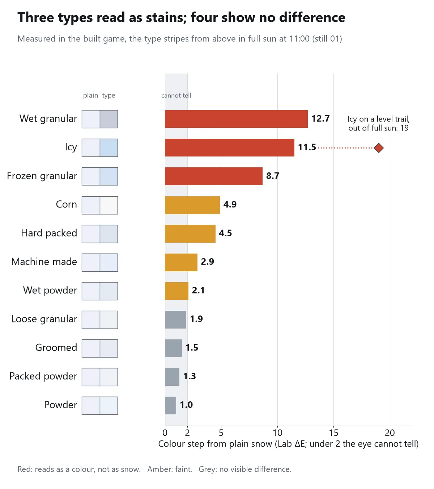
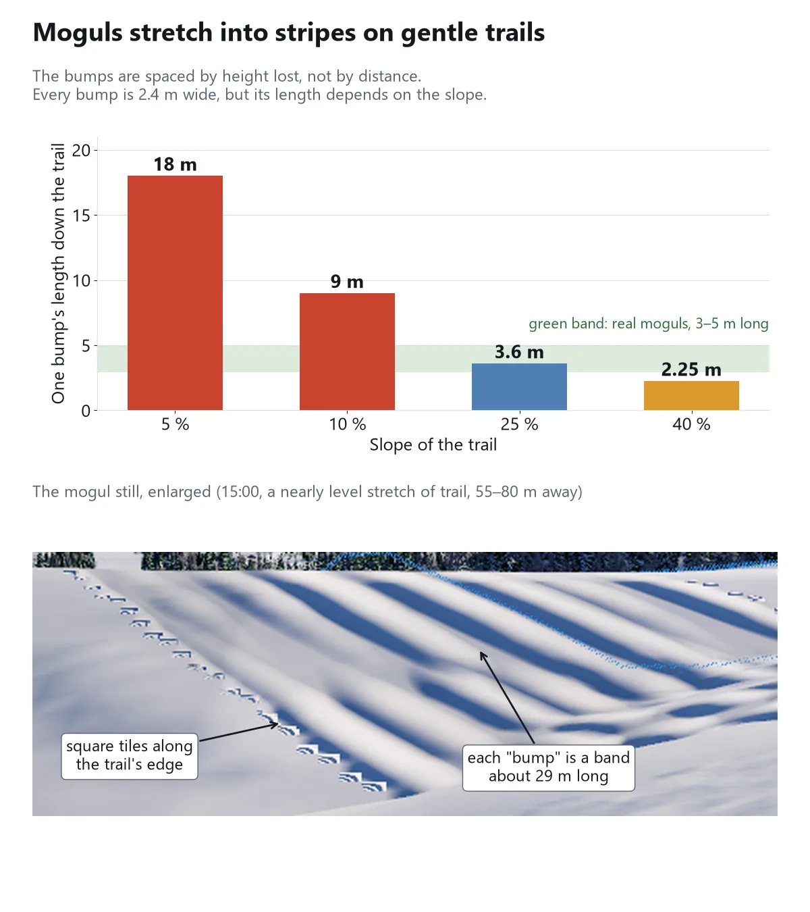
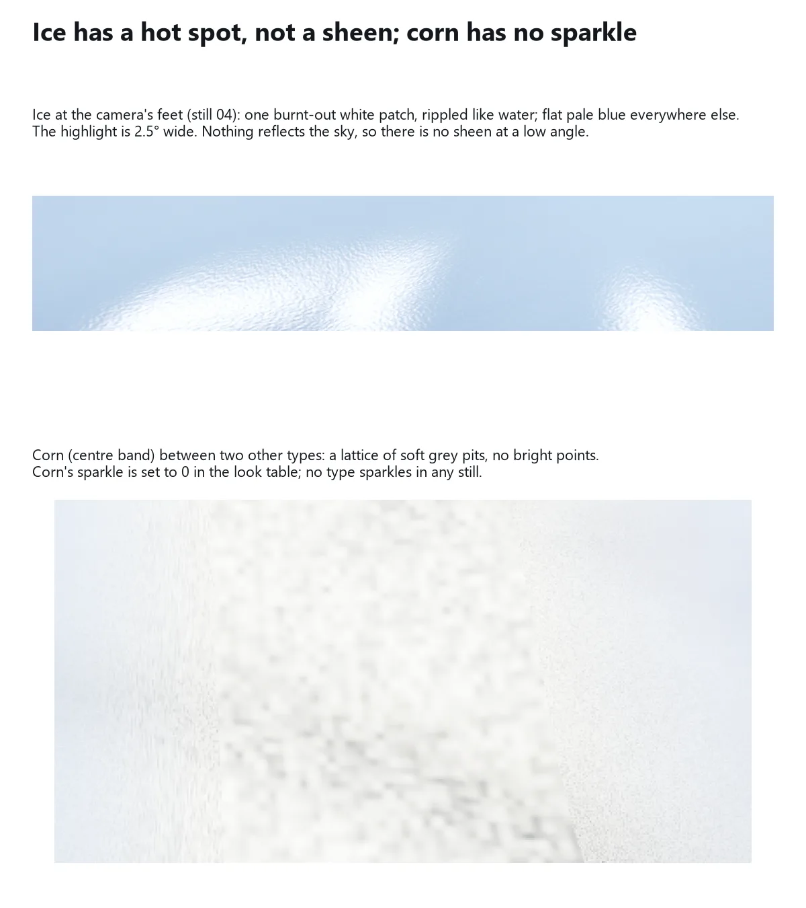
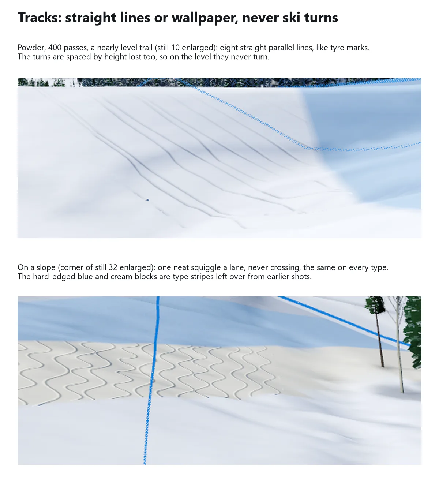
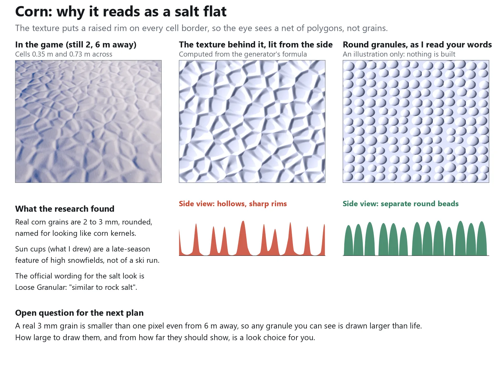
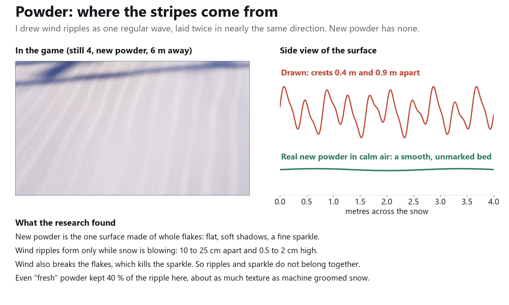
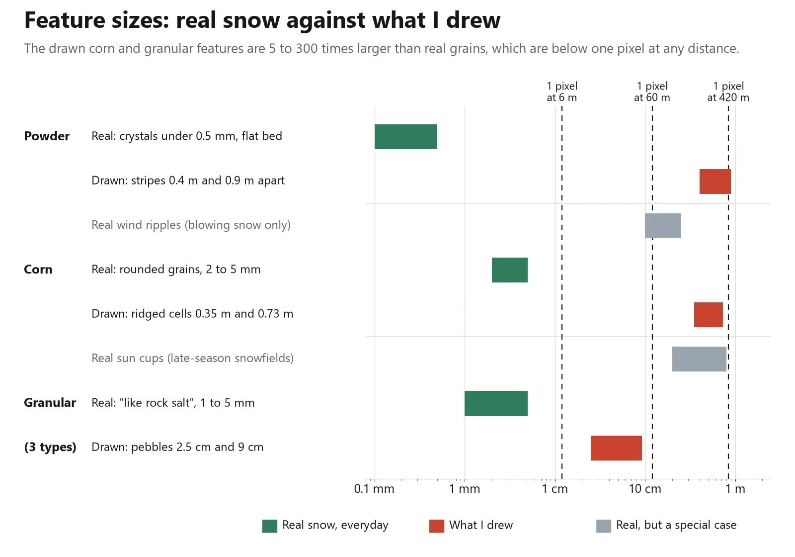
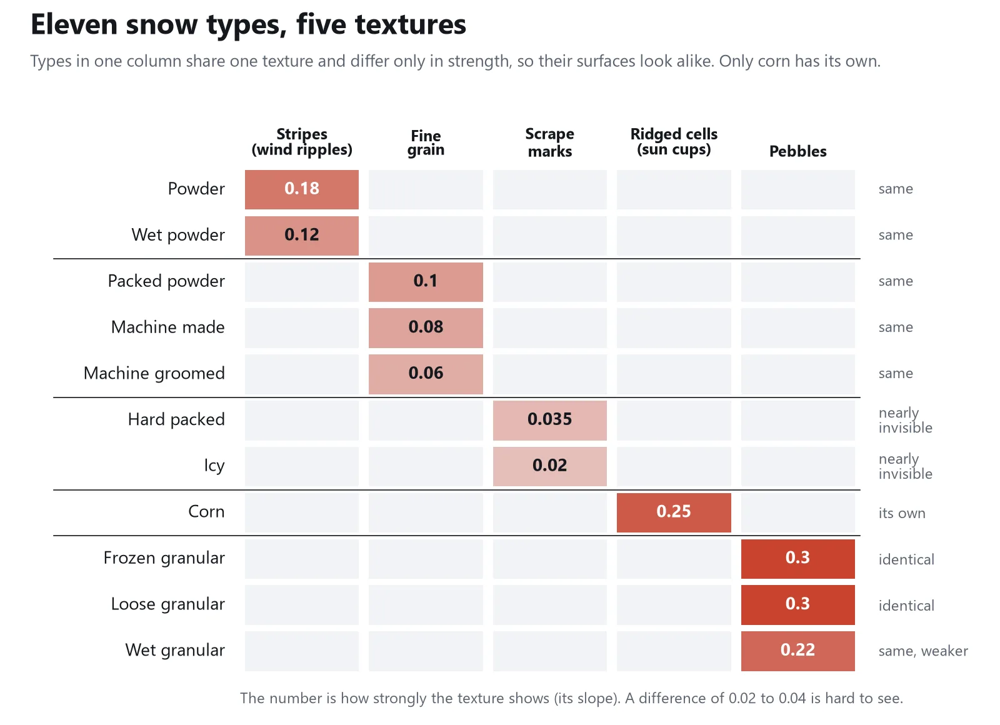

# Phase 4 · 08 Snow Look (PR B, the type looks, moguls and tracks): findings

**Audience:** the project owner and coding agents.

**Status:** the owner asked for a full revamp from these findings (2026-11-24, plan v5 approved). Round 2 is in progress,
uncommitted; a row's status changes when the owner has seen its fix in stills. See "Round 2 progress" at the end.
The owner rejected step B1b's surfaces on 2026-11-25; see "Round 3" at the end. Step G1 (corduroy from far away) is "Round 4".

**Build reviewed:** `feature/p4-08-snow-look` (uncommitted PR B work, player built 2026-11-23), the look round 1 stills:
14 raw stills in `test-results/shots408d`, 7 labelled ones sent to the owner in `test-results/review408b`. One save
(PR A's clear Jan 15 save on the drawn resort), one site.

**How the review was done:** two independent reviewers who had not written the code, one on the stills (measuring
pixels) and one on the shader and simulation code. I then checked each main claim against the code or an enlarged crop.
"Checked" in a row means I confirmed it myself; "from the code" means it follows from the code but no still shows it.

## The owner's findings (2026-11-24)

| # | Finding | Where | Fix idea | Status |
|---|---|---|---|---|
| O1 | "The color shifts are a bit too extreme." | The type gallery stills 01–03 | See R1–R3: carry the types by gloss, grain and finish, with much smaller colour steps | Recorded |
| O2 | "We also need to focus on making the game look beautiful while also implementing these changes." | The whole look | Beauty is a gate for every look change, not a later pass | Recorded |
| O3 | "The moguls also came out horribly. They're too small and hardly noticeable." | Stills 05 and 06 | See R5–R8 | Recorded |
| O4 | "I want ice to have a reflective texture to show a sheen." | Icy | See R11 | Recorded |
| O5 | "Corn should have a sparkly look about it but not reflective." | Corn | See R12 | Recorded |
| O6 | "In general, I want the user to feel immersed in the snow conditions." | The whole look | The types should read as snow you could ski, not as a colour-coded map | Recorded |

## The review's findings about the look

| # | Finding | Where | Fix idea | Status |
|---|---|---|---|---|
| R1 | Three types read as coloured stains, and corn reads ivory. In full sun, against plain snow (237 241 248): Wet granular is a flat grey 12.7 colour steps away (Lab ΔE; under 2 the eye cannot tell), Icy a baby blue 11.5 away (17 % saturated against snow's 4 %), Frozen granular a paler blue 8.7 away, Corn ivory 4.9 away. Real piste ice is grey-white with gloss; real corn is white and coarse. Checked (my own samples agree). Picture 1 | Stills 01, 01b, 33; the tint column of the look table (`Snow.hlsl` `SnowLookA`, `SnowLooks.cs`) | Cut the tints to a fraction and keep them inside real snow's range; tell types apart by light response and texture | Recorded |
| R2 | The tint about doubles when the snow is not in full sun. Icy is 11.5 steps from plain snow in sun, about 19 on a level trail at 11:00 (158 188 219), and about 20 in the storm frame. My round 1 change made this worse: I raised the tints 2.5 times because sunlit snow sits near white, where a darker tint barely shows; anywhere off that bright end the full tint shows. Checked. Not shown in any still: the grey types under cloud | Stills 12, 01; the storm frame behind still 07; `MountainTerrain.shader` 827 | The same visible step in sun and shade: tint by how lit the pixel is, or drop albedo as the main channel | Recorded |
| R3 | Four types show no difference from plain snow in sun (Powder 1.0, Packed powder 1.3, Groomed 1.5, Loose granular 1.9) and four are faint (Wet powder 2.1, Machine made 2.9, Hard packed 4.5, Corn 4.9). Powder and Packed powder are 0.6 apart; Icy and Frozen granular are two blues 3.2 apart. The grain does not help: it is under 1.5 grey levels for every type but corn and fades within tens of metres. Picture 1 | Stills 01, 10, 11, 13 | As R1; each type needs one cue that survives at play height | Recorded |
| R4 | Type borders look laid on. On a trail a border is 1–2 m wide with a dead flat fill, like a tarp; off the trail the same border is a 7 m blur; where a stripe leaves the trail the edge turns into right-angle steps. The gallery's stripes are artificial, but the game's real type changes follow the same cells. Checked in crops | Stills 33, 30, 32, 12; `Snow.hlsl` `SnowSurfaceAt` (fine cells against the 8 m map) | Feather the type over a few cells with an uneven edge; one border style on and off the trail | Recorded |
| R5 | Moguls are stripes on gentle trails. The bump rows are spaced by 1.5 m of height lost, so a bump's length runs with the slope: 18 m at 5 %, 9 m at 10 %, 3.6 m at 25 %, 2.25 m at 40 %; every bump is 2.4 m wide. Real moguls are 3–5 m both ways. The mogul still shows about 8 parallel dark bands, each about 29 m long, with shadow-dark cores. Checked (code and crop). Picture 2 | Stills 20–22 (labelled 05, 06); `MountainTerrain.shader` 892 `MogulField(u / 4.0, i.earthY / 1.5)` | Space bumps by distance along the trail, which needs a real along-trail coordinate; no moguls on gentle trails | Recorded |
| R6 | Moguls are too faint to read, as the owner saw. Three causes. (1) Shading only: at 11:00 the bumps vary by about ±6 % in brightness and cast no shadow. (2) A bump's slope down the trail is scaled by the trail's grade, so on gentle and medium trails it is lit from the sides only, as a ridge. (3) In play the amount is small: 300 passes give a mogul amount of 0.15 of full (the stills used 0.86), and the fade starts at about 0.3 m a pixel, not the metre the comment says. From the code, except the ±6 % (measured) | Stills 20, 21; `MountainTerrain.shader` 887–896; `SimWorld.Trails.cs` | Real bumps in the snow surface (the plan's decision 2 said "real bumps only if the stills look flat"; they do), with their own shadows; sized and spaced like real moguls | Recorded |
| R7 | A row of small square tiles with dark arcs runs down the mogul trail's edge, about 1 m each. Absent without moguls. Cause not confirmed; R17's derivative branch at the trail's edge is the likely one. Checked in the crop. Picture 2 | Stills 20–22, left edge of the trail | Fade the moguls to nothing over the trail's edge cells; fix the derivatives (R17) | Recorded |
| R8 | Worn-in tracks never read as ski turns. On a nearly level trail they are eight straight parallel lines, like tyre marks, because the turns are spaced by height lost as well. On a slope they are one neat squiggle a lane, never crossing, with a bright rim that makes them look engraved, and the same lines on every type. 400 real passes leave a scraped, braided surface. Checked in crops. Picture 4 | Stills 10, 13, 32; `MountainTerrain.shader` `SkiTracks` | Turn length by distance; lines that cross lanes and vary; at high pass counts a scraped surface, not lines | Recorded |
| R9 | On a trail that runs across the hill (a traverse or a catwalk) height changes across the trail, so the mogul lattice shears into diagonal bands and the track lines tilt and break up. Height cannot stand in for "distance along the trail". From the code; the diagonal bands in picture 2 fit it | `MountainTerrain.shader` 892, 906 | The along-trail distance from the trail's own data | Recorded |
| R10 | In a real game a track line will switch on and off along a trail. Whether a lane draws its line is decided from the passes of the cells under each pixel, which differ cell to cell; passes are stored in fours, so 1–3 read as none; cells that are not the trail's own add none. From the code; the stills used an even 400 passes, so they could not show it | `MountainTerrain.shader` 901–904; `Snow.hlsl` 405 | Decide a line's presence per lane over a longer stretch, not per pixel | Recorded |
| R11 | Tracks cannot be seen from play height: from 70 m further back powder's lines are 2–4 % hairlines. From far away they are replaced by an even darkening that is about 2.4 times too dark for the lines it stands for and changes with the direction the trail faces the camera. The order by type does hold close up (powder 10–28 %, machine made 6–19 %, packed 2–4.5 %, icy under 3 %) | Stills 14, 10–13; `MountainTerrain.shader` 907–908 | A far look that matches the near one in brightness and does not depend on view direction | Recorded |
| R12 | Ice has a hot spot, not a sheen (O4). Its highlight is 2.5° wide and very bright, so it shows only at the exact mirror angle: one burnt-out patch at the camera's feet with a rippled, water-like texture, and torn white patches that follow the ground's facets at mid distance. Everywhere else ice is flat pale blue. Nothing reflects the sky and nothing strengthens at a low angle, which is where real ice shines. Summed over all angles ice reflects about 5 times less highlight than packed powder; Hard packed shows more sheen than Icy in still 21. Checked (code and crop). Picture 3 | Stills 12, 21, 01; `MountainTerrain.shader` 968 | A wide soft sheen that grows at low angles and picks up the sky's colour, plus a small bright core, on smoothed normals | Recorded |
| R13 | Corn has no sparkle (O5), and nothing sparkles in any still, powder included. Corn's sparkle is 0 in the look table, as the approved plan's table had it; the owner's ask changes that. The sparkle itself only exists in bluebird weather near the camera, and it is switched off by dark snow, so the dark tints (Icy, Frozen granular, Wet granular) cancel their own sparkle. Corn's grain draws as a lattice of soft grey pits, like styrofoam. Checked (code and crop). Picture 3 | Stills 30–32, 10; `Snow.hlsl` `SnowLookB`; `Weather.hlsl` 371–393 | Sparse bright points on corn that come and go as the view moves, with no mirror highlight; a grain that is not a lattice | Recorded |
| R14 | The grain's size is blended across a type border, so between fine and coarse types the pattern is squeezed and stretched and will swim as the blend changes. From the code | `MountainTerrain.shader` 829–835 | Blend two grains by weight, not one grain's size | Recorded |
| R15 | Snow can be brighter than white before lighting: powder's tint is 1.05–1.06, machine made's blue 1.075, and groomed machine made reaches about 1.15 with the corduroy's own brightening. From the code | `Snow.hlsl` `SnowLookA`; `MountainTerrain.shader` 881–882 | Keep every tint at or under 1 | Recorded |

## The review's findings about the code, the simulation and the tests

| # | Finding | Where | Fix idea | Status |
|---|---|---|---|---|
| R16 | Every snow pixel now does more work: 4 reads of the 8 m map even where the trail's own cells answer everything, the fine cells read twice (once for the look, once for the corduroy), two noise lookups for the grain, and the mogul and track patterns. No before-and-after speed numbers exist yet; the measure runs were still to come | `Snow.hlsl` `SnowSurfaceAt`, `FineCorduroyOf` | Read once; skip the 8 m reads when not needed; measure before and after | Recorded |
| R17 | The screen derivatives the corduroy, moguls and tracks all need are taken inside a per-pixel branch on the snow's weight, which the comment above it says must not happen. At snow edges and trail edges the across-trail direction is undefined, giving speckles there (see R7). The pattern was there before PR B for the corduroy; it now feeds three effects | `MountainTerrain.shader` 848–857 | Take the derivatives before the branch | Recorded |
| R18 | The powder reset now zeroes a cell's passes (owner's decision 1), and the same count also drives the type changes (powder to packed, packed to hard) and the corduroy's wear, so those restart too. The reset only fires when the 8 m block's type changes to Powder or Wet powder, so a block already rated powder keeps its skied lane's old passes under new snow. The season golden value has not been re-run on this change | `SnowHour.cs` 644–654; `SimWorld.Trails.cs` 258–261 | Decide whether those restarts are wanted; reset by the cell's own new snow; run the golden check (a re-pin needs the owner's OK) | Recorded |
| R19 | Passes that build up while a cell is groomed, or on ground too gentle for moguls, never count toward moguls later. Before PR B a cell that lost its groomed finish jumped straight to moguls for all its passes. This follows from decision 1 but was not spelled out | `SimWorld.Trails.cs` 250–255 | Confirm with the owner as the intended rule | Recorded |
| R20 | The tests prove the numbers match, not that the snow looks right. They check that the shader's table equals the C# copy and that some numbers are in order. The "ice has the brightest, tightest highlight" test passes while the lit result is the opposite of a sheen (R12). The probe's fifth pass (corduroy, moguls, passes) is never drawn by any test. Nothing tests the mogul or track sizes, the lit picture, or the sparkle. Checked | `SnowLooksTests.cs`; `FineSnowAtlasTests.cs`; `SnowProbe.shader` | Tests on the lit result: sizes on the ground at several slopes, the colour step from plain snow in sun and shade, a sheen at a low angle | Recorded |
| R21 | The type gallery is never cleared: each new gallery leaves the earlier ones' stripes on the ground (see V2). A bad line in a shot list stops the run without quitting. Capture runs only; a normal game is not affected. Checked | `SurfaceStates.cs` `ShowTypeGallery`; `MountainViewer.SnowTypes.cs` `RunLookShots` | Restore the cells outside the new window; quit on a bad line | Recorded |

## Findings about my round 1 stills (what they did not prove)

| # | Finding | Where | Fix idea | Status |
|---|---|---|---|---|
| V1 | Still 03's title was wrong. "The stripes looking toward the sun" was shot with the sun behind the camera: the trees' shadows fall away from the camera in it. The same is true of the three icy shots from that side, so the sheen was never tested from the sun's side. My mistake in the camera's heading | Stills 30–33 (labelled 03) | Shoot toward the sun (heading about 200 at 14:00) and check the shadows before sending | Recorded |
| V2 | Stripes from earlier shots stayed on the ground (R21), so later stills carry unexplained blue, cream and grey blocks: the blue wedge in stills 10, 32 and 33 and the block beside the tracks in labelled 07. No still after 01b shows the save's real snow outside its window | Stills 10–33; labelled 03, 07 | One gallery at a time; a clean frame of the real save | Recorded |
| V3 | The mogul stills framed the wrong thing. The mogul patch is about 3 % of the frame, 55–80 m away, on a nearly level stretch. The foreground is not trail; its dark blotches at 15:00 are not moguls (their source is not confirmed) and invite the reading "small moguls" | Labelled 05, 06 | Moguls on a real pitch (20–25°) with the camera on the trail, at 11:00 and 15:00 | Recorded |
| V4 | Still 04's title said "the brightest, tightest glints"; the glint in it is one patch at least 860 pixels wide. Labelled 07 came from an earlier run in a storm, not from the clear-day set | Labelled 04, 07 | Titles state only what was measured | Recorded |
| V5 | Label dots sit on trees for Powder and Packed powder (stills 01, 02) and Icy (03), and the labels alternate ends, so neighbours are hard to compare. The labels are on the right stripes | Labelled 01–03 | Dots on open snow; labels in stripe order along one side | Recorded |
| V6 | I reported "tracks don't show on the open slope and I haven't found out why". That slope is not trail. Tracks do draw on a trail on a slope (still 32's corner) | My round 1 report | Closed by this review | Recorded |
| V7 | Not shown by any still: the types under cloud, in shade or at dusk (only Powder, Packed powder and Groomed appear in shade); moguls on a real pitch; tracks or moguls from a normal play height; groomed corduroy beside packed and hard packed close up; the corduroy before-and-after pair | The round 1 set | The next round's shot list | Recorded |

## Pictures

### 1. How far each type's colour moved from plain snow (still 01, full sun, 11:00)

### 2. Mogul length by the trail's slope, and the mogul still enlarged

### 3. Ice and corn close up

### 4. Tracks on a level trail and on a slope

## Round 2 progress (2026-11-24, uncommitted)

Step B0 (foundations) and step B1a (shine and sparkle) are built and with the owner as stills (`test-results/review408r2a`).

- **In the build, awaiting the owner's look:** R1, R2, R15 (tints within a few percent of plain snow, none above white;
  lit test: every type within 3 colour steps of plain snow in sun and shade, ice's glassy patches within 6.5);
  R12 (ice: mirrored sky that grows at low angles, a broad rippled glare toward the sun, none under a closed deck);
  R13 (sparkle of its own in any direct sun, by type; corn sparkles and never shines).
- **Fixed in code and tests:** R16 (each fine cell read once; no 8 m reads inside a trail), R17 (the trail offset and its
  derivatives outside every branch; the snow's light takes none), R18 (the reset is the cell's own new snow; test SL10),
  R20 (tests on the lit result, `SnowLitTests`), R21, V1, V2 (the gallery puts back what it overwrote; `sun=` headings
  checked against the sun; a bad shot line stops the run), V5 (labels on the clearest spot of each stripe).
- **Removed until their steps:** round 1's moguls and tracks (R5 to R11) and its lattice grain (R14).
- **New finding R22:** sun-facing snow draws at 253 to 255 of 255, so sparkle and glare added on top of it cannot show
  there; they show on snow the sun rakes or that faces away. From play height in full sun only ice's glare shows. A
  small cut in the snow's brightness would open room for both; the owner's call.

## Round 3: the B1b surfaces (2026-11-25)

The owner rejected step B1b's surfaces and asked for an adversarial review and research. Nothing below is fixed; every row
is Recorded until the owner says how to go on.

**What was reviewed:** the 10 B1b stills sent to the owner (`test-results/review408r2b`) and the uncommitted B1b code
(`SnowReliefTextures.cs`, the `SnowLookRelief` table in `Snow.hlsl`, `SnowRelief` in `SnowLighting.hlsl`).

**How:** one independent reviewer who had not written the code read the generator and the shader and looked at stills
2, 3, 4 and 10. Two research passes read published sources: one on what each snow type really looks like, one on how
games and papers draw snow. I checked every code claim against the files and looked at the four stills again. I did not
reopen the research pages myself; where the researcher marked a point as its own reading, the row says "inferred".

### The owner's findings (2026-11-25)

| # | Finding | Where | Fix idea | Status |
|---|---|---|---|---|
| O7 | "I do not like the assigned textures." | All B1b surfaces | See R25: choose each type's surface from what a skier sees, before building | Recorded |
| O8 | "Corn looks like a salt field and instead it should look like a bunch of perfectly circular granules." | Still 2 (corn close) | See R23 | Recorded |
| O9 | "Powder with stripes is weird, it should just be a smooth surface without much texture." | Still 4 (new powder close) | See R24 | Recorded |
| O10 | "If texture is too hard to show, we can also align on color and reflectivity alone." (said after reading this round) | All types | Carry the types by colour and reflectivity; keep texture only where it is a real, large feature. To settle in the next plan | Recorded |

### The review's findings about the surfaces

| # | Finding | Where | Fix idea | Status |
|---|---|---|---|---|
| R23 | **Corn is drawn as a net of ridged cells.** The texture is a cell pattern with a raised rim on every cell border, so the eye sees polygons, not grains. It is laid twice, with cells 0.35 m and 0.73 m across, and at one of the highest strengths in the table (0.25). Real corn grains are 2 to 3 mm. Checked. | `SnowReliefTextures.cs` (Cups), `SnowLighting.hlsl` (3.5 m and 7.3 m tiles), still 2 | Separate round beads with gaps and no rims. How large to draw them is the owner's choice (see the open questions) | Recorded |
| R24 | **Powder's stripes are one regular wave.** The texture is a single sine with 10 crests a tile, laid twice in nearly the same direction (20 and 27 degrees), so the crests sit 0.4 m and 0.9 m apart and read as stripes. New powder keeps 40 % of it, about as much texture as machine groomed snow. Checked. | `SnowReliefTextures.cs` (Ripple), `SnowLighting.hlsl`, `Snow.hlsl` (0.18, fresh factor 0.6), still 4 | No relief on powder. Carry it by softness, soft shadows and fine sparkle | Recorded |
| R25 | **A rare feature was presented as each type's everyday look.** Sun cups belong to late-season high snowfields, not to a ski run. Wind ripples form only while snow is blowing. Wet powder got ripples too, though heavy wet snow does not form them. The cause is the plan's own look table, which I wrote without researching real snow first. Checked. | Plan v5's look table; `SnowLookRelief` | Rewrite the surface column from the research below, and have the owner agree it before any build | Recorded |
| R26 | **The granular types are drawn as pebbles 2.5 cm and 9 cm across.** Real granules are 1 to 5 mm ("similar to rock salt"). Still 3 reads as curd or an orange peel, not as loose grains. Checked. | `SnowReliefTextures.cs` (Pebble, 28 cells on a 0.7 m tile), still 3 | Same as R23: decide the drawn size on purpose | Recorded |
| R27 | **Frozen, loose and wet granular share one texture.** Frozen and loose have the same strength (0.30); wet is the same pattern, weaker (0.22). Nothing on the surface says frozen, loose or wet. Checked. | `Snow.hlsl` (`SnowLookRelief` rows 7 to 9) | Tell them apart by what differs in reality: welded and dull (frozen), dry and loose (loose), dark and glistening (wet) | Recorded |
| R28 | **Packed powder, machine made and machine groomed share one texture**, at strengths 0.10, 0.08 and 0.06. Powder and wet powder share another. Only corn has a texture of its own. Checked. | `SnowLookRelief` rows 1 to 3, 10, 11 | The research says machine made looks like packed snow to the eye, so some sharing may be right; decide it per type | Recorded |
| R29 | **Hard pack and ice have almost no surface of their own** (strengths 0.035 and 0.02). I lowered them in run 7 because the stronger scrape looked like sand ripples. They now rest on shine alone. From the code. | `SnowLookRelief` rows 4, 5; still 5 | Research: hard pack is chalk white and matt, ice is translucent and glazed; that difference is shine and tone, not relief | Recorded |
| R30 | **The surfaces exist only close up.** They are at full strength within 15 m and gone by 60 m. At play height (still 10, 420 m) step B1b adds nothing: only the glassy stripes show. Checked. | `SnowLighting.hlsl` (`SnowRelief`, 0.03 to 0.12 m a pixel), still 10 | Research: beyond a few metres every type reads by tone, sheen and features of centimetres to metres (tracks, corduroy, chop, moguls), not by grain | Recorded |
| R31 | **The relief only bends the light.** Rims and grains cast no shadow on each other and have no depth, so at a low sun the rims read as drawn lines. Checked. | `SnowLighting.hlsl` (`SnowLit`) | A baked shadow or hollow-darkening channel in the texture | Recorded |
| R32 | **Two sizes of one pattern laid over each other.** Corn shows two nets at once; powder's two sets of crests beat against each other. Checked on stills 2 and 4. | `SnowLighting.hlsl` (`SnowRelief`) | One size, with a method that hides the repeat | Recorded |
| R33 | **Corn's sparkle is 3 cm glints, the brightest in the table.** With the rims they read as salt crystals. Real glints are pin-points, each a tiny image of the sun, rare, brighter than white, and swapping as the view moves. This may be part of why the owner found the sparkle "kinda weird" in B1a. From the code and the research; not tested. | `Snow.hlsl` (`SnowLookSparkle` row 6: 1.30, grain 0.030 m) | Smaller, rarer, brighter points; the owner's wish for sparkly corn (O5) stands | Recorded |
| R34 | **Shimmer under a moving camera was never measured.** The texture's smaller copies are plain averages and no clip was taken. Not checked. | `SnowReliefTextures.cs` (`Halve`) | A short moving clip before the next gate | Recorded |

### Findings about my B1b tests and stills

| # | Finding | Where | Fix idea | Status |
|---|---|---|---|---|
| V8 | **The tests check structure, not likeness.** They prove no seam, no lattice, the right direction, equal slope and a contrast number. None compares a feature's size with the real one or a type with its real look, so all 24 passed on surfaces the owner rejected. Checked. | `SnowReliefTests.cs`, `SnowLitTests.cs` (`EachTypeShowsItsOwnSurface`) | A size check against the agreed table; the look itself can only be judged against a written description | Recorded |
| V9 | **Every close-up was taken at 6 m**, the distance where the relief is strongest. No still sits between 20 m and 400 m, where the game is mostly played. Checked. | `lookshots408r2f.txt`, `lookshots408r2g.txt` | Each type at three set distances | Recorded |
| V10 | **The captions named what I meant to draw** ("Soft sun cups", "Wind ripples"), which leads the viewer, and no still had the real look described beside it. Checked. | `test-results/review408r2b` titles | Captions state the type and the distance; the real look goes beside it | Recorded |
| V11 | **I built before researching.** The surfaces came from my own idea of each type, and I sent stills without checking them against any reference. | The B1b step | Research and an agreed table first (R25) | Recorded |

### What each type really looks like (research)

Sources are listed at the end. "Inferred" means the researcher's reading of the sources, not a quoted line.

| Type | Official wording | To the eye |
|---|---|---|
| Powder | New, dry, fluffy snow | A smooth, unmarked bed of whole flakes, under 0.5 mm; matt, soft shadows, the type that sparkles most. Ripples appear only once wind works it |
| Packed powder | Powder pressed by grooming or skiers; not fluffy, not hard | Smooth, even, matt white; grains too fine to see; ski tracks (inferred) |
| Machine groomed | Freshly groomed by a snowcat | Evenly spaced corduroy ridges; from far off, sheen stripes along each pass (inferred) |
| Machine made | Not a separate surface code in the glossaries read | Tiny round ice grains, dense; to the naked eye much like natural packed snow |
| Hard pack | Dense, harder than packed powder, softer than ice; never melted | Smooth, opaque, chalk white and matt, with scraped lanes (inferred) |
| Icy | A hard glazed surface; breaks into chunks, not granules | Translucent, shiny, grey-blue; no grains to see; a glitter path like sun on water |
| Frozen granular | Wet granular snow refrozen solid; a pole still sticks in | Opaque, off-white, rough welded granules, a dull sheen without glaze (inferred) |
| Loose granular | "Loose granules similar to rock salt" | Dry, loose, sugary granules that roll and gather in piles (inferred). This is the real salt look |
| Corn | "Large ice-like granules", loose when warm, frozen together when cold | Rounded grains of 2 to 3 mm, named for corn kernels. Frozen hard in the morning; ripe at midday it is smooth and velvety, a moist beaded layer at your feet and a slightly glistening sheet beyond a few metres (inferred) |
| Wet granular | Granular snow gone wet and soft | Darker and greyer, a wet glisten, pushed-up piles and ruts (inferred) |
| Wet powder | Snow wet when it falls, or powder wetted by warmth or rain | Still smooth and white, but heavy and clumpy; no sparkle (inferred) |

Other points from the research:

- **Sun cups** are hollows 20 to 80 cm apart on late-season snowfields. My size was right; the feature was wrong for a ski run.
- **Wind ripples** are 10 to 25 cm apart and 0.5 to 2 cm high, and form only while snow is blowing. Wind also breaks the
  flakes and kills the sparkle.
- **Sparkle** comes from flat crystal faces acting as tiny mirrors. It is strongest on new, dry snow in calm weather for a
  day or two, and weak on old, wind-broken or melted snow. By that, real corn sparkles little (inferred); the owner
  asked for sparkly corn (O5), and that stands.
- **No real grain can be seen in the game.** One pixel covers about 12 mm from 6 m away and 120 mm from 60 m. A 3 mm grain
  is below one pixel at every camera distance, so any visible granule is drawn larger than life on purpose.

### How games and papers draw it (research)

- **Round grains:** a plain cell pattern leaves a crease on every cell border, which is what draws the polygon net. A disc
  inside each cell gives separate round shapes instead.
- **Journey's sand** models no grains at all: a random fine texture tilts the light, and three highlights do the work (a
  rim, a broad sheet highlight, and rare glitter set brighter than white so the bloom spreads it).
- **Soft snow** in shipped games is mostly light, not relief: light that wraps past the shadow line, shade tinted with
  the sky's colour, and very low relief.
- **Sparkle that looks wrong** is usually too dense, too even in size, or pops as the camera moves. The published fixes
  anchor the points in the world, blend between sizes by distance, and keep the points rare and very bright. The most
  exact published methods cost 0.2 to 1.1 ms a frame, more than this step's whole 0.15 ms.
- **Far away, relief should turn into dullness**, not vanish: a rough surface seen from afar is a less shiny one.
- **Hiding a texture's repeat** has two published methods (three samples each).
- **Not found:** any written account of how the named ski and snow games shade their snow, or any game that shows snow
  conditions from a strategy camera.

### Open questions for the next plan

1. **How large are corn's granules drawn, and from how far should they show?** Real ones are invisible at any game
   distance, so this is a look choice.
2. **Which types need a close-up surface of their own at all?** The research says most types differ by tone, sheen,
   softness and sparkle, and by larger features such as corduroy, tracks and chop, not by grain.
3. **Should loose granular be the type with visible loose granules**, since its official wording is the rock-salt one,
   and how should it then differ from corn?

### Round 3 progress (2026-11-25, uncommitted)

The owner chose colour and reflectivity alone (O10), dropped every surface texture including corn's granules, and set the
colour at about a third of round 1's strength. Plan v6 step C1 is built and with the owner as stills
(`test-results/review408c1-final`).

- **In the build, awaiting the owner's look:** O8, O9, R23 to R29, R31, R32 (no type has a texture: the relief textures,
  their table and their tests are deleted; the surface is smooth for every type). O10 (four families by colour: fresh,
  packed and groomed, hard and icy, spring and wet; shine and sparkle, unchanged from B1a, tell the types apart inside a
  family).
- **Measured on the stills** (colour step from the powder stripe, flat ground from above, 11:00 sun): packed powder 2.1,
  groomed 1.2, hard packed 5.0, icy 6.0, frozen granular 5.7, corn 3.9, loose granular 4.0, wet granular 4.6, wet powder
  3.5. Round 1's strongest was 12.7. The numbers move with the view: from a lower eye the glassy types mirror more sky
  and read stronger (icy 7.5 at 150 m), and under a closed deck the glassy types show clearly while the tinted spring
  types are faint.
- **Not changed:** R33 (the sparkle is as the owner accepted it in B1a). R30 (nothing type-specific shows close up
  now; from play height the families are faint in full sun).
- **New finding R35:** the lit test's picture of the game was wrong. It used an ACES curve; the game uses URP's Neutral
  tone map with contrast, so the test read colour steps about 2.5 times too small. The test now models the game's own
  grade, and the built game still shows about 1.35 times its step for tinted types. Fixed in `SnowLitTests.Lab`.
- **New finding R36:** how softly the sun wraps a type ("soft") is also a brightness difference on ground the low sun
  rakes: with no tint at all, hard pack already sat about 4 steps from powder and ice about 9. Hard packed, frozen
  granular, icy and wet granular now wrap a little more (0.10, 0.08, 0.05, 0.10), so the family's colour comes from its
  tint and stays the same on every slope.
- **New finding V12:** the "building" weather look is broken cloud that drifts, so a still asked for under cloud came out
  in sun on one run. Cloud stills now use the closed "storm" deck. From 270 m above the valley floor that deck hides the
  ground, so the cloud still is the 150 m one.
- **Not done:** the short moving clip for shimmer (R34). Its cause, the relief texture, is gone; a clip needs a measure
  run, which is not yet asked for.

### Pictures (round 3)

#### 5. Corn: the ridged cells, and round granules as an illustration

#### 6. Powder: where the stripes come from

#### 7. Feature sizes: real snow against what was drawn

#### 8. Eleven types, five textures

### Sources (read 2026-11-25 by the research passes)

- Surface condition wording: <https://www.iskiny.com/surface-conditions-codes>,
  <https://www.missionridge.com/surface-conditions-descriptions>,
  <https://www.skisoutheast.com/surface-conditions-101-what-is-corn/>
- Grain shapes and sizes: the International Classification for Seasonal Snow on the Ground,
  <https://cryosphericsciences.org/wp-content/uploads/2019/02/snowclass_2009-11-23-tagged-highres.pdf>
- Corn: <https://avalanche.org/avalanche-encyclopedia/corn-snow/>,
  <https://www.outsidebozeman.com/departments/sizing-spring-corn>
- Sun cups: <https://en.wikipedia.org/wiki/Suncup_(snow)>, <https://snowbrains.com/what-are-suncups-and-how-do-they-form>
- Wind-worked snow: <https://tc.copernicus.org/articles/13/1267/2019/>, <https://avalanche.org/avalanche-encyclopedia/sastrugi/>
- Sparkle: <https://www.montana.edu/jshaw/documents/Snow%20sparkles%20-%20VollmerShaw%20-%20Phys%20Ed%202013.pdf>,
  <https://wxguys.ssec.wisc.edu/2020/02/17/snow-sparkle/>, <https://northernwoodlands.org/outside_story/article/sparkle-snow>
- Cell patterns: <https://iquilezles.org/articles/voronoilines/>,
  <https://docs.blender.org/manual/en/4.2/render/shader_nodes/textures/voronoi.html>
- Journey's sand: <https://www.alanzucconi.com/2019/10/08/journey-sand-shader-3/> (and parts 2, 4 and 5)
- Snow in shipped games: <https://www.slideshare.net/colinbb/gdc2014-deformable-snow-rendering-in-batman-arkham-origins>,
  <https://80.lv/articles/santa-monica-s-senior-programmer-on-how-god-of-war-ragnar-k-s-snow-system-was-made>
- Sparkle methods and their cost: <https://arxiv.org/abs/2306.05051>, <https://advances.realtimerendering.com/s2015/>
- Relief seen from afar: <https://realtimerendering.com/advances/s2018/MaterialAdvancesInWWII-course_notes.pdf>
- Hiding a repeat: <https://jcgt.org/published/0011/03/05/paper-lowres.pdf>, <https://eheitzresearch.wordpress.com/722-2/>

## Round 4: corduroy from far away (step G1, 2026-11-25)

The owner asked (2026-11-25): "Can we make the groomed texture more noticeable from further away?", with photos of
grooming and groomed trails. Plan v7 step G1 answers it. The owner kept my three guesses: 5.5 m lanes from
`Pacing.GroomPassMm` (SK3 v2), the real amount of contrast tuned on stills, and under a closed deck faint with the joins
still showing.

### What the photos show (free-licence photos on Wikimedia Commons, credited as Commons lists them)

| Distance | What reads | Photo |
|---|---|---|
| Close (under 10 m) | Ridges about 2–3 cm apart; the grooves deep blue in a low sun | Lenzerheide (Maciupiciu68, CC BY-SA 4.0) |
| Where two passes meet | A rough strip 10–50 cm wide where the ridges break; sometimes a small step | Kronplatz (Zefram, CC BY 2.0 de) |
| Mid (50–300 m) | The ridges blur into a fine streak; the joins show as thin lines along the run's curves, and neighbouring passes as bands of slightly different tone | Seceda, morning (Wolfgang Moroder, CC BY-SA 3.0) |
| Far (from the air) | Smooth, even ribbons with faint streaks down the run and crisp edges | Courchevel (Nikgrech, CC BY-SA 3.0); Bristol Mountain (meg colombo, CC BY 2.0) |
| Light | Strongest with the sun low across the ridges or the eye toward the sun; weak with the sun behind; almost gone under a closed overcast | All of the above; Northeast Slopes drone, overcast (Redjar, CC BY-SA 4.0) |
| Afternoon | Skied away; ski tracks replace it | Les Arcs, Val-Cenis chairlift views (Florian Pépellin, CC BY-SA 4.0) |

The PistenBully 600 Polar datasheet lists a 5.48 m finisher; the game's groomers already work 5.5 m passes (GO-16 v2).

### The owner's findings on the G1 stills (2026-11-25)

| # | Finding | Where | Fix idea | Status |
|---|---|---|---|---|
| O-G1-1 | "These lines are too prominent" (circled on the game half of still 05) | West Cat Track toward the sun, the foreground: a join between two passes and the close ridges beside it | Measured on still 05: the join is a smooth band about 15 grey levels brighter than the passes beside it (it gets flat snow's full sun while the passes are shaded), where real joins are broken ridges of about the passes' tone; the close ridges swing about 19% of their mean against about 12% in the Seceda photo. Give the join the passes' tone with a broken edge, so it reads as a faint line, and soften the close ridges | Recorded |

### The review's findings about the old corduroy

| # | Finding | Where | Fix | Status |
|---|---|---|---|---|
| G1-F1 | Ridges under 2 pixels averaged the light on their two faces with no shadow and no view, so a low sun across them made the snow slightly brighter; real corduroy goes darker and bluer, most toward the sun | `MountainTerrain.shader`, the far corduroy | A V-groove model with shadowing and masking (`CorduroyLight`); it scales the sun only, so shaded grooves keep the blue sky; the close ridges use the same shadow so near and far match | In the build |
| G1-F2 | Neighbouring passes differed by at most ±2%, invisible on sunlit snow at 253–255 | The pass shade | Each pass has its own depth (±25%) and turn (±4°) from a hash: bands in the sun, alike under cloud | In the build |
| G1-F3 | The joins were 6 cm, 7% darker, lost past about 100 m | The joins | A 0.3 m strip with no ridges, box-filtered by its share of the pixel: no shimmer | In the build |
| G1-F4 | A flat +3–5% brightening of groomed snow sat above white in the sun | The groomed tint | Removed | In the build |
| G1-F5 | The lanes were SK3's 15 ft; the groomers work 5.5 m | `TrailSurfaceMap` | `_TrailParams.w` from `Pacing.GroomPassMm` (SK3 v2) | In the build |
| G1-F6 | Under the storm deck the groove light still darkened groomed snow by about 8 L; real corduroy all but vanishes | The gate's storm still (09) | `CorduroyUnderCloud`: the groove sun light fades over cloud cover 0.5–0.9, as the sun disc does | In the build; re-shot: the groove light now adds nothing under the deck (12.7 on, 12.4 off) |

### Measured on the stills (CIE Lab, groomed against the snow beside it, same row band; West Cat Track, Jan 13)

| View | Groove light on | Groove light off | Target |
|---|---|---|---|
| Toward the sun, 150 m | 8.7 | 2.3 | 6 or more |
| Across the sun, 150 m | 6.7 | 3.0 | 6 or more |
| Raking sun 3 PM, 150 m | 7.8 | | 6 or more |
| Sun behind, 150 m | 0.9 | 0.7 | 3 or less |
| 60 m toward the sun | 4.8 | | |
| Close-up 6 m, across | 8.3 | | |
| Close-up 6 m, toward | 0.7 | | |
| Storm deck, 150 m, before the cloud fade | 21.1 | 12.6 | 2 or less |
| Storm deck, 150 m, with the cloud fade | 12.7 | 12.4 | 2 or less (the 12.4 left is G1-F8) |

### Other findings from G1

| # | Finding | Status |
|---|---|---|
| G1-F7 | No still since PR A showed any corduroy at all, and nothing caught it. `-lookshots` now logs how many groomed squares each shot shows and where, so a still with none can't pass unnoticed (V7) | In the build |
| G1-F8 | Even with the groove light off, groomed snow under the storm deck sits about 12.6 from the powder beside it: C1's colour step for the packed family reads stronger under a closed deck than in sun | Recorded for C1's gate (0.0 noted it) |
| G1-F9 | Partial grooming shows 8 m stair-steps on screen: the grooming sim marks whole 8 m squares | Recorded; 0.0's backlog (task 4.25's sim) |
| G1-F10 | BB28 (main since 4.25 PR A): a save made while tonight's plan holds pieces of work does not reopen ("a piece's lane holds 2049"): the lane is written as a byte and read as 4 | Hotfix branch `fix/p4-26-groom-lane-read`, test GO09; waits for the owner's OK |
| G1-F11 | BB29: a reopened save's trail snow logs "0 squares as saved ... 18321 new" although the layout hash matches, so groomed snow is lost on reopening | Recorded; chip 4.31 |
| G1-F12 | `-simto MM-DD` goes to the first face day whose label is on or after the date; Jan 14 and 15 land on Jan 16, which was snowed over. Stills use Jan 13 (the morning after a clear groomed night) | Recorded (dev only) |
| G1-F13 | The 600 m still had no groomed snow in frame | Recorded; no far still yet |
