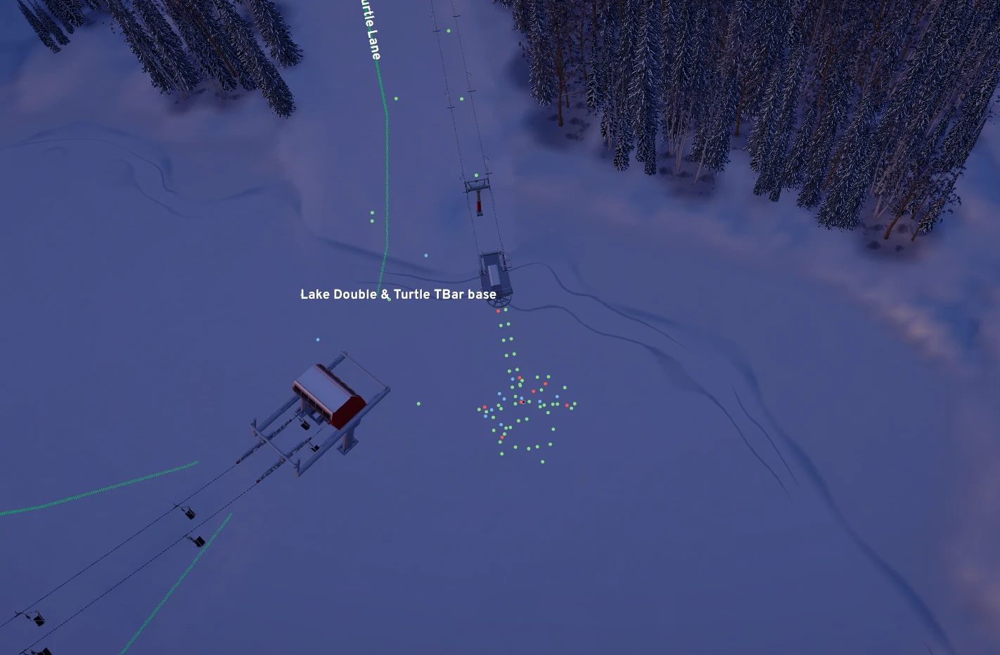
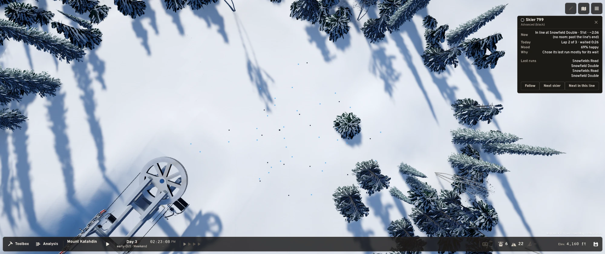

# Phase 4 · 13 Guests on Screen (Guests Engine v0.1): the owner's findings

**Audience:** the project owner and coding agents.

**Status:** findings 1–3 fixed at the owner's word ("Create a plan to fix these issues", plan approved 2026-11-10) and approved in `demo.bat` 98 ("Looks good", 2026-11-10). New findings are recorded only until the owner says go.

**Build reviewed:** `feature/p4-13-guests-on-screen` (uncommitted, built 2026-11-10), `demo.bat` 97 (renumbered 98 after
this review): dots, lift lines, the skier card, Follow, GU-10 v2 confidence and GU-10 v3 steepness by ability.

| # | Finding | Where | Fix idea | Status |
|---|---|---|---|---|
| 1 | Near the end of the day a large pile of guests sits at the bottom of the Turtle T-bar. Are they waiting for the T-bar? (owner, 2026-11-10, with a screenshot at dusk) | The "Lake Double & Turtle TBar base" Area: a single-file string of dots runs from the T-bar's bottom terminal into a loose cluster of about 60 dots (mostly green, some blue and red) in the open snow behind it. The cluster has no rows, so it isn't drawn as line slots. It may be the line's overflow, skiers waiting at the node, or skiers going home | Cause: yes, the T-bar's line. `LineLayout` stopped a line for good at the first fold it couldn't lay (a tree, steep ground, its 90 m window), and `SkierPlaceJob` drew everyone ranked past the end at a keyed spot 2–6 m round the last place: that is the pile. A T-bar is slow, so its line is long at the end of the day. Fixed with finding 2: the line grows, so they stand in rows | Fixed, approved |
| 2 | Some lines look like a pile of people who all seem to be waiting for the lift. Is something blocking the line from growing longer? The line doesn't seem to get as long as it should (owner, 2026-11-10). A second screenshot (daylight, a chairlift's bottom bullwheel at the left): about 45 blue and black dots scattered loosely in the clearing behind the terminal, with no rows or columns and no line at the loading point. Added by the owner: a selected skier whose card says it is in line isn't standing in a queue. The screenshot is on Mount Katahdin, day 3, 2:23 PM, Skier 799, Advanced (black). Its card says "In line at Snowfield Double · 51st · ~2:36 (no room: past the line's end)". The dots behind the double's bottom bullwheel are loose blue and black specks among the trees, with no queue at all. **Owner's direction:** the "past the line's end" part is concerning. Lines should grow as long as they need to, to hold every guest in them. This differs from plan §E 6, where the tail past the layout's room stacks into a "+N" badge and the lift card shows "No room for this line" |  Lift lines (§E free-space layout, `Presentation/Guests/LineLayout`). For context: on the drawn resort the layout's own log already shows little room at some bases. One lift has 26 free cells of 1,640 m², blocked mostly by steep ground (over 25 %) or forest. Past the layout's capacity the plan stacks the tail into a "+N" badge, so a short line beside a pile may be the room running out. Not looked into yet; may be the same cause as finding 1 | Fixed: lines grow as long as they need. A blocked fold turns and steers round the obstacle, a boxed-in line strings out single file through a gap and folds again beyond, and with no open ground in reach it folds on, full width, over trees or steep ground at its lift (never a terminal, a lift's line or a run). The design build lays 100 places a line, and the screen adds 100 when a line comes within 50 of its end. Places only append. A skier joining a far tail reaches its place in about 1.5 s; at walking pace newcomers looked like a loose stream (found in my own capture, North Quad). No more pile; the card drops "(no room: past the line's end)"; plan §E 6's "+N" is retired (p4-02 §7.2). Tests: `LiftLineLayoutTests` (a lone tree, a clearing with a gap, boxed in by forest beside a run, places never move, 3,000 at one base) | Fixed, approved |
| 3 | A guest's click target seems offset a little from where the dot is drawn, which makes guests hard to click (owner, 2026-11-10) | Picking (`SkierLayer.Pick`, the screen points `SkierPlaceJob` writes, `UpdateSkierHover`). For context: hover and click run in Update against the screen points placed in the previous frame's LateUpdate, so a moving dot or camera is a frame behind. The pick uses the plain projection and `camera.pixelWidth/Height`, which may not match the drawn dot if the render scale or the Input System's pixels differ. Not looked into yet | Cause: the shader draws a dot 0.9 m over the skier's feet (a standing skier's middle), pulled towards the camera, but the click target was the feet, which is 20–40 px below the dot up close. Fixed: `SkierPlaceJob.DrawnCentre` is the click target, and the shader reads the same constants (`SkierLayer.DotLiftMetres`, `PullMaxMetres`, `PullShare`). The hit radius is at least the drawn dot's radius plus 2 px. Test `AClickLandsWhereTheDotIsDrawnNotAtTheFeet`; capture check: the frame with the dots shown and hidden differs at every click target. The one-frame lag in the plan isn't one: the click points are made after the camera moves, for the frame on screen | Fixed, approved |

## Pictures

### 1. A pile at the Turtle T-bar's bottom near the end of the day

### 2. Skier 799 "in line" at Snowfield Double (Mount Katahdin), but not standing in a queue

### 2. Dots loose behind a chairlift's bottom terminal, no line formed
*(The owner's screenshot pasted into chat; it isn't saved anywhere on disk yet. It goes here once saved as
`images/p4-13-findings/02-loose-crowd-behind-terminal.webp`.)*
