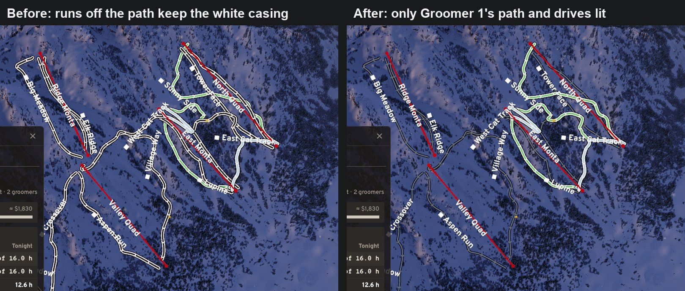

# Phase 4 task 26: bug bash findings (v0.3.4)

These are the fixes for the owner's findings and the coordinator backlog after **v0.3.4** (tag `v0.3.4`, published
2026-11-21 4:49 PM PT; main `acd39fbd`, #186; save v17, sidecar v14, Pacing v15). Branch: `feature/p4-26-bug-bash`.
It follows [p3-16-bug-bash-findings.md](p3-16-bug-bash-findings.md).

Each finding is recorded first; the owner sets the severity and decides what gets fixed. Severity: **B** = blocking
(fixed now, ships in a v0.3.5 patch), **N** = next, **L** = later (backlog).

**Owner, 2026-11-21:** free rein. Every finding is attacked one at a time in the order below: reproduce, find the cause,
fix it generally, verify it, and loop until it holds. This thread opens and merges its own PRs. The owner follows along on the
progress dashboard. BB21 is reported to the owner as a plan before any model changes.

Attack order (PR: findings): **A** BB20, BB11 · **B** BB13, BB12, BB14, BB5, BB6 (A and B ship as one PR, with BB17 and BB19) · **C** BB16, BB17, BB18, BB7 ·
**D** BB19 · **E** BB1, BB2, BB3 · **F** BB4 · **G** BB15 · **H** BB8, BB9, BB10 · **I** BB21.

## Findings

| # | Source | What happened | Expected | Sev | Decision |
| --- | --- | --- | --- | --- | --- |
| BB1 | Candidate (backlog) | On the drawn resort, Big Meadow says "No way there" at night, but the daytime grooming preview plans it | Night grooming reaches every trail the daytime preview plans | | Explained in PR E: the drawn resort's network is split (no code change) |
| BB2 | Candidate (backlog) | With a groomer's card open, trails off its path aren't dimmed | Trails off the groomer's path are dimmed while its card is open | | Fixed in PR E: only the path is lit |
| BB3 | Candidate (backlog) | Hovering a trail allocates 12–33 MB: the highlight is draped on the package heights, which makes a hitch | Hovering a trail allocates nothing per frame and doesn't hitch | | Fixed in PR E: the casing copies the drawn line |
| BB4 | Candidate (backlog) | In long lift lines two guests sometimes share one line place, so their skis cross | Every guest in a line has a place of their own | | Parked: measured; how a line moves on a part-full chair is the owner's call |
| BB5 | Candidate (backlog) | The lift ride button's tooltip names an R key that doesn't exist (`MountainHud.Lifts.cs` ~249) | The tooltip names only keys that work | | Fixed in PR A+B: "Ride this lift" |
| BB6 | Candidate (backlog) | The Weather tab still has its placeholder tooltip (`MountainHud.Panels.cs` ~50); 4.17 may own it | A real tooltip | | Fixed in PR A+B: player words |
| BB7 | Candidate (backlog) | T-bar and J-bar log "TW-01 v2 SHORT": the chair-clearance check runs on surface lifts | The chair-clearance check runs only on aerial lifts | | Already fixed in 4.01 PR 2 (92da0416) |
| BB8 | Candidate (backlog) | The Core test `TheWeatherAllocatesNothing` is flaky: 8200 vs 6152 B, seen twice on CI | The test passes every time and still catches real allocations | | |
| BB9 | Candidate (backlog) | `WeatherFields.ReadRows` takes 288–300 ms; its test budget was raised from 250 to 350 ms for the release (#186) | It runs within the original 250 ms budget | | |
| BB10 | Candidate (backlog) | EditMode tests aren't run in CI, so outdated EditMode tests only show up at release time | CI catches broken EditMode tests on the PR | | |
| BB11 | Candidate (backlog) | The quit crash (0xC0000005) is seen again in short `-screenshot` runs after v0.3.2 | Quitting exits cleanly | | Not reproduced on v0.3.4 (7/7 clean); closed |
| BB12 | Owner, 2026-11-21 | Typing in forms throughout the game is janky | Every form in the game is audited and typing works smoothly | | Fixed in PR A+B: Shift keys silenced while typing; `-typecheck` 55/55 |
| BB13 | Owner, 2026-11-21 | A trail's name can't be changed from the new-trail creation pane or the trail edit pane | The name can be changed in both | | Fixed in PR A+B: a press on the name no longer drags the window |
| BB14 | Owner, 2026-11-21 | On a lift, clicking the "#" (plate) field and leaving it blank (no number or letter) makes the field disappear entirely | A blank plate leaves the "#" field in place so it can be set later | | Fixed in PR A+B: the "#" chip comes back |
| BB15 | Owner, 2026-11-21 | Lift terminals that are intentionally kept clear of snow get overwritten by the new snow layer model | Terminals stay clear of snow | | |
| BB16 | Owner, 2026-11-21 | The last few towers approaching a terminal are often far too tall, so carriers go really high, then really low, then back up to the terminal | A revised tower-placement algorithm: towers and the line approaching a terminal are much more consistent and realistic | | Fixed in PR C: the plan prices tall towers and height steps |
| BB17 | Owner, 2026-11-21 | When building a ski lift, towers aren't leaned by default | Leaned towers are the default | | Fixed in PR A+B: Leaned by default |
| BB18 | Owner, 2026-11-21 | Editing and moving towers in game isn't fluid | The edit-tower and move-tower features are audited and made much smoother and more responsive | | Improved in PR C: towers kept, dragged tower follows the pointer; rope redraw left |
| BB19 | Owner, 2026-11-21 | The brush size can't be changed with the mouse while using a brush (painting a trail, terrain edits, etc.) | With any brush, holding Ctrl and using the scroll wheel changes the brush size | | Fixed in PR A+B: Ctrl + wheel on trail and terrain brushes |
| BB20 | Owner, 2026-11-21 | The game always starts with a crash-log popup, implying the game crashed on startup | Find out why the notice appears; a normal start shows no crash notice | | Fixed in PR A+B: one crash marker per session |
| BB21 | Owner, 2026-11-21 | Deciduous trees seem way too big, and the owner isn't loving how they look in game | Audit the deciduous trees and report the findings as a plan to make them look more normal | | |

Each finding's cause, fix and evidence are recorded in its own section below as it is worked.

## BB20: the crash notice at every start

### What it is

No error is logged on a normal start: a v0.3.4 player opened to the title with an empty data folder, and with a copy of
the owner's own data (library, saves, recent areas), logs nothing in a minute (2026-11-21). The notice is the title's
offer after a crash ("If the game closed unexpectedly, the title asks once whether to send a report"), which shows when
the crash marker from an earlier session is still there. A normal close is clean: a run on the real data folder closed
with the window's close box wrote `Reports/running.txt` while it ran and removed it on the way out (exit 0).

### Cause

One marker file, `Reports/running.txt`, served every session. Whenever two copies of the game ran at the same time
(a second copy, or a test or demo run on this PC), the second one's start moved the first one's live marker to
`last-crash.txt`, so the next start offered a report for a crash that never happened. A capture or benchmark run killed at
its time limit left its marker the same way. Before 4.26, only some tool switches (`NotAPlayerSession`) skipped the marker.

### Fix (PR A)

- `Persistence/Reports/CrashMarker`: one marker per session, `running-<process id>.txt`, holding the process's start
  time. At start, a marker counts as a crash only if its process is gone, or if Windows has reused its id for a process
  that started at another time. A marker of a session that is still running is left alone. The old `running.txt` still counts
  once.
- `App/Flow/AppFlow.Report`: capture and benchmark runs (`CaptureRun`) never write a marker.
- Tests (`Tests/Core/ProblemReportTests`): a second copy running at the same time isn't a crash; a reused process id
  still is; the old single marker counts once; the existing once-only offer still holds. `dotnet test --filter
  ProblemReportTests`: 15/15.

## BB11: the quit crash in short `-screenshot` runs

Not reproduced on v0.3.4 (2026-11-21): 4 short `-styletile -screenshot` runs on the default D3D11 and 3 with
`-force-d3d12` all exited 0. None of about 170 GPU-queue runs since 2026-11-08 ended with 0xC0000005 (`tools/gpu`
history). The default stays D3D11 (P4-01). A crash after the quit can't leave a false marker either: the marker is removed
when the quit starts, before the device is torn down.

## BB14: a blank lift plate hides the "#" chip

Cause: `MountainHud.Lifts.EndLiftCardPlate` removed the field but never showed the chip again (`InlineName.Open` hides
the label it replaces). So every plate edit, typed or left blank, hid the chip until the card was rebuilt. Fix:
`InlineName.Close(label, field)` puts the label back. All six in-place name fields (tool window, trail, lift name and
plate, Area, water) now close through it. The test (`UiKeyboardTests.Network`) checks the chip after a blank, a typed
and an emptied plate.

## BB5: the Ride tooltip's R key

Cause: `MountainHud.RideOpenLiftCard` (R on an open card) was written in 4.11 PR B and never called, so no key rides
a lift. Fix: the tooltip reads "Ride this lift", and the unused method is gone.

## BB6: the Weather tab's placeholder

The greyed Analysis tabs show their empty line as the tooltip. The Weather tab's said "Weather comes with the snow
simulation in Phase 4" while it snowed. The other tabs, the unbuilt tool tiles ("comes in Phase 3", "comes with task
4.15") and a toast used the same developer wording, and the Lifts and Trails tabs' empty lines said building came "in
Phase 3". All are now in player words (`MountainHud.Panels.AnalysisEmpty`). Weather: "Weather charts come in a later
update; today's weather and the forecast are on the date in the top bar." 4.17, which builds the Weather and Guests
tabs, isn't started (0.0, 2026-11-21).

## BB13: New trail and Edit trail names can't be renamed

Seen in the built game (`-typecheck`, below): a click on the name in the New trail and Edit trail windows' title lands
on the name (`toolwin-name`, picking on) but never opens the field; the trail card's name opens.

Cause: `UI/Hud/HudWindow` drags a window by its title bar. Its PointerDown took every press that wasn't on a button and
captured the pointer for the drag, so the press and release never made a ClickEvent on the name. Fix: a press on a text
field, an in-place name field, or an element marked `HudWindow.NoDragClass` doesn't start a drag; the tool window's
renamable name carries the mark. Dragging by the rest of the title bar is unchanged.

## BB12: typing in forms

The audit covered every text field in the game: the tool window's name and text rows, the trail, lift (name and plate),
Area and water cards, the save and report dialogs and the site picker's search. All of them silence the key bindings
while they have the focus (`UiFocus.Typing`), except one path: `KeyBindings.PressedAnyShift` (Shift + a key turns a
terminal or slides a tower) didn't check it, so a capital letter could turn a terminal while typing. Fixed. The other
jank was BB13 and BB14.

A new check, `-typecheck <out.txt>` (with `-drawnresort -notitle`, demo 143), plays the forms as a player does: it
clicks each name in the New trail window, a trail card, Edit trail, a lift card and its plate, types a name with Ctrl+A
first, then Enter, and checks that the field opens with the keyboard, takes the text, keeps the camera and the tools
still, frames stay smooth, and the name is kept. Before the fix: 3 of the 5 fields failed (BB13). After: 55 of 55 pass
(2026-11-21, slowest frame 10 ms while typing).

## BB7: the TW-01 check on tows

Already fixed by task 4.01 PR 2 (`92da0416`, 2026-11-06): the tows' terminal ends now come from their models, so the
view and the build solve the same rope, and a tow's check is "rope over the track", not "lowest chair". On the owner's
Mount Katahdin save, T-bar 7 logs `TW-01 v2 OK (rope over the track 18.0 ft)` (2026-11-21). One chairlift there,
Baxter Bowl Express, logs SHORT by 0.1 ft at 1,535 ft; that's an aerial lift's real check, looked at with BB16.

## BB17: leaned towers by default

`UI/Tools/NewLiftTool` started every new lift Plumb. It now starts Leaned; a tow or a carpet still uses Plumb (it has
no choice), and switching back to a chairlift restores the player's own pick. Test: `ToolboxTests.NewLiftsLeanTheirTowersByDefault`.

## BB19: Ctrl + wheel sizes the brush

Painting a trail (New and Edit trail) and every terrain brush now take Ctrl + wheel: one notch is one 5 ft step of
the `[` and `]` keys, a touchpad's small steps add up to whole notches, and the camera doesn't zoom meanwhile. The
tools turn it on with `ToolContext.ClaimBrushWheel` (a flag beside the key claims, cleared with them; nothing is saved,
so key-binding prefs read unchanged). The keys strip reads "width (or Ctrl + wheel)" and "diameter (or Ctrl + wheel)".
Test: `ToolboxTests.NewTrail_PaintHeadTailReviewBreaksGround` (3 notches up, 2 down).

## BB16: tall towers before a terminal

Reproduced on real ground (`Tests/Core/TowerApproachTests`, the Jackson Hole fan of 32 lines that
`TW16v3_AFanOfRealLinesBuildsWithinTheRules` builds). Lines over a crest whose top terminal sits lower down ended
"… 45 58 **97** 15" ft: a 97 ft last tower beside a 15 ft station tower, so the chairs rose to it, dropped steeply and
levelled into the terminal. A tower's *spike* is how far it stands above the line between its neighbours' heights; the
worst next to a station tower was 60 ft (FGQ-4) and 55 ft (D6), and 50 of the two lifts' 651 towers were 80 ft or taller.

Cause: the tower plan (`TowerPlacement.PlanLine`, TW-12 v2) prices a tower at 1,000 and its height at
10 × ((H − 35 ft) / 10 ft)², so a 100 ft tower cost 422 more than a 35 ft one: one very tall tower always beat one more
tower of a modest height, before a terminal or anywhere. Nothing priced a tall tower beside a short one either.

Fix (general, every chairlift; tows top out at 30 ft and are unchanged): past 50 ft a tower costs
100 × ((H − 50 ft) / 10 ft)² more, and a height step from the tower before costs 10 × (step / 10 ft)². A 100 ft tower
now costs about 2,900 over a 35 ft one, so the plan adds a tower where one more brings the heights down, and keeps tall
towers for gullies. Over the fan: worst spike next to a station tower 34 ft (FGQ-4) and 33 ft (D6), 11 of 682 towers
80 ft or taller (1 of 335 FGQ-4, 10 of 347 D6), about 5% more towers, every line still within the rules. Towers already built and saved stay as they
are (they're stored; only building, Edit lift's Automatic and the drawn resort place towers).

The Core lift tests (1,733, filtered to lifts, towers, design, earthwork, guests and the golden) all pass; no behaviour pin
moved. Three timing tests failed once while a Unity build ran beside them and passed on a quiet PC (TW-12's mile 12 ms of
60). `SeasonRunner.GoldenFoldValue` doesn't move (its lifts have no towers). The drawn resort places its towers as it
opens, so its lifts gain a few towers; its benchmark baselines aren't re-pinned here.

## BB18: dragging a tower

Measured in the built game (`-towerdragcheck <out.txt>` with `-drawnresort`, measure lane, release player, 1920×1080):
each step of a tower drag in Edit lift redrew the whole draft lift, 25–37 ms median and up to 52 ms per redraw, 10 times
a second, while the rope solve took 3 ms and the profile strip 0.2 ms. The dragged tower moved only with each redraw, in
100 ms jumps, with a hitch at every one. By part: towers 8–15 ms (a base, a head and a mast section a metre, all built
again), the rope, cable and carriers 10–15 ms, terminals 0.4–2.3 ms.

Fix (`Presentation/Lifts/LiftView`):
- A redraw keeps the last build's tower bases and mast sections and stands them where their towers go now (as a
  re-height does); only the heads are new, since posing turns their sheave trains from where they stand. Towers' share:
  4–8 ms; the redraw 21–32 ms median (2026-11-21, same run setup).
- Between redraws the dragged tower itself slides to the pointer every frame (`LiftView.NudgeTower`), so it follows the
  hand; the rope and the carriers catch up at the next redraw.

Left: the rope, cable and carriers (10–15 ms a redraw) are built again each time.

## BB3: hovering a trail allocates 12–33 MB

Found by 4.07 A3-13: a trail under the pointer lights its whole line with a white casing. The casing was drawn as a new
line (`TrailMapView.DrawCasing` → `PendingPreview.Line`), draped every 6 m on the trail layer's ground, which reads the
package heights through `EditedHeights` (tile loads: 12 to 33 MB in one frame, and a hitch). The trail's own line was
already draped, in its own slot, when the layer was drawn.

Fix (`Presentation/Design`): the layer keeps which slot each drawn line is in, and the casing copies that slot's draped
points (`PendingPreview.CopyLine`); only a line not drawn yet is draped for its casing. Test:
`TrailHoverTests.BB3_HoveringATrailSamplesNoGroundAndAllocatesNothing` (60 hovers: no ground read, 0 bytes).

## BB1: Big Meadow "No way there" at night

Probed in the built game (`-drawnresort -simto 01-15 -groomers 4`, a temporary trace in `PlaceTask` and a fresh search
from the depot beside the cached route rows, render lane, 2026-11-21). Every "No way there" from the depot (the foot of
the lowest lift a trail reaches, node 62) is real: only 34 of the network's 70 nodes can be driven to over trails, and the
cached rows agree with the fresh search every time. The drawn resort's network has 96 trail segments, **0 paths** and
"10 trail warnings" (`NetworkReport`: a trail no lift serves, or with no way down). The runs off Base Six, Summit Six
and Ridge Monta end 36–82 m short of their stations, and nothing joins them to the rest. So 11 of the 20 runs (Big
Meadow among them) have no drive from the depot.

The day's preview and the night's own plan agree: both read "No way there" for the same 11 runs (the morning after
day 36: Done 9, NoRoute 9, PowderHeld 2). The only nights that read otherwise are snowy ones: when the plan keeps the
powder, the row reads "Powder kept" and the route isn't asked (the morning after day 37: PowderHeld 19). That flip,
which depends on the weather, is what looked like the route changing during the day.

No code change: the planner, its cached routes and the preview are right for this network. What a player sees is the
same as the trail warnings: a run that doesn't join a lift can't be reached by a groomer. The drawn resort's split
network (half its runs unjoined, so the guests and the drawn benchmark also see only half the mountain) goes to the
Coordinator's backlog. A player-placed groomer parking area is already on it.

## BB2: a groomer's card doesn't dim the other runs

With the Grooming tab open, a groomer's card shows its path tonight: its runs green, its drives blue, the rest in a dim
colour. Seen in the built game (`-groomtab`, the drawn resort, two groomers): the runs off the path still read as the
regular trail lines. The map draws them as a catchment (`NetworkView.SetCatchment`), which lights every segment it's
given, and a lit segment gets the white casing whatever its colour; the dim fill barely showed inside it.

Fix: `SetCatchment` takes the segments to light; the Grooming map lights only the picked groomer's runs and drives (all
runs when no groomer is picked), so the rest are drawn as the grey line under a pick. Test:
`NetworkViewTests.BB2_ACatchmentLightsOnlyTheSegmentsAskedFor`.

## BB4: two guests in one lift-line place (parked: needs the owner)

Measured in the built game (`-linecheck <out.txt>` with `-drawnresort -guests 3000`: four minutes at 8×, twice a second,
counting queued guests standing within 0.4 m of another on the same line; render lane, 2026-11-21):

- 58 % of samples (726 of 1,257) held at least one such pair, on every lift. Over the run: 871 pairs with one guest on
  its own place, and 14,069 with a guest between places (walking up).
- The places themselves never overlap (0 of 1,200–1,500 places within 0.5 m of another, 6 on one line of 1,662).
- The simulation's ranks are unique per line (a FIFO list; guests join only at the tail).
- A guest ranked past the places laid so far stands on the last one until the line grows (owner, 2026-11-10). In this
  run the lines could always grow; at 8× a line sometimes ran a few hundred guests past its places for a moment.

Cause: a line is laid in rows as wide as a chair. When a chair takes a full row, every guest steps straight forward one
row, which is ideal (0.91 m apart throughout). When a chair takes fewer, every guest's place moves along the rows, and
each walks straight to its new place: the one wrapping to the row ahead walks diagonally across the guest stepping
sideways in its old row. A model of a 4-wide line puts them 0.46 m apart mid-step for chairs taking 1, 2, 3 or 5.

Tried (not kept): walking each guest along the places in between instead of straight. It cut the pairs about four times
in the game (moving pairs 14,069 to 3,349; on-place pairs 871 to 33), but a full row now shuffles sideways through the
row instead of stepping forward. That's the common case in a long line, and it looks worse, so it was reverted.

Question for the owner: how should a line move when a chair takes less than a full row? Options: rows step forward and
the gap fills from behind; single file through the maze, rows only at the loading gate; or guests keep their column, and
a row boards whoever is at its front. The probe stays (`-linecheck`) to measure whichever is chosen.
